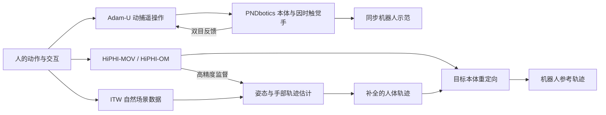
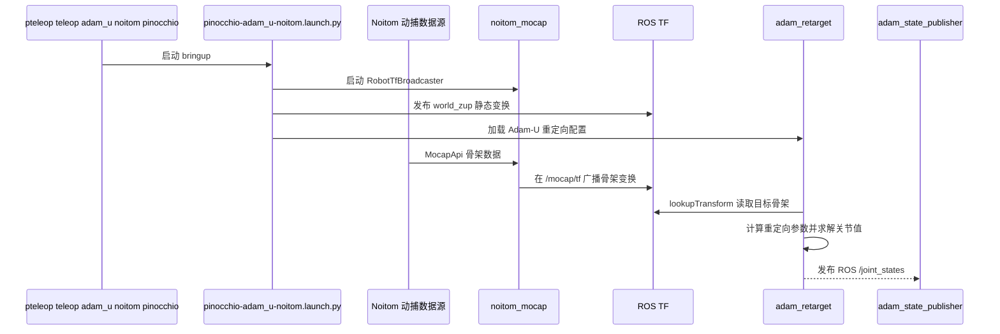

# 诺亦腾机器人（Noitom Robotics）

## 一句话定义

诺亦腾机器人于 2025 年从诺亦腾科技的机器人应用业务分拆，提供动捕遥操作与人体多模态训练数据，并通过重定向和下游人形实验验证数据用途。2024 年诺亦腾科技将动捕接入 Isaac 的案例是这条路线的技术前序。[官方资料归档](../../sources/sites/noitom-robotics.md)

## 英文缩写速查

| 缩写 | 英文全称 | 简要说明 |
|---|---|---|
| MoCap | Motion Capture | 记录人体、关节或物体的运动 |
| HITL | Human-in-the-Loop | 操作者参与遥操作或接管的闭环 |
| HOI | Human–Object Interaction | 人体运动与所操作物体的交互 |
| ITW | In-the-Wild | 自然环境中的人体行为与场景数据 |
| BVH | Biovision Hierarchy | 表示骨架层级和逐帧运动的文件格式 |

## 为什么重要

从 Adam-U 真机录制得到的关节和传感数据可以对齐到采集时使用的本体。脱离机器人采集的人体数据可以覆盖更多动作和场景，训练前需要补全缺失观测，再将动作和接触条件映射到目标机器人。诺亦腾的公开资料提供了观察这两条数据管线的实例。

## 核心机制

- **真机遥操作。** Adam-U 由诺亦腾机器人、PNDbotics 与因时机器人联合推出，分别提供动捕遥操作、机器人本体与触觉灵巧手。官方公布的 2025 年展会配置为固定底座、31 自由度，操作员可通过头显收到机器人的双目画面。采集侧记录机器人的视觉、关节状态与触觉。
- **人体多模态数据。** ModalityNet 用 HiPHI-MOV 覆盖全身运动与大物体交互，以 HiPHI-OM 采集手–物操作及同步视觉和触觉，以 ITW 扩展到自然环境。World Compiler 技术文章提出用高精度样本训练深度与动作补全模型，为稀疏的第一视角记录补上手部轨迹或遮挡体段，并在遮蔽的高精度数据上验证恢复误差。
- **下游研究。** [HiPHI](./paper-hiphi.md)提供人体与物体同步轨迹和运动覆盖评测。[UMR](./paper-umr-unified-motion-retargeting.md)用人体与机器人表面的稠密对应来传递姿态与接触。[OmniContact](./paper-omnicontact-humanoid-loco-manipulation.md)和 [AdaPT](./paper-adapt.md)分别展示动捕数据在接触技能组合与网球风格跟踪中的用途。各篇为独立的多机构研究。

### 采集与训练数据流

## 源码运行时序图

图示为 PNDbotics v0.8.0 的 Adam-U Noitom 动捕分支，终点是 ROS 关节状态发布。入口和源码文件见[仓库归档](../../sources/repos/pnd-teleoperation.md)。

## 工程实践

| 读者目标 | 对照入口 |
|---|---|
| 接入动捕遥操作 | 从 [PNDbotics 启动分支](../../sources/repos/pnd-teleoperation.md)核对骨架坐标、位置单位、接收时间戳与机器人关节输出。摄像头及触觉同步需在录制侧另行验证。 |
| 选运动参考 | 先用 [HiPHI](./paper-hiphi.md)的标准骨架、同步物体数据和许可检查任务是否适用，再依据 [UMR](./paper-umr-unified-motion-retargeting.md)评估换本体的关节约束与接触保真。 |
| 选自然环境数据 | [ITW-Ego Plus](./itw-ego-plus.md)公告列出 Sol 与 Jupiter 采集设备。使用时按采集配置核对每条记录实际包含的视觉、人体运动与扩展模态。 |

## 局限与风险

- HiPHI 公布的 617.5 小时包含左右镜像。算独立采集量或划分训练与测试时，应追溯到原始动作。数据按研究许可申请访问，Viewer 按自己的软件许可证提供。
- World Compiler 的补全标签来自估计模型。高精度数据遮蔽后的恢复测试只能测受控条件下的误差，实际自然场景还会有遮挡、视角和任务分布变化。
- PNDbotics 源码提供可检查的动捕和重定向路径。Adam-U 商用全栈、完整训练数据、HiPHI-OM 与 ITW-Ego Plus 的全面下载入口在本次核查中未确认。

## 关联页面

- [遥操作](../tasks/teleoperation.md)与[模仿学习](../methods/imitation-learning.md) — 从操作端演示到策略训练的任务与方法
- [遥操作纵深路线](../../roadmap/depth-teleoperation.md) · [具身数据纵深路线](../../roadmap/depth-embodied-data.md)
- [动作重定向](../concepts/motion-retargeting.md) · [人形参考运动与操作数据集选型](../comparisons/humanoid-reference-motion-datasets.md)
- [公司技术路线对照](../comparisons/robot-foundation-model-company-paths-2026.md)

## 参考来源

- [诺亦腾机器人官网、技术文章和日期归档](../../sources/sites/noitom-robotics.md)
- [PNDbotics 遥操作仓源码归档](../../sources/repos/pnd-teleoperation.md)

## 推荐继续阅读

- [NEAR Lab 官方研究目录](https://noitomrobotics.com/research/)
- [ModalityNet 官方数据目录](https://modalitynet.com/)
