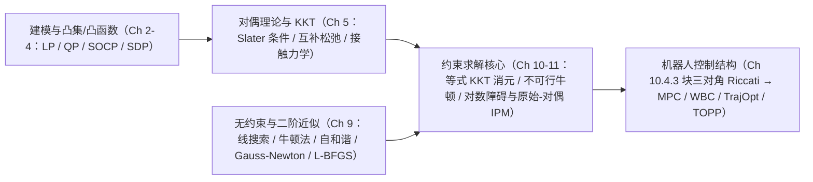

# 数值优化学习策展（机器人 L0+）

## 一句话定义

把 Boyd & Vandenberghe《Convex Optimization》核心理论与经典二阶/拟牛顿优化器文献体系化映射为机器人控制可执行学习路径，贯通凸建模、对偶与 KKT、牛顿与内点法求解结构，直达 [运动控制成长路线](../../roadmap/motion-control.md) 中的 QP、MPC 与轨迹优化工程栈。

## 英文缩写速查

| 缩写 | 英文全称 | 简要说明 |
|------|----------|----------|
| LP | Linear Programming | 线性规划，多面体可行域上的线性目标优化 |
| QP | Quadratic Programming | 二次规划，WBC 与线性凸 MPC 的核心标准形式 |
| SOCP | Second-Order Cone Program | 二阶锥规划，涵盖欧氏范数约束与鲁棒优化问题 |
| SDP | Semidefinite Program | 半正定规划，处理线性矩阵不等式与非凸松弛 |
| KKT | Karush–Kuhn–Tucker | 约束优化一阶最优性条件（可微凸问题配 Slater 条件为充要） |
| IPM | Interior-Point Method | 内点法，沿中心路径在多项式级牛顿步内收敛求解凸问题 |
| BFGS / L-BFGS | (Limited-memory) Broyden–Fletcher–Goldfarb–Shanno | 经典与低内存拟牛顿方法，常用于高维无约束与 TrajOpt |
| OCP | Optimal Control Problem | 最优控制问题；MPC 与轨迹优化的统一数学外壳 |
| TOPP | Time-Optimal Path Parameterization | 沿给定几何路径求解动力学约束下的时间最优速度曲线 |

## 为什么重要

1. **统一控制栈的底层数学语言：** 机器人全身控制（WBC QP）、滚动时域凸 [MPC](../methods/model-predictive-control.md)、非线性 [NMPC](../methods/nonlinear-model-predictive-control.md)、[轨迹优化](../methods/trajectory-optimization.md) 与 [碰撞距离计算](../concepts/collision-distance-optimization.md) 在数值求解层面对接同一套最优性条件、线搜索策略与结构化 KKT 线性代数。
2. **打通「调包」到「判错与提速」的关键鸿沟：** 仅会调用 [OSQP](./osqp.md) 或 [acados](./acados.md) 无法解释为何不可行、为何一阶法在病态子水平集震荡（条件数 \(\kappa = M/m\)），也看不懂为什么显式保留稀疏动力学等式约束能让单步牛顿复杂度从 \(O(N^3)\) 降为 \(O(N)\)（即 [LQR / iLQR](../methods/lqr-ilqr.md) 与 Riccati 递推的本质关联）。
3. **补全非凸与连续逼近出口：** 通过广义不等式、增广拉格朗日（ALM）与凸松弛，串联从 [LQR / iLQR](../methods/lqr-ilqr.md)、[Sequential Convexification](../methods/successive-convexification.md) 到非凸 [TrajOpt](../methods/trajectory-optimization.md) 的工程过渡。

## 核心原理

本页以已全文通读的一手核心教材 **Boyd & Vandenberghe《Convex Optimization》（Ch 1–5 理论篇与 Ch 9–11 算法篇）** 与 **二阶/拟牛顿优化器一手文献汇编** 为知识底座，同时保留《数值优化基础（机器人应用）》六章中文课程大纲作为章节对照参考。

### 一手理论主干（Boyd & Vandenberghe Ch 1–5, 9–11 & 二阶优化文献映射）

| 学习阶段 | 一手内容与核心结论 | 机器人控制关联 | 本库对应页面 |
|---------|------------------|---------------|-------------|
| 问题分级与凸性识别 | **Ch 1–4**：区分 LS（\(O(n^2 k)\)）、LP（\(O(n^2 m)\)）与一般凸问题（全局即局部最优）；建立 \(\text{LP} \subseteq \text{QP} \subseteq \text{QCQP} \subseteq \text{SOCP} \subseteq \text{SDP}\) 谱系、对数变量换元 GP 与标量化 Pareto 权衡 | 识别接触力摩擦锥线性化 vs SOCP、姿态控制 SDP 松弛与多目标代价权重调试 | [Convex Functions](../formalizations/convex-functions.md)、[Quadratic Programming](../formalizations/quadratic-programming.md)、[Symmetric Cone Programming](../formalizations/symmetric-cone-programming.md) |
| 对偶与 KKT 最优性 | **Ch 5**：凹对偶函数与弱对偶 \(d^\star \le p^\star\)；Slater 严格可行条件下强对偶成立；可微凸问题 KKT 为充要条件；§5.5.4 力学平衡揭示 \(\lambda_i^\star\) 即单向接触反力；Farkas 引理给出不可行认证 | 理解接触互补条件、WBC 力矩可行性与约束微扰影子价格分析 | [KKT Conditions](../formalizations/kkt-conditions.md)、[Constrained Optimization](../concepts/constrained-optimization.md)、[接触互补](../formalizations/contact-complementarity.md) |
| 一阶 vs 二阶与拟牛顿 | **Ch 9 & 二阶优化汇编**：回溯线搜索（\(\alpha \in (0, 0.5),\beta \in (0,1)\)）；梯度/最速下降线收敛率受 Hessian 条件数 \(\kappa=M/m\) 制约；牛顿法具备仿射不变性与局部二次收敛；自和谐（\(|f'''|\le 2f''^{3/2}\)）消除未知常数依赖；Gauss-Newton / LM / BFGS / L-BFGS / Truncated-Newton 以较低 Hessian 开销逼近二阶曲率 | 解释为何尺度失调关节代价下纯梯度震荡，而 iLQR / cuRobo 类求解器选用 Gauss-Newton、LM 或 L-BFGS | [Line Search Steepest Descent](../methods/line-search-steepest-descent.md)、[Newton's Method](../methods/newtons-method.md)、[Gauss-Newton](../methods/gauss-newton.md)、[Levenberg-Marquardt](../methods/levenberg-marquardt.md)、[Quasi-Newton BFGS](../methods/quasi-newton-bfgs.md)、[Conjugate Gradient](../methods/conjugate-gradient-method.md) |
| 等式约束与最优控制稀疏结构 | **Ch 10**：线性 KKT 系统等价于零空间消元；不可行起始牛顿法直接沿 KKT 残差 \(\|r\|_2\) 下降并在全步后保可行；**§10.4.3 最优控制** 展示显式动力学等式导出的 Schur 补 \(S = -A H^{-1} A^T\) 呈**块三对角**结构，将求解复杂度从稠密 \(O(N^3)\) 降为视界线性 \(O(k^3 N)\) | 在线 [MPC](../methods/model-predictive-control.md) 与 [LQR / iLQR](../methods/lqr-ilqr.md) 利用时序稀疏性（Riccati 递推 / 带状分解）在毫秒级预算内完成求解 | [Optimal Control](../concepts/optimal-control.md)、[LQR / iLQR](../methods/lqr-ilqr.md)、[Model Predictive Control](../methods/model-predictive-control.md) |
| 不等式内点法与锥推广 | **Ch 11**：对数障碍逼近硬指示函数并定义中心路径（\(-\lambda_i f_i(x)=1/t\)，间隙 \(m/t\)）；双层障碍法（自和谐给出 \(O(\sqrt{m})\) 理论牛顿步上界）与 Phase I 可行性构造；推广到广义不等式（SOC/SDP 间隙 \(\theta/t\)）与单循环原始–对偶 IPM（代理间隙 \(\hat{\eta}=-f^T\lambda\)） | [Penalty / Barrier / Augmented Lagrangian](../methods/penalty-barrier-augmented-lagrangian.md) 原理对照；指导从 IPM 求解器、ALM 到 ADMM 类 QP 求解器选型 | [Penalty / Barrier / Augmented Lagrangian](../methods/penalty-barrier-augmented-lagrangian.md)、[Optimization Software Selection](../queries/optimization-software-selection.md) |

### 机器人数值优化课程大纲补充对照（参考索引）

除上述已通读的一手教材外，[`numerical_optimization_foundations_robotics.md`](../../sources/courses/numerical_optimization_foundations_robotics.md) 收录的 6 章机器人向课程大纲可作为工程延伸目录对照：第 1–2 章对应凸性与无约束（[平滑导航路径](../methods/smooth-navigation-path-generation.md)）、第 3 章串联 [Control Allocation](../concepts/control-allocation.md) / [Collision Distance Optimization](../concepts/collision-distance-optimization.md) / [NMPC](../methods/nonlinear-model-predictive-control.md)、第 4 章覆盖对称锥与 [TOPP](../methods/time-optimal-path-parameterization.md)、第 5 章覆盖 [Adjoint Sensitivity Analysis](../formalizations/adjoint-sensitivity-analysis.md) 与求解器选型、第 6 章覆盖非凸问题的 [Convex Relaxation in Robotics](../methods/convex-relaxation-robotics.md) 与 [Successive Convexification](../methods/successive-convexification.md)（该中文课程大纲原视频与讲义未开源获取，表中对应为课程目录层面的主题映射）。

## 源码运行时序图

**不适用** — 本页为《Convex Optimization》（Boyd & Vandenberghe）与二阶优化器理论的教材及学习路线策展实体，本身不包含独立可运行的工程代码仓库。对应运行时算法实现与 KKT/QP 求解调用链请见下游求解器与控制框架实体：[OSQP](./osqp.md)（ADMM QP）、[acados](./acados.md)（SQP / RTI NMPC）、[Crocoddyl](./crocoddyl.md)（FDDP 稀疏轨迹优化）与 [cuRobo](./curobo.md)（GPU 并行 L-BFGS / 粒子轨迹优化）。

## 工程实践

1. **按「建模凸性 → 对偶结构 → 线性代数稀疏性」推进学习：** 读 Boyd & Vandenberghe 时先精读 Ch 2–5 确保能手写常见工程问题的标准型与 KKT 条件，再精读 Ch 9–11 重点理解「为何直接消元动力学有时反而破坏稀疏性（Ch 4.2.4 / Ch 10.1 / Ch 10.4.3）」，最后用 [Second-Order Optimizers 对比](../comparisons/second-order-optimizers.md) 补齐实际常用的 Gauss-Newton、LM 与 L-BFGS。
2. **算法与控制栈分层选型：**
   - 凸 QP / 控制分配 / 线性 MPC：查阅 [OSQP](./osqp.md) 与 [MPC Solver Selection](../queries/mpc-solver-selection.md)；
   - 非线性实时轨迹与反馈控制：查阅 [Nonlinear MPC](../methods/nonlinear-model-predictive-control.md)、[LQR / iLQR](../methods/lqr-ilqr.md)、[acados](./acados.md) 与 [Crocoddyl](./crocoddyl.md)；
   - 机械臂高维非凸避碰规划与操作：查阅 [Trajectory Optimization](../methods/trajectory-optimization.md)、[Manipulation](../tasks/manipulation.md) 与 [cuRobo](./curobo.md)。
3. **非光滑与非凸问题的工程处理：** 碰撞距离、摩擦锥与接触切换常见次梯度或互补约束，工程中需结合精确 SOC/QP 锥约束或软惩罚/增广拉格朗日（PHR ALM）处理，见 [Successive Convexification](../methods/successive-convexification.md) 与 [Convex Relaxation in Robotics](../methods/convex-relaxation-robotics.md)。

## 局限与风险

- **经典凸优化教材的边界：** *Convex Optimization*（Ch 1–5, 9–11）系统解决确定性凸问题、牛顿与光滑内点法，但**不展开**一般非凸 SQP 收敛证明、拟牛顿（BFGS/L-BFGS，Ch 9.5 末尾明确说明略过）以及离散接触互补（MPCC）求解细节，需由 Nocedal & Wright 与机器人最优控制文献补齐。
- **未涵盖现代一阶算子分裂细节：** ADMM、一阶原始–对偶与预条件共轭梯度（面向嵌入式免矩阵乘法微秒级 QP）在本教材主体章节中着墨较少，实际落地 [OSQP](./osqp.md) 类求解器时需另行阅读 ADMM 与 active-set 文档。
- **配套中文大纲来源有限：** 本页所列中文课程《数值优化基础》仅归档六章标题与子目，未获取完整讲义、推导或作业源码，具体公式与工程数值边界一律以一手教材 *Convex Optimization* 及 `second_order_optimizers.md` 所载文献为准。

## 与其他页面的关联

- 上游数学：[Linear Algebra Curriculum](./linear-algebra-curriculum.md) · [Convex Functions](../formalizations/convex-functions.md) · [KKT Conditions](../formalizations/kkt-conditions.md)
- 优化形式与方法：[Quadratic Programming](../formalizations/quadratic-programming.md) · [Symmetric Cone Programming](../formalizations/symmetric-cone-programming.md) · [Line Search Steepest Descent](../methods/line-search-steepest-descent.md) · [Newton's Method](../methods/newtons-method.md) · [Quasi-Newton BFGS](../methods/quasi-newton-bfgs.md) · [Penalty / Barrier / Augmented Lagrangian](../methods/penalty-barrier-augmented-lagrangian.md)
- 机器人控制应用：[Optimal Control](../concepts/optimal-control.md) · [MPC](../methods/model-predictive-control.md) · [NMPC](../methods/nonlinear-model-predictive-control.md) · [Trajectory Optimization](../methods/trajectory-optimization.md) · [LQR / iLQR](../methods/lqr-ilqr.md) · [Successive Convexification](../methods/successive-convexification.md) · [Convex Relaxation in Robotics](../methods/convex-relaxation-robotics.md) · [HQP](../concepts/hqp.md) · [Locomotion](../tasks/locomotion.md) · [Manipulation](../tasks/manipulation.md)
- 互补课程与求解器对比：[CMU Optimal Control 2025 策展](./cmu-optimal-control-curriculum.md) · [Second-Order Optimizers](../comparisons/second-order-optimizers.md) · [Optimization Software Selection](../queries/optimization-software-selection.md) · [MPC vs RL](../comparisons/mpc-vs-rl.md) · [TrajOpt vs RL](../comparisons/trajectory-opt-vs-rl.md) · [Motion Control Roadmap](../../roadmap/motion-control.md)

## 参考来源

- [Boyd & Vandenberghe: Convex Optimization（Ch 1–5 & Ch 9–11 通读归档）](../../sources/courses/boyd_vandenberghe_convex_optimization.md) — 凸优化核心理论与牛顿/内点法一手教材
- [Second-Order & Quasi-Newton Optimizers（一手文献归档）](../../sources/papers/second_order_optimizers.md) — Newton / Gauss-Newton / Levenberg-Marquardt / BFGS / L-BFGS / Truncated Newton 原始出处
- [数值优化基础（机器人应用）课程大纲归档](../../sources/courses/numerical_optimization_foundations_robotics.md) — 六章机器人专题目录对照参考

## 推荐继续阅读

- Stephen Boyd & Lieven Vandenberghe, [*Convex Optimization*](https://web.stanford.edu/~boyd/cvxbook/) — 斯坦福官方公开电子书与习题集
- Jorge Nocedal & Stephen J. Wright, *Numerical Optimization*（2nd ed., Springer）— 拟牛顿（L-BFGS）、SQP 与非线性内点法标准教材
- [CMU 16-745 Optimal Control & Reinforcement Learning 2025](./cmu-optimal-control-curriculum.md) — 将优化嵌入轨迹、接触与反馈控制的视频课程
- Russ Tedrake, [*Underactuated Robotics*](https://underactuated.mit.edu/) — 欠驱动动力学、轨迹优化与 Lyapunov/SDP 控制视角
