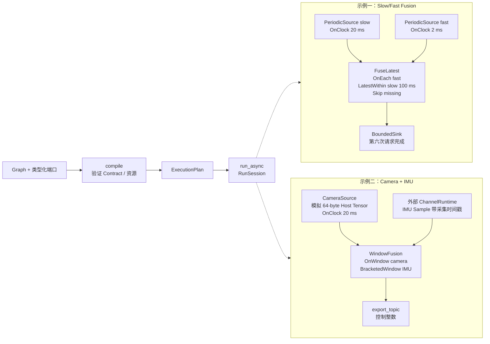
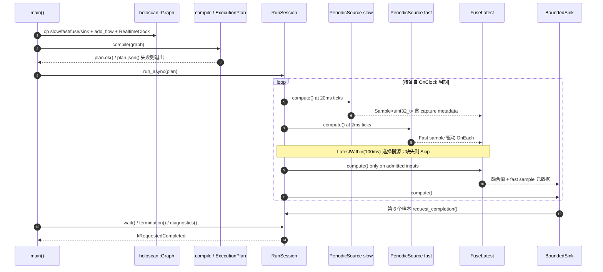

# NVIDIA Holoscan SDK｜英伟达实时 AI 传感器处理框架

**NVIDIA Holoscan SDK**（[官方项目页](https://developer.nvidia.com/holoscan-sdk)、[官方文档](https://docs.nvidia.com/holoscan/sdk-user-guide/)、[开源代码](https://github.com/nvidia-holoscan/holoscan-sdk)）用于构建由多速率传感器输入、GPU/CPU 处理算子和实时输出组成的 Physical AI 数据流应用。本页**以 2026-10-21 发布的 SDK 5.0.0** 为基线，结合官方技术文档和可执行 C++ 示例整理；旧 4.x 的编程模型不应直接套用。

## 一句话定义

**Holoscan 把「传感器何时采样、算子何时计算、数据如何传给下游」写成可验证的图和时间契约，让机器人感知—融合—推理—输出链路在有界资源内运行。**

## 英文缩写速查

| 缩写 | 英文全称 | 简要说明 |
|---|---|---|
| SDK | Software Development Kit | Holoscan 软件开发套件 |
| HoloMQ | Holoscan Message Queue | 基于 iceoryx2 的跨进程通道传输层 |
| IMU | Inertial Measurement Unit | 相机配套的高频惯性传感器 |
| CUDA | Compute Unified Device Architecture | GPU 计算、流序与 Tensor 内存运行时 |
| GXF | Graph Execution Framework | 4.x 所依赖的执行框架；5.0 原生运行时不再以其为底座 |
| UCX | Unified Communication X | 4.x fragment 跨进程/节点通信路径 |
| RDMA | Remote Direct Memory Access | 可选直接数据通路；实际依赖网卡、驱动和平台 |
| HSB | Holoscan Sensor Bridge | 单独的 FPGA/Ethernet 传感器接入项目 |

## 为什么重要

- **多速率天然存在：** 相机、IMU、推理与控制回路各自节拍不同，按到达顺序拼接会误用过期数据。5.0 在 `contract()` 中显式指定触发方式、数据选择与缺失策略。
- **提前发现错误：** 编排时使用类型化端口；`compile()` 在运行前验证图连接、时序契约、资源上限与执行计划，减少将错误拖到真机上才暴露的概率。
- **减少热路径开销：** 使用有界队列、预分配内存、CUDA stream 顺序和 HoloMQ 通道；但不应由此推断任何工作负载自动满足硬实时截止期。
- **机器人系统意义：** 可单独把感知融合管线的最坏队列长度、时序策略、迟到/缺帧处理和 Tensor 生命周期写清；与 [Jetson](./nvidia-jetson.md)、[TensorRT](./tensorrt.md) 和控制栈相接时，仍需实测整机端到端延迟。

## 核心原理

### 架构分层与五个原语

| 层 / 原语 | 职责 | 官方 5.0 接口 |
|---|---|---|
| HoloMQ | 进程间通道与 GPU 内存感知传输 | `ChannelRuntime`，外部 `import_topic` / `export_topic` |
| Operator | 单一处理算子：端口、时间、计算 | `setup()` / `contract()` / `compute()` |
| Graph | 定义算子与有类型的数据边 | `graph.op<T>()`、`add_flow()`、`set_default_clock()` |
| Contract | 何时激活、用哪个样本、丢帧如何处理 | `OnClock` / `OnEach` / `OnWindow` 等 |
| ExecutionPlan | 编译后不可变、可检查的执行方案 | `compile(graph)`、`plan.ok()`、`plan.json()` |
| RunSession | 启动、请求停止、等待、结果诊断 | `run_async(plan)`、`wait()`、`termination()` |
| 领域模块 | 推理、图像处理、可视化 | Inference（TensorRT）、Vision（CV-CUDA/NPP）、Visualization |

**生命周期：** `compose → compile → run`。图的语义在冷态编译，运行时执行编译方案；Operator 的 `setup()` 描述结构、`contract()` 描述时间、`compute()` 只处理已经按规则选定的输入。

### 流程总览（基于官方 5.0 示例）

下面用官方 `slow_fast_fusion` 和 `camera_imu_control` 的真实模块画主干。两条分支代表**不同参考应用**，不是 SDK 默认自动把所有传感器串成一条管线。

### 时间契约（Temporal Contract）

| 要素 | 常见选项 | 语义 |
|---|---|---|
| Trigger | `OnClock`、`OnEach`、`OnAligned`、`OnWindow` | 谁驱动这次激活 |
| Selector | `Exact`、`LatestWithin`、`DrainAll`、`BracketedWindow` | 哪些具有可比较采集时间的样本参与 |
| Missing policy | `Skip`、`SafeDefault`、`ReuseLast` | 缺失/过期输入时跳过、降级或有限复用 |
| 入场迟到 | `max_start_delay` + `on_violation` | 约束**开始执行**相对触发坐标的允许延迟，不保证 `compute()` 在预算内结束 |

**容易混淆的 50 Hz 与 60 Hz：** 官方文档导言用「60 Hz 相机 + 高频 IMU」介绍通用场景；固定 tag `v5.0.0` 的 `camera_imu_control.cpp` 实际将模拟相机的 `OnClock` 设为 **20 ms = 50 Hz**。不要把导言频率当作这份源码的配置。

## 源码运行时序图

以下对应已阅读的 **[`examples/slow_fast_fusion/cpp/slow_fast_fusion.cpp`](https://github.com/nvidia-holoscan/holoscan-sdk/blob/v5.0.0/examples/slow_fast_fusion/cpp/slow_fast_fusion.cpp)**，并非虚构的通用运行图：

进阶源码：[**`camera_imu_control.cpp`**](https://github.com/nvidia-holoscan/holoscan-sdk/blob/v5.0.0/examples/camera_imu_control/cpp/camera_imu_control.cpp) 的 `main()` 调用 `compile(CameraImuGraph)` 再进入 `run_reference(plan)`；该函数使用 `ChannelRuntime::create()`、`create_publisher`、`create_subscriber` 接入 IMU/控制端点，启动 `run_async(plan)`，发布 IMU 样本、等待融合结果，再 `request_stop()` 和 `wait()`。具体入口与源码路径均已记录在[源码归档](../../sources/repos/nvidia_holoscan_sdk.md)。

## 工程实践

| 步骤 | 建议与核查点 |
|---|---|
| 选择版本 | 先锁定 [v5.0.0 release](https://github.com/nvidia-holoscan/holoscan-sdk/releases/tag/v5.0.0)，不要直接把 4.x 教程中的 `Application`、GXF codelet 混用到 5.0 |
| 环境 | 官方 5.0 预构建目标：Ubuntu 24.04、CUDA 13、Ampere+ GPU、Python 3.12+；C++ 应用 CMake 4.0+ |
| 编译/运行 | 安装官方 SDK 并构建示例后，执行 `./slow_fast_fusion --plan-json` 先检查编译计划，再 `./slow_fast_fusion`；相机 IMU 参考应用执行 `./camera_imu_control` |
| 时序 | 检查各端口 `queue_depth`、采集时间戳的时钟域、过期数据策略以及 `plan.diagnostics()`；测量 p95/p99 时延、丢帧、队列积压 |
| 外部进程 | `camera_imu_control` 通过 `endpoint-catalog.json` 描述通道；外部 `sensor_daemon` / `result_recorder` 按 catalog 及采集时间戳约定连接 |
| 接入真实相机 | 使用 HSB 等独立的 IO 组件时，先验证硬件路径与 GPU 数据传输能力；目前两份示例只是模拟输入 |

**开源结论（2026-11-12）：** [Holoscan SDK 仓库](https://github.com/nvidia-holoscan/holoscan-sdk)及 C++/Python 示例公开，官方提供 GitHub release、Docker / Python wheel / Debian 安装途径；`holoscan-sensor-bridge` 是**独立仓库与硬件接入方案**，不等于 SDK 自带即插即用 FPGA 传感器。

## 局限与风险

- **5.0 改动大：** 原生 Graph + ExecutionPlan 取代 4.x 的 GXF/UCX fragment 组合；跨版本代码/通道工件不能想当然兼容。
- **契约不等于实时保证：** `max_start_delay` 限制 compute 启动时刻；没有硬保证算子结束时间。GPU kernel、驱动、外部网络、控制板和安全停机仍须实测。
- **示例不是实机性能报告：** slow/fast 示例仅操作 host 整数；camera/IMU 示例用 64 字节模拟 Tensor 和整数融合，非真实惯导融合算法，不提供真机成功率或控制安全证明。
- **API 成熟度不同：** 5.0 external-topic / channel 的部分功能属于 Prototype；Temporal Contract 仍处于 Beta 稳定度，升级需核查具体版本。
- **平台限制：** 不支持 JetPack 6、IGX OS 1；GPUDirect RDMA 需额外硬件/软件支持，不是所有 Jetson 设备都天然支持。
- **复现状态：** 本次已核对官方文档、README 和 C++ 入口，但**未在本地实际编译、运行或测延迟**。

## 关联页面

- [Holoscan Sensor Bridge](./holoscan-sensor-bridge.md) — FPGA + Ethernet + ConnectX 的传感器接入路径（与 SDK 分离）
- [NVIDIA Jetson](./nvidia-jetson.md) — 机器人机载 GPU 平台
- [TensorRT](./tensorrt.md) — Holoscan Inference 模块使用的推理引擎
- [Isaac ROS Visual SLAM](./isaac-ros-visual-slam.md) — ROS 2 感知链路的另一条工程路线
- [Hardware-in-the-Loop](../concepts/hardware-in-the-loop.md)
- [边缘–云机器人](../concepts/edge-cloud-robotics.md)

## 参考来源

- [NVIDIA Holoscan SDK 5.0 官方技术文档归档](../../sources/sites/nvidia-holoscan-sdk-5.md)
- [NVIDIA holoscan-sdk v5.0.0 源码和运行入口归档](../../sources/repos/nvidia_holoscan_sdk.md)

## 推荐继续阅读

- [SDK 5.0 Overview](https://docs.nvidia.com/holoscan/sdk-user-guide/5-0-latest/introduction/overview)
- [Temporal Contracts](https://docs.nvidia.com/holoscan/sdk-user-guide/5-0-latest/building-operators/temporal-contracts)
- [Camera + IMU Control](https://docs.nvidia.com/holoscan/sdk-user-guide/5-0-latest/examples/camera-imu-control)
- [5.0 迁移指南](https://docs.nvidia.com/holoscan/sdk-user-guide/introduction/migrating-from-4x)
- [HoloHub 示例生态](https://github.com/nvidia-holoscan/holohub)
