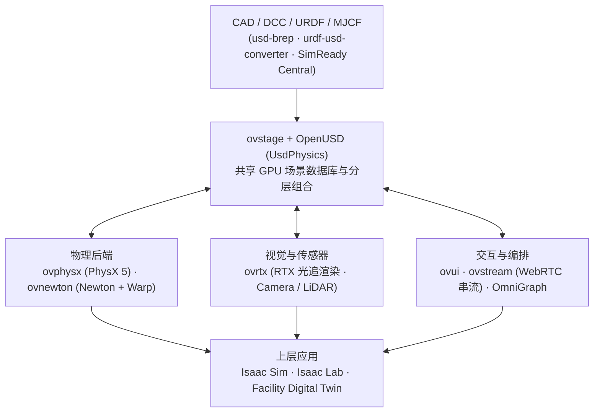

# NVIDIA Omniverse (具身仿真底座)

## 一句话定义

**NVIDIA Omniverse** 是以 **OpenUSD** 为场景中枢、由 GPU 共享场景层（`ovstage`）、RTX 渲染/传感器仿真（`ovrtx`）与可替换物理求解器（`ovphysx` / `ovnewton`）组成的实时三维协作与数字孪生底座，也是 [Isaac Sim](./isaac-sim.md) 的底层运行与资产交换平台。

## 英文缩写速查

| 缩写 | 英文全称 | 简要说明 |
|------|----------|----------|
| OpenUSD | Open Universal Scene Description | 皮克斯开源的场景描述与非破坏性分层协作标准 |
| RTX | Ray Tracing Texel eXtreme | NVIDIA 硬件光线追踪，用于物理材质渲染与相机/LiDAR/Radar 传感仿真 |
| CAD | Computer-Aided Design | 机械结构与装配体设计数据（经转换或 `usd-brep` 进 USD） |
| SIL / HIL | Software / Hardware-in-the-Loop | 在环仿真验证，利用串流与数字孪生场景闭环测试控制栈 |
| SimReady | Simulation-Ready OpenUSD Asset | 附带刚体物理、碰撞、材质与传感语义的标准 OpenUSD 资产 |
| AI | Artificial Intelligence | 人工智能与物理 AI（Physical AI）模型及智能体工具链 |
| GPU | Graphics Processing Unit | 并行物理求解、渲染合成与策略训练的硬件基础 |

## 为什么重要

- **打通多软件 CAD → 仿真 → 数字孪生数据孤岛：** 基于 OpenUSD Sublayer / Reference / Variant 非破坏性组合，把工程 CAD（Onshape、`usd-convert-cad`、`usd-brep`）、DCC 美术（[Blender](./blender.md)）与机械 URDF/MJCF 资产汇集到同一 Stage 上，避免单向覆盖与版本失真（见 [格式对比](../comparisons/urdf-vs-mjcf-vs-sdf-vs-openusd.md)）。
- **从单体桌面应用演进为 Agent 可调用的模块化库：** 官方 2026 年开发者门户将核心能力拆分为 `ovstage`、`ovrtx`、`ovphysx`、`ovnewton`、`ovstream`、`ovui` 与 `ovstorage`，使开发团队和代码智能体能按需组合最小仿真应用而不强依赖全量 GUI（见 [NVIDIA Skills](./nvidia-skills.md)）。
- **工业级传感器与数字孪生底座：** RTX 光追传感器与可串流视口使工厂布局预演、产线多机协同与传感器保真度对齐可先在虚拟闭环内验证。

## 核心原理与模块化架构

1. **通用场景描述与 `UsdPhysics`（OpenUSD）：** 用非破坏性 API Schema 把刚体质量、主轴惯量、碰撞近似与关节驱动附加到现有几何 prim 上，使渲染网、物理代理与多团队图层独立演进（详见 [`UsdPhysics` 规范归档](../../sources/sites/openusd_usdphysics_spec.md)）。
2. **双路线 GPU 物理（`ovphysx` 与 `ovnewton`）：** `ovphysx` 面向工业成熟多物理刚体与大场景吞吐；`ovnewton` 通过 `ovstage` 接入开源可微多求解器引擎 [Newton Physics](./newton-physics.md) 与 [NVIDIA Warp](./nvidia-warp.md)，面向研究者自定义接触、软体与柔性线缆实验。
3. **高保真光学与传感器仿真（`ovrtx`）：** 以硬件加速路径追踪模拟镜头畸变、光照与原生物理材质反射，提供相机、深度与原始 LiDAR 数据流，并可用 `ovstream` 推流给本地或浏览器客户端审阅。
4. **SimReady 资产体系与转换器：** SimReady Central Library 提供 2,000+ 开箱可用资产；`urdf-usd-converter`、`mujoco-usd-converter` 与 `usd-validation-nvidia` 组成资产入库与合规检验门禁。

## 源码运行时序图

**说明（部分闭源平台底座，总图按平台边界标记）：** NVIDIA Omniverse 的核心运行时 **Omniverse Kit、RTX 光追渲染器（`ovrtx`）与底层商业插件** 以闭源二进制形式随工作站/容器安装包分发，仓内未包含 Omniverse Kit 完整可运行源码入口，因此本总览页不虚构 Kit 主引擎内部源码调用链。已公开可运行源码的独立组件请参见各自实体页的源码运行时序图：[Isaac Sim](./isaac-sim.md)、[OmniGraph](./omnigraph.md) 与 [NVIDIA USD BRep / SMLib](./nvidia-usd-brep-smlib.md)。

## 前沿代理辅助仿真应用构建

NVIDIA 2026 年的开发者博客（2026-10-08 原发、2026-11-19 扩充）汇总了使用前沿模型代理（GPT-6 Astra / Sol、Claude 等）调用模块化 Omniverse Libraries 搭建仿真的实践模式：模型帮助连接场景、物理、渲染、传感器与界面，开发者设定约束、检查物理与传感器指标并指导修订。

博客中的工程实践集中在三点：
- **按能力组合最小库栈：** 例如 VR 交互同时使用 `ovstage + ovrtx + ovxr + ovphysx` 并切换 `ovnewton` 对比物理行为，发现抓取高频颤振后改为每帧更新一次抓持控制；燃气轮机数字孪生则将 Cantera/SciPy 数值求解结果映射至 `ovstage`/`ovrtx`/`ovstream` 浏览器端视图。
- **大规模场景性能剖面化：** 仓储压测（80 条输送线 + 40 机械臂 + 800 箱体）显示将物理、渲染与视频编码解耦并发可在 FHD 下维持 30 FPS；医院 256 病房并行仿真 768 台机器人时将家具改为静态碰撞并离线导出姿态渲染。
- **传感器对齐与 CAD-to-SimReady 迭代：** 以 `ovrtx` 相机和原始 LiDAR 与实录数据差异驱动 OpenUSD 场景几何与材质修正；用 ABB YuMi 演示 CAD 转 OpenUSD + 碰撞/关节配置并通过 SimReady Foundation 校验（原文明确指出其物理参数为估算值，尚未针对真机实测标定）。

证据边界：该博客属官方应用展示，未提供统一对照基准或全部案例的完整独立复现配置，演示统计（如 G1 跨栏 100 次试验通过 64 次）不能外推为通用真机成功率。

## 工程实践

- **单机算法开发 vs. 模块化服务部署：** 训练 RL 或跑标准仿真优先经由 [Isaac Sim](./isaac-sim.md) / [Isaac Lab](./isaac-lab.md) 的 Python `World` 与 `ManagerBasedRLEnv` 入口；若将渲染/物理嵌入既有工作流或浏览器数字孪生，优先评估独立发布的 `ovstage`/`ovphysx`/`ovnewton` 轻量库，而非启动完整 Omniverse GUI Kit。
- **资产预检门禁：** 导入 CAD/URDF 后先运行 `usd-validation-nvidia` 与 SimReady 校验（检查 `metersPerUnit`、默认坐标系 Z-up/Y-up、`UsdGeomMesh` 碰撞近似与闭合关节定义），再进入物理仿真。
- **多机/产线数字孪生选型：** 单机控制与桌面验证通常无需整套 Omniverse 多机集群；仅当涉多车间资产协同、传感器光追合成数据或跨部门 OpenUSD 分层协作时，再引入完整 Omniverse 流水线。

## 局限与风险

- **硬件与许可门槛高：** RTX 路径追踪与大规模物理求解强依赖较新高显存 NVIDIA RTX GPU；Kit 与部分核心扩展为专有软件受 NVIDIA EULA 约束（仅 `ovphysx`、`ovnewton`、`usd-brep` 等特定库按开源许可独立发布）。
- **物理与可视化表示切换有代价：** 从精确 CAD（`BrepArray`）转为 `UsdGeomMesh` 与凸分解碰撞体存在近似误差；`UsdPhysics` 角度使用**度（`degrees`）**而 URDF/MJCF 使用**弧度（`radians`）**，跨工具链换算极易出错。
- **SimReady 不等于已真机标定：** 资产通过 SimReady Foundation 格式与关节完整性检查后，摩擦、电机 `armature`、阻尼与延迟仍必须经过系统辨识（见 [仿真与标定区别](../concepts/robot-dynamics-simulation-vs-calibration.md)）才能支持高置信度 Sim2Real。

## 关联页面

- [Isaac Sim](./isaac-sim.md) — Omniverse 上的机器人仿真应用实体页
- [Newton Physics](./newton-physics.md) — Warp + OpenUSD 的 GPU 多求解器引擎（`ovnewton` 底座）
- [OmniGraph](./omnigraph.md) — Kit 可视化脚本：Action / Push Graph、ROS 与机器人控制快捷图
- [NVIDIA Warp](./nvidia-warp.md) — Kit 扩展 `omni.warp.core`；Newton / MJWarp 的计算层
- [NVIDIA Cosmos](./nvidia-cosmos.md) — 学习式 WFM；Omniverse 仿真视频可送入 Cosmos Transfer
- [NVIDIA Learn OpenUSD](./nvidia-learn-openusd.md) — 官方 USD 课纲与 OpenUSD 认证备考
- [NVIDIA USD BRep / SMLib](./nvidia-usd-brep-smlib.md) — OpenUSD NURBS 实体建模与转换库
- [Isaac Lab](./isaac-lab.md) — 建立在 Isaac Sim 上的学习框架
- [机器人数字孪生](../concepts/digital-twin.md) — Model / Shadow / Twin 分级理论
- [URDF vs MJCF vs SDF vs OpenUSD](../comparisons/urdf-vs-mjcf-vs-sdf-vs-openusd.md) — 四大格式机制对比
- [Blender（开源 DCC 与 USD 资产来源）](./blender.md)
- [对比：MuJoCo vs Isaac Sim](../comparisons/mujoco-vs-isaac-sim.md)
- [Sim2Real (仿真到现实迁移)](../concepts/sim2real.md)
- [Reinforcement Learning（强化学习）](../methods/reinforcement-learning.md)
- [视觉伺服（Visual Servoing）](../methods/visual-servoing.md)
- [机器人仿真场景生成](../methods/robot-simulation-scene-generation.md)

## 参考来源

- [NVIDIA Omniverse Frontier AI Agents 博客与 Libraries 门户归档](../../sources/blogs/nvidia_frontier_ai_agents_simulation_2026-10-09.md)
- [OpenUSD `UsdPhysics` 官方规范通读](../../sources/sites/openusd_usdphysics_spec.md)
- [NVIDIA Isaac Sim 官方仓库 README 通读](../../sources/repos/isaac_sim_reading_docs_readme_is01.md)
- [NVIDIA Omniverse Isaac Sim 仓库归档](../../sources/repos/isaac_sim.md)
- [Learn OpenUSD 课程归档](../../sources/courses/nvidia_learn_openusd.md)

## 推荐继续阅读

- NVIDIA Omniverse Developer Portal：<https://developer.nvidia.com/omniverse>
- NVIDIA Blog（2026-11-19 更新版）：<https://blogs.nvidia.com/blog/developers-simulation-frontier-ai-agents/>
- Pixar OpenUSD `UsdPhysics` Overview：<https://openusd.org/release/api/usd_physics_page_front.html>
- [机器人建模与数字孪生纵深路线](../../roadmap/depth-robot-modeling-digital-twin.md) — Stage 2 / Stage 4 / Stage 6 在环与场景闭环
