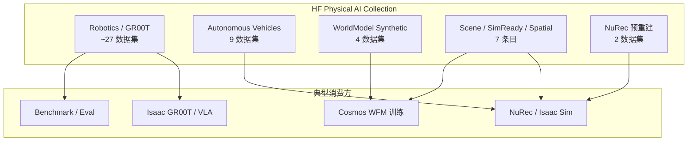

# NVIDIA Physical AI 数据集（Hugging Face 集合）

**NVIDIA Physical AI**（[Hugging Face Collection](https://huggingface.co/collections/nvidia/physical-ai)）是 NVIDIA 为 Physical AI 开发者维护的 **官方数据与资产索引**：把机器人操纵、人形遥操作、自动驾驶神经重建、世界模型合成场景、SimReady 工业场景等 **50** 个条目（2026-11-07 HF API；此前归档按通配符族合并为 49）收进同一集合，与 [Isaac GR00T](./isaac-gr00t.md)、[NuRec](./nvidia-nurec.md)、[Cosmos](./nvidia-cosmos.md) 产品栈互指。

2026-10-21 NVIDIA 另发布了 [SimReady Central](./nvidia-simready-central.md)：面向仿真的 **2,000+ OpenUSD 资产发现与 OEM 提交入口**。它与本页的 Physical AI Collection 有资产生态交集，但不是该 collection 的别名或同一计数口径。

## 一句话定义

**NVIDIA Physical AI 在 Hugging Face 上的「数据超市」：按任务域浏览可下载数据集与预重建场景，训练 VLA/GR00T、跑 NuRec Real2Sim 或喂 Cosmos 世界模型时从这里选子集，而不是零散搜 `nvidia/PhysicalAI-*`。**

## 英文缩写速查

| 缩写 | 英文全称 | 简要说明 |
|------|----------|----------|
| Physical AI | Physical Artificial Intelligence | 需在物理世界中感知、推理与行动的 AI 系统 |
| HF | Hugging Face | 权重与数据集托管平台 |
| NuRec | NVIDIA Neural Reconstruction | 神经重建 USDZ 体积；AV/机器人各有预重建集 |
| NCore | NVIDIA Core clip format | AV 重建输入的 clip 清单格式 |
| GR00T | Generalist Robot 00 Technology | NVIDIA 人形/通用操纵基础模型族 |
| WFM | World Foundation Model | 视频级世界模型；合成场景子集服务其训练 |
| SimReady | Simulation Ready | Omniverse 可直接仿真的 USD 场景资产 |
| VLA | Vision-Language-Action | 视觉–语言–动作策略 |

## 为什么重要

- **单一入口替代碎片搜索：** 官方描述为 *open, commercial-grade datasets for physical AI developers*；集合把 `PhysicalAI-Robotics-*`、`PhysicalAI-Autonomous-*`、`PhysicalAI-WorldModel-Synthetic-*` 等同前缀仓编目，降低漏集风险。
- **与 NVIDIA 栈对齐：** GR00T 论文与 [Isaac GR00T](./isaac-gr00t.md) 教程默认引用 `GR00T-X-Embodiment-Sim` 等子集；[Instant NuRec](./paper-instant-nurec.md) / [NuRec](./nvidia-nurec.md) 文档指向 `PhysicalAI-Autonomous-Vehicles-NCore` 与 `PhysicalAI-Robotics-NuRec`。
- **合成 + 真实混布：** 除遥操作与 LeRobot 移植集外，还有 Cosmos Drive Dreams、WorldModel Synthetic 系列——与 [Cosmos 3](./cosmos-3.md) 数据增广叙事一致。
- **门控要预期：** AV 主集、NuRec / NCore / Foundation4D、Spatial-Intelligence-Warehouse 等为 **`gated: auto`**；下载前需 HF 账号接受各数据卡条款，不能假设匿名 wget。
- **「商业级」不等于全部可商用：** 集合描述写 *open, commercial-grade*，但 API 标签显示 `GR00T-Teleop-Sim`、`GR00T-Teleop-GR1`、`Locomanipulation-GRAIL`、`mindmap-*`、`DigitalCousin-Assets` 为 **CC BY-NC 4.0（非商业）**，多个 AV / WorldModel 子集为 `license: other`（OpenMDW-1.1 或 NVIDIA 评测数据许可等）。

## 核心原理：集合的任务域结构

### 高流量子集（选型起点）

| 域 | 推荐入口 | 典型用途 |
|----|----------|----------|
| **GR00T / 操纵** | [PhysicalAI-Robotics-GR00T-X-Embodiment-Sim](https://huggingface.co/datasets/nvidia/PhysicalAI-Robotics-GR00T-X-Embodiment-Sim) | 跨 embodiment 仿真演示；GR00T 基线数据 |
| **遥操作** | `GR00T-Teleop-Sim`（GR-1 仿真）/ `Teleop-G1`（G1 真机）；`Teleop-GR1` 现为 DreamDojo 说明页 | 仿真 GR-1 或 G1 真机轨迹 |
| **人形 loco-manip** | [PhysicalAI-Robotics-Locomanipulation-GRAIL](https://huggingface.co/datasets/nvidia/PhysicalAI-Robotics-Locomanipulation-GRAIL) | 见 [GRAIL 数据集](./grail-locomanipulation-dataset.md) |
| **LeRobot 生态** | `LIBERO_LeRobot_v3`、`BridgeData2_LeRobot_v3` | 标准 LeRobot v3 schema 移植 |
| **AV Real2Sim** | `PhysicalAI-Autonomous-Vehicles-NCore` + `NuRec` | Instant / Docker NuRec 重建 |
| **机器人 Real2Sim** | `PhysicalAI-Robotics-NuRec` | Isaac 加载预重建 USDZ |
| **WFM 合成** | `PhysicalAI-WorldModel-Synthetic-*` | Cosmos / 视频 WM 场景增广 |
| **评测** | `PhysicalAI-VANTAGE-Bench`、`GR00T-Eval` | 空间智能 / GR00T 对标 |

完整清单见 [来源归档](../../sources/sites/hf-nvidia-physical-ai-collection.md)。

### GR00T / 机器人子集数据卡要点（2026-11-07 读卡）

| 数据集 | 卡片内容 | 许可 |
|--------|----------|------|
| `GR00T-X-Embodiment-Sim` | GR00T N1 后训练数据：跨具身双臂 9 个任务各 1000 条（共 9k）+ GR-1 桌面操纵 24 个任务各 1 万条（共 240k）+ 降采样版 24 个任务各 1000 条（24k）；约 1.87 TB | CC BY 4.0 |
| `GR00T-Teleop-Sim` | GR-1 上半身仿真遥操作：24 个桌面任务各 1000 条；HDF5 约 14 GB / LeRobot 风格约 39 GB；44 维状态与动作；256×256、20 fps | CC BY-NC 4.0（卡片写明 non-commercial） |
| `GR00T-Teleop-G1` | Unitree G1 **真机**水果拾放：1000 条，4 种水果（苹果、梨、杨桃、葡萄），43 维状态/动作，640×480、20 fps，约 400 MB；卡片给出 GR00T-N1.5 微调入口 | CC BY 4.0 |
| `GR00T-Teleop-GR1` | **卡片正文已是 DreamDojo（arXiv:2602.06949）世界模型的说明**，而非 GR-1 遥操作轨迹说明；约 74 GB | CC BY-NC 4.0 |
| `GR00T-GR1` | 92 段 Fourier GR1-T2 第三人称视频（142 MB），引用 DreamGen / IDM-GR1 | CC BY 4.0 |
| `GR00T-Eval` | EVAL-175：123 张 GR-1 视角任务初始帧 | CC BY 4.0 |
| `GR00T-Tuned-Tasks` | Isaac Lab 里的 GR1 工业桌面任务（排气管分拣、倒螺母）各 1000 条，由 5 条 Apple Vision Pro 遥操作示范经 MimicGen 扩增，20 Hz，用于 N1 后训练 | CC BY 4.0 |
| `GR00T-N1.7-AppleToPlate` | Unitree G1 静态 loco-manip 拾苹果放盘子：402 条，用于 N1.7 后训练（2026-05-20 创建） | CC BY 4.0 |
| `LIBERO_LeRobot_v3` | LIBERO 五个套件（spatial/object/goal/90/10）的 LeRobotDataset v3.0 转换 | `license: other`（openmdw1.1） |
| `Open-H-Embodiment` | 手术机器人与超声的社区多具身 LeRobot v2.1 数据（非 GR00T 家族） | CC BY 4.0 |
| `Anchor-Lab` | sim-to-real RL 相关数据（H1/G1/SO101，Isaac Lab、Newton） | Apache-2.0 |

注意：卡片或标题与仓库名并不总一致（例如 `Teleop-Sim` 的卡片正文自称 `Teleop-GR1`），下载前以实际文件结构为准。

## 工程实践

| 目标 | 做法 |
|------|------|
| 浏览全集 | 打开 [HF collection](https://huggingface.co/collections/nvidia/physical-ai) 或 `huggingface-cli` 按 `nvidia/PhysicalAI-` 前缀搜索 |
| 门控集 | 登录 HF → 数据集页 **Access repository** → 读 LICENSE → `datasets.load_dataset(...)` |
| GR00T 训练 | 官方教程 + `GR00T-X-Embodiment-Sim`；评测用 `GR00T-Eval` |
| NuRec | AV：`NCore` clip → Instant/NuRec 容器；机器人：直接下 `Robotics-NuRec` USDZ |
| 与 Cosmos 权重配合 | 数据从此集合；模型权重见 [Cosmos3 HF 集合](../../sources/sites/hf-nvidia-cosmos3-collection.md) |

**开源状态（2026-11-07 复核）：** 集合内条目 **已开放获取**（部分需登录并同意条款）；**不是**单一许可证——API 标签中既有 CC BY 4.0、Apache-2.0，也有 CC BY-NC 4.0 与 `other`，逐卡核对。代码入口分散在各产品 GitHub（GR00T、NuRec、Isaac 等），本集合仅索引数据/资产。

## 局限与风险

- **核对深度：** 本页对集合清单与上表 GR00T / 机器人子集的数据卡做了核对；AV、NuRec、WorldModel 等其余子集仅核对了 API 元数据（门控条目匿名读不到卡片正文），详细字段请以各数据卡为准。
- **集合 ≠ 完整 NVIDIA 数据宇宙：** 部分 checkpoint（如 Cosmos Policy-DROID）在独立 HF 仓，不在本 collection。
- **门控与地域：** `gated: auto` 子集无法 CI 匿名拉取；企业合规需单独审数据卡。
- **格式异构：** 有 parquet+video、USDZ、imagefolder、LeRobot v3 等；不要假设统一 schema。
- **重定向就绪度：** 机器人子集按具体本体采集（`Teleop-G1` 为 Unitree G1、`Teleop-Sim`/`GR00T-GR1` 为 Fourier GR-1、`mindmap-Franka-*` 为 Franka），同形态可直接作策略输入；换目标形态须按目标骨架 **重定向 / retarget** 或重采。`X-Embodiment-Sim` 覆盖多本体但仍是各自动作空间，`LIBERO_LeRobot_v3` / `BridgeData2_LeRobot_v3` 统一的是 **schema 而非形态**。
- **第三方条目：** 如 `bones-studio/seed`、`NianticSpatial/real2sim-sample-usdz-scenes` 许可与 NVIDIA 主集不同。

## 关联页面

- [Isaac GR00T](./isaac-gr00t.md) — 主要数据消费模型
- [NVIDIA Omniverse NuRec](./nvidia-nurec.md) — 预重建场景消费
- [NVIDIA Cosmos](./nvidia-cosmos.md) — 世界模型平台
- [Cosmos 3](./cosmos-3.md) — WFM 权重（另集合）
- [GRAIL Loco-Manipulation Dataset](./grail-locomanipulation-dataset.md) — 集合内大型 G1 子集
- [NVIDIA Physical AI Learning](./nvidia-physical-ai-learning.md) — 官方课程门户
- [NVIDIA SimReady Central](./nvidia-simready-central.md) — 2,000+ 仿真就绪 OpenUSD 资产的发现与提交入口
- [Sim2Real](../concepts/sim2real.md) — 合成/仿真数据上真机语境

## 参考来源

- **原文通读：** [HF Physical AI 集合归档](../../sources/sites/hf-nvidia-physical-ai-collection.md)（集合 API 全清单 + 20 张数据卡，2026-11-07）
- [SimReady Central 公告与入口归档](../../sources/sites/nvidia-simready-central.md)

## 推荐继续阅读

- [Hugging Face：Physical AI Collection](https://huggingface.co/collections/nvidia/physical-ai)
- [NVIDIA Physical AI Learning](https://docs.nvidia.com/learning/physical-ai/)
- [Isaac GR00T 文档](https://developer.nvidia.com/isaac/gr00t)
- [NuRec 文档](https://docs.nvidia.com/nurec/)
