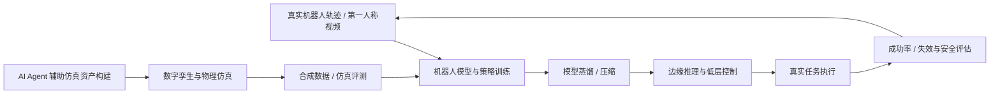

# NVIDIA's Plan for Robotics' ChatGPT Moment / NVIDIA 的机器人 ChatGPT 时刻：基础模型、仿真与规模部署

## 一句话定义

本页归纳 NVIDIA 机器人与边缘 AI 副总裁 **Deepu Talla** 接受 The Information AI Deep Dive 访谈时的技术判断：通用机器人要把 **可规模化的数据与仿真 → 能理解/预测物理世界的模型 → 多速率边缘控制 → 可验收部署** 连接起来；“ChatGPT 时刻”指成百上千个任务达到稳定可用门槛，而不是展示少量成功 Demo。

## 英文缩写速查

| 缩写 | 英文全称 | 简要说明 |
|---|---|---|
| AI | Artificial Intelligence | 访谈所讨论的物理智能与代理式开发工具 |
| AMR | Autonomous Mobile Robot | 相对成熟的仓储自主移动机器人 |
| AGV | Automated Guided Vehicle | 结构化场景中的自动导引车 |
| CAD | Computer-Aided Design | 传统仿真资产建模入口 |
| VLM | Vision-Language Model | 对输入图像与语言进行理解的模型 |
| VLA | Vision-Language-Action | 视觉/语言条件下输出机器人动作的策略族 |
| WAM | World Action Model | 在世界状态预测与动作产生之间建立耦合的模型方向 |
| Sim2Real | Simulation to Reality | 仿真训练/测试结果迁移到真机 |
| API | Application Programming Interface | 远端模型或工具服务接入边界 |
| GPU | Graphics Processing Unit | 训练、仿真、边缘计算所依赖的并行硬件 |

## 为什么重要

- 把 NVIDIA 的 Physical AI 技术叙述拆成**数据、训练、仿真、推理、部署**五个能分别测量的环节，避免将产品发布、访谈愿景和实验结果混为一谈。
- 对控制工程师尤其有用：语义规划模型不负责 kHz 级执行闭环；边缘端策略频率、动作接口、掉线安全和执行器误差仍决定真实可用性。
- 商业化不能只看 Demo：多种任务覆盖、系统稳定性、现场集成时间和单位任务成本才决定可规模化部署。

## 核心原理

### 1. Agentic AI 的重点是降低“造数据”和“接现场”的成本

视频 [05:43](https://youtu.be/rarKwkLN-Bg?t=343) 起讨论两种自动化：从图像/视频辅助生成 3D/CAD 仿真资产，为合成数据制造复杂场景；以及读取旧设备文档、辅助编写设备对接与协议层 glue code。嘉宾以“约 100 倍”描述部分流程的加速潜力，**没有提供统一测试集、端到端统计或人工复核时间**，不能外推为完整机器人交付周期提速百倍。

### 2. 仿真是风险前移，不能免去真机验收

约 [13:50](https://youtu.be/rarKwkLN-Bg?t=830) 说明真机探索昂贵且可能有风险：在 Isaac Sim / Isaac Lab 先探索策略与场景，再进行真实执行与误差闭合。约 [30:40](https://youtu.be/rarKwkLN-Bg?t=1840) 讨论软体、接触、灵巧操作对物理模拟的要求，并提及 Newton；这说明仿真真实性仍是限制，**不等于真实接触已被无损模拟**。

### 3. World Model 是“动作后果”的推理部件

访谈 [32:38–35:15](https://youtu.be/rarKwkLN-Bg?t=1958) 对 Cosmos、VLM、机器人动作模型与世界状态预测作概念性讨论。可以把问题拆成三层：
- **看懂当前：** 任务指令、物体关系、三维环境；
- **预测后果：** 动作可能使物体滑落、碰撞、变形，或产生失败状态；
- **选择并执行：** 将规划或策略输出交给可控、可停止的执行路径。

**不要将 VLM、VLA、访谈里提到的 VAM 和 WAM 当成四个严格互斥的统一标准。** 本期没有提出新的、可复现的单一模型架构。

### 4. NVIDIA 研发与部署流程的访谈版示意

这张图是对访谈所描述研发—部署思路的**工程归纳**，不是 NVIDIA 发布的产品架构图，也不声称所有箭头已在一个可运行开源系统里得到验证。

### 5. 三类计算平台 × 多速率“大脑”

约 [36:05–47:46](https://youtu.be/rarKwkLN-Bg?t=2165) 的两条独立划分不能混淆：

| 维度 | 访谈提及的结构 | 工程上需补充验证 |
|---|---|---|
| 计算平台 | 数据/模型训练计算机；Omniverse 与 Isaac 仿真计算机；Jetson 等机器人边缘计算机 | 使用的实际产品版本、计算与功耗预算、部署接口 |
| 控制分层 | System 0 关节/稳定性 kHz 量级；System 1 近实时策略约 30–100 Hz；System 2/3 更慢的规划或远端服务 | 各模型最坏执行时间、网络抖动、执行器周期、安全监控 |
| 远端扩展 | “Phone a friend” 方式调用外部模型/API | 断网降级、超时中止、控制权限与风险边界 |

以上频率是视频中的**示例级别**，不是所有 NVIDIA 机器人芯片或算法统一保证的指标。低层安全闭环不能依赖不确定的云端 RTT。

### 6. 数据规模化与边缘模型适配

约 [47:47–56:23](https://youtu.be/rarKwkLN-Bg?t=2867) 将前沿模型能力蒸馏到更小参数/功耗预算，与真实机器人数据、egocentric 人类视频、自动生成合成数据并行推进。**人视频不天然提供机器人动作标签**；策略学习还需状态/动作对齐、形态映射、质量筛选与真机验证。

### 7. ChatGPT 时刻的“百米十秒”比喻

嘉宾在 [20:25](https://youtu.be/rarKwkLN-Bg?t=1225) 用百米跑跨越十秒阈值比喻成熟度，在 [56:24](https://youtu.be/rarKwkLN-Bg?t=3384) 补充定义：不是十个应用成功，而是**数百乃至数千个用例跨过各自可用门槛**。因此：
- “10 秒” **不表示任务必须在 10 秒内做完**；
- “通用”也不自动等于任何未见任务零样本成功；
- 他对未来几年的判断属于预测，本视频没有给出可核查的产品发布时点。

访谈还指出，AMR/AGV 的规范化仓储任务更易先规模部署；灵巧操作和变化频繁的制造任务更难。

### 8. 人形有数据与环境优势，但不排他

约 [1:01:08](https://youtu.be/rarKwkLN-Bg?t=3668) 讨论人类建筑、工具与工作流程（Brownfield）的形态匹配，以及人类 egocentric 数据对类人操作的启发。嘉宾认为人形可能是通用物理智能的重要路径，同时承认专用机械臂、仓储 AMR 和其他形态会共存。约 [1:09:31](https://youtu.be/rarKwkLN-Bg?t=4171) 提到希望家庭社交机器人能协助老年照护及陪伴；这是个人愿景，不能视为已部署产品能力。

### 9. 任务成熟度：百米赛跑比喻的实际用法

[20:25–30:20](https://youtu.be/rarKwkLN-Bg?t=1225) 对谈不是提出统一的“10 秒动作时限”，而是把**跨过技术可用门槛**与**规模化商业部署**分开。嘉宾的场景划分可整理为：

| 类型 | 受访者的相对成熟度判断 | 仍需独立测量 |
|---|---|---|
| 自动驾驶 | 已有特定范围商业部署 | 长尾安全、监管、人工接管 |
| 仓储 AMR、巡检、配送 | 结构化场景更早接近可用线 | 非结构化障碍、恢复时间 |
| 工业臂与协作臂的刚体抓取 | 相对成熟，工位可隔离 | 变品种、节拍、夹具改造 |
| 软体/灵巧接触操作 | 仍受高保真物理与触觉限制 | 力/力矩、形变、Sim2Real |
| 跨任务通用人形、家庭机器人 | 需要更强泛化及更高安全性 | 碰撞、失稳、综合成本 |

[56:24](https://youtu.be/rarKwkLN-Bg?t=3384) 提出的“数百到数千任务跨线”是愿景性判断，**不是**已经发表的多任务基准结果；“十秒”更不是单个任务执行十秒。

### 10. Microduck 与工具自动化示例的证据边界

访谈 [16:06–19:45](https://youtu.be/rarKwkLN-Bg?t=966) 以 GTC Berlin 的 **Microduck** 双足机器人作为开发案例：使用 AI Agent 辅助从图像/机械参数生成场景，调用 Isaac 系工具进行仿真与训练，再部署到边缘计算。嘉宾声称这一演示从构想到现场呈现不到一周，且展示允许的偶发错误与工业产线可靠性要求相差甚远。NVIDIA [官方 GTC 动态](https://blogs.nvidia.com/gtc-berlin-2026-news/) 独立记录了 Microduck 演示，但**不等于该完整训练链路已开源并可一键复现**。

### 11. System 0–3：四类时延和部署位置

与上文三类**计算平台**正交，嘉宾在 [37:18–47:39](https://youtu.be/rarKwkLN-Bg?t=2238) 讨论了四层**执行职责**：

| 层级 | 访谈示意量级 | 职责与位置 |
|---|---|---|
| System 0 | 约 1 kHz / 1–2 ms | 关节/执行器反射与安全底层，需本体局部实时闭环 |
| System 1 | 约 30–100 Hz | 端侧感知与短期控制策略，要求可离线运行 |
| System 2 | 数百毫秒至数秒 | 复杂推理/计划，可部署本体或厂内本地算力 |
| System 3 | 长时延或夜间批处理 | 跨机规划、远端 API 求助与仿真资源调度 |

这些并非 NVIDIA 对所有机器人统一保证的硬实时规格。嘉宾另讨论前沿模型的蒸馏与端侧 2B–4B 量级的局限。对此可用独立 [NVIDIA Astranomy 实验](https://research.nvidia.com/labs/srl/projects/astranomy/) 做数量级对照：GPT-6 Astra 直接担任机器人大脑时平均一次推理 **18.56 秒**，不能把离线开发 Agent 的提效宣传等同于满足 System 0/1 实时性。

### 12. 数据泛化、现场纠偏与五项有序基本功

[51:05–61:08](https://youtu.be/rarKwkLN-Bg?t=3065) 提到单任务反复采集的数据边际收益与跨任务数据缺口。嘉宾构想把第一人称真实数据、机器人示教、仿真扰动及失败反事实生成结合起来，甚至让工厂员工通过一次口头/动作纠偏完成后续后台适配。**这属于未来用户体验目标，不是“一次示教已能解决所有工位”的经验证据。**

访谈 [69:08–74:41](https://youtu.be/rarKwkLN-Bg?t=4148) 总结通用机器人五项有序基本功：**准确率 → 可靠性 → 安全性 → 经济性 → 自然且不令人不适的人机交互**。实际验收需要任务成功率、故障恢复、接管、节拍及生命周期成本等数据，不应把演示可靠性百分比直接作为工业安全认证标准。

## 工程实践

将视频主张转成可操作的实验与交付检查：

| 待决策环节 | 最小验证与记录字段 | 判断失败的典型信号 |
|---|---|---|
| AI 构建仿真资产 | 原始输入、场景可交互对象、人工修补时长、仿真可运行率 | 资产外观漂亮，但接触/物性无法训练 |
| 合成/真实数据配比 | 机器人动作标签覆盖、状态对齐、碰撞/接触事件、失败恢复样本 | 视频帧多，但可用于训练的有效 episode 少 |
| Sim2Real | 同一动作的接触时序、执行器响应、成功率、故障模式 | 仿真高分、真机频繁失稳或无法恢复 |
| 分层控制 | 各层频率、P99/WCET、通信延迟、超时和停机权限 | 高层请求阻塞低层闭环，断网失去安全策略 |
| 基模商业化 | 任务覆盖、未见变化成功率、人工接管率、节拍与单位工时 | 十个 Demo 成功却无法复用现场流程 |

## 源码运行时序图

**不适用：** 本实体是 NVIDIA 高管访谈，不对应一个发布了代码、训练入口或运行脚本的独立项目；Isaac、Cosmos、Newton 等软件的具体源码运行链路应在各自实体页按照官方 README 单独核验，不以通用时序图冒充真实调用。

## 局限与风险

1. **自述 ≠ 外部实验：** “100 倍”加速是嘉宾描述，缺公开统一 benchmark；产品名亦不代表本次测量过特定版本。
2. **预测 ≠ 交付计划：** 对“未来几年”的看法不是明示发布日期或可保证的技术路线。
3. **术语与产品代际：** 世界模型、动作模型、分层系统的叫法具有访谈语境，产品迭代与官方 API/硬件规格需另查。
4. **模型≠机器人整机：** 真实瓶颈还包括接触力学、关节闭环、人工接管、工厂接口、安全认证和总体拥有成本。
5. **证据边界：** 此页基于原始视频英文字幕逐段阅读，未逐帧复查画面；自动字幕中的个别术语可能有误，不引用其作为性能规格。

## 关联页面

- [NVIDIA Cosmos](./nvidia-cosmos.md)：访谈讨论的未来状态预测、仿真与策略评估部件。
- [WAM](../concepts/world-action-models.md) 与 [GR00T](./isaac-gr00t.md)：联系基础模型与动作执行的演进路径。
- [Jetson](./nvidia-jetson.md) 与 [Physical AI 综览](../overview/physical-ai.md)：三台计算机及边云部署的交叉阅读。

- [具身大模型与本体协同设计](../concepts/embodied-foundation-model-hardware-codesign.md)：把人形/非人形的任务覆盖映射到硬件、动作接口与部署约束。
- [控制与推理频率解耦](../concepts/control-inference-frequency-decoupling.md)：把 System 0/1/2/3 讨论落到实时执行接口。
- [VLA](../methods/vla.md) 与 [生成式世界模型](../methods/generative-world-models.md)：区分感知条件、动作生成与世界状态预测。
- [操作任务](../tasks/manipulation.md) 与 [Sim2Real](../concepts/sim2real.md)：讨论灵巧操作和真机偏差。
- [Isaac Lab](./isaac-lab.md) · [Isaac Sim](./isaac-sim.md) · [Newton](./newton-physics.md)：分别核验训练、场景与物理引擎的实际能力。
- [模型架构纵深路线](../../roadmap/depth-model-architecture.md)：Stage 4–5 的访谈交叉阅读资料。
- [Bloomberg Primer：人形机器人热度与现实差距](./bloomberg-primer-humanoid-hype-reality-2026.md)：交叉验证数据稀缺、遥操作与实际仓库试点的人工介入和 ROI 口径。

## 参考来源

- [NVIDIA GTC Berlin 2026](https://blogs.nvidia.com/gtc-berlin-2026-news/)：Microduck 官方演示报道。
- [OpenAI GPT-6 Astra 官方介绍](https://openai.com/index/gpt-6-astra/)：专名校对，非机器人性能基准。
- [NVIDIA Astranomy](https://research.nvidia.com/labs/srl/projects/astranomy/)：机器人直接推理的独立对照，不属于本访谈演示。

- [英文逐字字幕与时间戳分段阅读归档](../../sources/videos/nvidia-robotics-chatgpt-moment-deepu-talla.md)：一手访谈文本及声明的核对范围。

## 推荐继续阅读

- [The Information 原始完整访谈](https://www.youtube.com/watch?v=rarKwkLN-Bg)：建议从 [05:43 AI Agent](https://youtu.be/rarKwkLN-Bg?t=343)、[30:40 World Model](https://youtu.be/rarKwkLN-Bg?t=1840)、[36:05 架构](https://youtu.be/rarKwkLN-Bg?t=2165)、[56:24 定义](https://youtu.be/rarKwkLN-Bg?t=3384) 定位观看。
