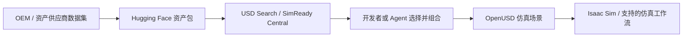

# NVIDIA SimReady Central

**NVIDIA SimReady Central** 是 NVIDIA 面向机器人仿真与 AI 工厂数字孪生的 **SimReady OpenUSD 资产发现与提交体系**：Hugging Face 上的公开入口汇集多个 OEM 和资产供应商的数据集；配套 GitHub 仓库负责资产包提交、审核与本地索引流程。它不是一套统一制作、统一许可的游戏素材包，也不是 NVIDIA 自己拥有全部模型的单一资产仓库。

## 一句话定义

**把可仿真的 3D 资产按 OpenUSD 与仿真属性组织起来，让开发者和 Agent 能检索、筛选并组合进机器人或工厂仿真场景。**

## 英文缩写速查

| 缩写 | 英文全称 | 简要说明 |
|------|----------|----------|
| SimReady | Simulation-Ready | 为指定仿真用例准备了相应结构与属性的资产；支持字段由 profile 决定 |
| USD / OpenUSD | Universal Scene Description | 描述、组合 3D 场景和资产的开放框架 |
| OEM | Original Equipment Manufacturer | 向库提交设备资产的设备制造商 |
| HF | Hugging Face | 托管 SimReady 数据集及资产包的开放平台 |
| USD Search | Universal Scene Description Search | 用关键词或自然语言检索 OpenUSD 资产的服务 |
| AI | Artificial Intelligence | 本页语境中，指协助搜索资产和编排仿真场景的 Agent 工作流 |

## 为什么重要

- **仿真资产不仅要有几何。** 机器人接触任务还需要碰撞形状、质量、摩擦、关节等信息；用于合成数据时也可能需要语义标签、材质和传感器属性。SimReady profile 把特定工作流需要的条件写成可验证约定。
- **资产供给跨厂商。** 开发者可在一个搜索入口发现机器人手臂、夹爪、仓储设备、货架、冷却设备等资产，再按需要组合到场景里。
- **Agent 能参与资产准备。** 官方示例中，Agent 根据任务与空间约束查找合适资产、生成场景组装脚本和预览；人工仍需要检查场景结果与任务参数。

## 核心结构

### 资产从来源到仿真场景

### 资产 profile 与工作流

资产是 OpenUSD 场景的一部分。NVIDIA 的 SimReady Foundation 为不同用例定义规范和 profile；资产是否包含碰撞几何、物理参数、关节结构、语义标签或传感器属性，取决于该资产及其 profile。使用者应选择与目标仿真任务匹配的资产，并在相应运行时验证属性是否可用。

| 资产信息 | 可支持的工作 |
|----------|--------------|
| 碰撞几何、质量、摩擦 | 接触与物理仿真 |
| 关节结构与限位 | 机器人或设备的铰接运动 |
| 语义标签 | 物体识别与带标注的合成数据 |
| 材质与传感器属性 | 场景渲染及相应传感器仿真 |

### Agent 场景编排

NVIDIA 公告给出的典型流程是：按任务描述检索资产 → 将资产引用到 OpenUSD stage → 生成场景组装代码 → 配置操作任务 → 渲染预览供人检查。示例面向 Isaac Sim 中的仓储抓取和 AI 工厂布局；这说明它支持 Agent 辅助仿真工作流，不等于资产能自动变成任意游戏引擎里的即用素材。

## 工程实践

| 目标 | 做法 |
|------|------|
| 搜索资产 | 使用 [SimReady Central Hugging Face Space](https://huggingface.co/spaces/nvidia/simready-central) 搜索词或描述所需资产 |
| 搭建场景 | 按目标任务选 profile 匹配的资产，组合到 OpenUSD 场景，再在 Isaac Sim 或兼容运行时验证 |
| Agent 辅助 | 给出资产类别、空间约束和任务要求，让 Agent 搜索、编写组装脚本并输出预览；检查脚本、版本和场景结果 |
| 提交 OEM 资产 | 通过 [NVIDIA-Omniverse/simready-central](https://github.com/NVIDIA-Omniverse/simready-central) 文档先完成 onboarding，再按包清单和验证流程提交审核 |
| 复现和引用 | 记录数据集、资产包版本、profile 与运行时版本；保留固定来源以便重建场景 |

## 开放状态

- **资产发现入口：** 官方称 Hugging Face 库免费且无需门控，公告发布时列出 2,000 多个资产。
- **来源：** 资产由多个 OEM 和资产供应商通过各自 Hugging Face 数据集提供；不要把集合入口误写成单一 NVIDIA 自制资产集。
- **代码：** [SimReady Central GitHub 仓库](https://github.com/NVIDIA-Omniverse/simready-central)公开，仓库中 NVIDIA 编写的代码采用 Apache-2.0；它提供 OEM 提交/审核工作流与本地资产目录工具。
- **许可：** Apache-2.0 只覆盖 GitHub 仓库的代码，不自动覆盖资产。每个包需根据来源数据集和资产元数据分别核对许可、归属及商业使用条款。
- **提交权限：** OEM 提交需 onboarding 和协作者权限；公开浏览与搜索不等于开放提交。

## 局限与风险

- **用途边界：** 官方定位是机器人仿真、Physical AI 训练环境与 AI 工厂数字孪生。可用 OpenUSD 不代表每个资产都能无修改导入 Unreal、Unity 或任意游戏管线。
- **属性不保证齐全：** SimReady profile 与资产能力各异；先检查 profile、碰撞与物理字段，再用于操作或训练。
- **许可不统一：** 资产库跨多个供应商与数据集，需逐项审查 license；不可仅凭“免费/开放入口”推断可以商业再分发。
- **运行时需匹配：** OpenUSD 表达、SimReady profile 与物理运行时共同决定可用性，跨仿真器时应验证物理属性和行为。
- **与 Lightwheel 同名体系区分：** [Lightwheel SimReady](./lightwheel-simready.md) 是光轮自己的资产产品与物理测量体系；NVIDIA SimReady Central 是多方资产发现和 OEM 提交审查入口，两者有关联生态但不是同一个产品或单一许可证。

## 关联页面

- [NVIDIA Physical AI 数据集](./nvidia-physical-ai-datasets.md) — NVIDIA Hugging Face 数据与资产集合；SimReady Central 提供更专门的仿真资产发现/提交入口。
- [Lightwheel SimReady](./lightwheel-simready.md) — 光轮自有的测量、生成和资产库体系；商业产品与开放资产子集并存。
- [NVIDIA Omniverse](./nvidia-omniverse.md) — OpenUSD 与仿真生态。
- [Isaac Sim](./isaac-sim.md) / [Isaac Lab](./isaac-lab.md) — 场景仿真与机器人学习工作流。
- [EmbodiChain](./embodichain.md) — 另一套使用 SimReady/生成式资产准备仿真环境的机器人软件栈。
- [Sim2Real](../concepts/sim2real.md) — 仿真场景与真实部署之间的差距和验证问题。

## 参考来源

- [NVIDIA SimReady Central 官方公告归档](../../sources/sites/nvidia-simready-central.md)
- [NVIDIA-Omniverse/simready-central 仓库归档](../../sources/repos/nvidia-simready-central.md)

## 推荐继续阅读

- [NVIDIA/Hugging Face：SimReady Central 公告](https://huggingface.co/blog/nvidia/simready-central-assets-robotics-ai-factories)
- [SimReady Central 资产搜索](https://huggingface.co/spaces/nvidia/simready-central)
- [SimReady Foundation](https://github.com/NVIDIA/simready-foundation) — 规范、profile 与校验工具
- [USD Search](https://github.com/NVIDIA-Omniverse/usd-search) — OpenUSD 资产检索组件
