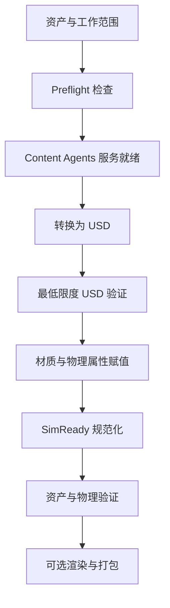

# NVIDIA Skills（英伟达智能体技能库）

## 一句话定义

NVIDIA Skills 是英伟达发布的 Agent Skills 目录，通过可安装的 `SKILL.md` 和参考材料向兼容智能体提供产品与工作流指导。

## 英文缩写速查

| 缩写 | 英文全称 | 简要说明 |
|------|----------|----------|
| CAD | Computer-Aided Design | 计算机辅助设计 |
| USD | Universal Scene Description | 三维场景描述 |
| GPU | Graphics Processing Unit | 图形处理器 |
| CLI | Command-Line Interface | 命令行接口 |

## 目录与使用

仓库 README 描述了来自各产品仓库的技能镜像、技能卡、签名及评测资料；官方文档将其用于 CUDA、Physical AI、Omniverse 等领域。可用 `npx skills add nvidia/skills --list` 查询，并用 `npx skills add nvidia/skills` 安装；具体兼容性及目录随版本变化。

## 项目流程图

以下为快照中 **omniverse-cad-to-simready** 的主干，不代表全部技能的执行流程：

这是属性赋值开启时的主路径；仅转换或仅验证请求会跳过 Content Agents，已有 USD 可跳过转换。技能要求记录每阶段结果，并在可修复的规范验证失败后重新处理与验证。

## 评测与局限

快照评测报告在 8 个任务、每项 1 次尝试的设置下，报告 Claude Code 总体 54% → 91%；Codex 总体数据不可用。该结果来自具体评测任务，不能视作通用成功率。执行属性赋值涉及服务、密钥和计算资源；部署条件与具体步骤须以技能原文为准。

技能和代码公开，仓库按产品同步；本次只通读一个代表性技能及其评测，未逐项核查目录中其他技能或其所有依赖。

## 源码运行时序图

待补：该技能明确没有单一 `scripts/run.py`，而是调用各阶段参考脚本；尚未逐一核对这些脚本及调用入口，不能据此绘制源码运行时序图。

## 关联页面

- [NVIDIA Omniverse](./nvidia-omniverse.md) — 仿真与资产工作流平台
- [Isaac Lab](./isaac-lab.md) — 机器人学习环境
- [CAD Skills](./cad-skills.md) — 面向 CAD 的另一技能库

## 推荐继续阅读

- [官方文档](https://docs.nvidia.com/skills)
- [在线技能目录](https://build.nvidia.com/skills)
- [CAD to SimReady 技能原文](https://github.com/NVIDIA/skills/blob/40af08d/skills/omniverse-cad-to-simready/SKILL.md)

## 参考来源

- [官方仓库来源归档](../../sources/repos/nvidia-skills.md)
- [指定快照 README](https://github.com/NVIDIA/skills/blob/40af08d/README.md)
- [CAD to SimReady 评测报告](https://github.com/NVIDIA/skills/blob/40af08d/skills/omniverse-cad-to-simready/BENCHMARK.md)
