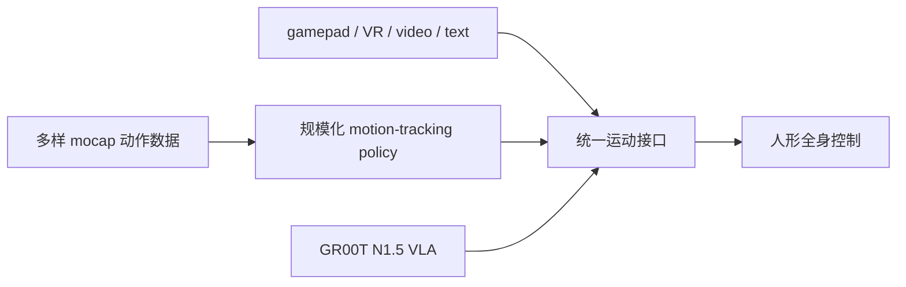

# SONIC：大规模自然人形全身控制

## 英文缩写速查

| 缩写 | 英文全称 | 简要说明 |
|---|---|---|
| WBC | Whole-Body Control | 人形全身协调控制 |
| mocap | Motion Capture | 训练动作来源 |
| VLA | Vision-Language-Action | 视觉语言条件的动作策略接口 |
| GPU | Graphics Processing Unit | 训练计算资源计量单位 |

**SONIC**（*Supersizing Motion Tracking for Natural Humanoid Whole-Body Control*）是 NVIDIA 提出的人形全身动作跟踪策略。项目将 motion tracking 视为一种可规模扩展的训练任务，借助动作捕捉数据提供稠密监督，从而建立自然的人体动作先验，而不需要为每个行为单独手工设计奖励。

## 扩展维度与统一接口

项目页报告网络规模从 1.2M 扩展到 42M 参数，训练数据超过 700 小时、1 亿帧，训练计算约 21,000 GPU hours。其下游展示包含实时运动学 planner、VR 全身遥操作、视频遥操作、音乐/文本条件动作和 GR00T N1.5 的 VLA 接口；项目方说明演示由统一控制策略产生。

## Leaderboard 版本映射

sim2real 的榜单包含 **SONIC、SONIC-Low-Latency 与 SONIC-v1.1** 三个策略/发布配置。它们都属于 SONIC 项目，因此共用本实体，不额外重复创建项目页；分数应结合具体 runtime、checkpoint 及 leaderboard 固定协议阅读。见 [榜单映射](./egalahad-sim2real.md)。

## 与相近节点区分

本页对应 NVIDIA 的 GEAR-SONIC (*Supersizing Motion Tracking...*)。不要与 [SONIC-Transfer](./paper-sonic-transfer.md) 混淆；后者是不同的跨形态迁移工作。训练路线上的对照见 [SuperMimic](./paper-supermimic.md)：SONIC 以模型无关 PPO 和大规模并行仿真扩展动作跟踪；SuperMimic 使用从仿真转移数据学习的可微世界模型，以短时想象 rollout 更新策略。

## 参考来源

- [Science Robotics 论文](../../sources/papers/sonic_science_robotics_aed4592.md)
- [官方项目页](../../sources/sites/sonic-gear-project.md)
- 代码与文档入口：[NVlabs/GR00T-WholeBodyControl](https://github.com/NVlabs/GR00T-WholeBodyControl)。
## 关联页面

- [SONIC motion tracking 方法](../methods/sonic-motion-tracking.md) — 相关方法节点；论文 arXiv ID 仅在该节点登记。
- [SONIC-Transfer](./paper-sonic-transfer.md) — 不同的跨形态迁移工作。
- [SuperMimic](./paper-supermimic.md) — 用可微世界模型降低动作跟踪训练成本的相关路线。
- [sim2real leaderboard 映射](./egalahad-sim2real.md) — SONIC 三个运行配置共用本项目实体。
- [TRACE（人形跨形态迁移）](./paper-trace-humanoid-transfer.md) — 把预训练 SONIC 从 Unitree G1 迁到 H2：投影注入运动学先验 + 编码器蒸馏 + 低秩 RL，约 8 GPU 小时
