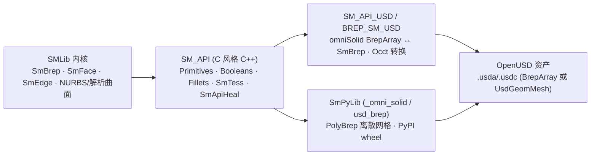
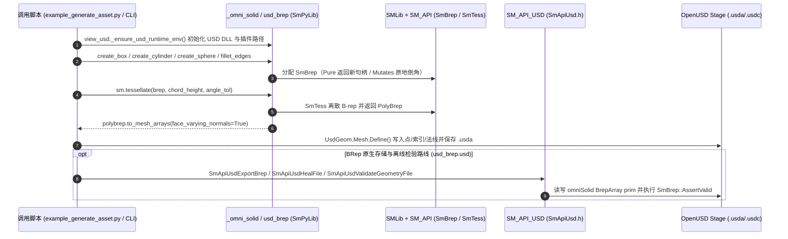

# NVIDIA USD BRep / SMLib

## 一句话定义

**NVIDIA USD BRep** 是一套独立开源的 C++/Python NURBS 边界表示（B-rep）实体建模与 OpenUSD 互操作库，用 SMLib 内核、`SM_API` 与 `SM_API_USD` 在精确 CAD 实体与可仿真网格之间搭建可编程桥梁。

## 英文缩写速查

| 缩写 | 英文全称 | 简要说明 |
|------|----------|----------|
| CAD | Computer-Aided Design | 计算机辅助设计 |
| NURBS | Non-Uniform Rational B-Splines | 非均匀有理 B 样条，可精确表示解析或自由曲线/曲面 |
| B-rep | Boundary Representation | 通过 Shell、Face、Edge、Vertex 及其邻接关系表示实体边界 |
| USD | Universal Scene Description | Pixar 开源的场景描述与交换格式 |
| API | Application Programming Interface | 程序调用接口 |
| GUI | Graphical User Interface | 图形用户界面 |

## 为什么重要

传统 CAD 应用通常将几何内核藏在产品内部；公开可编程内核降低了开发者构建 CAD 自动化、数据转换器和 Agent 工具的门槛。NVIDIA 的公开动作更准确地说是**将 USD BRep / SMLib 作为开源项目发布**，而不是证明整个 CAD 行业的内核均处于闭源垄断之下。

对机器人研发来说，精确 B-rep 可用于表达制造尺寸和工程曲面；转为网格后则便于渲染、碰撞近似和仿真资产构建。两类表示用途不同，转换不是无损同义替换。

## 核心原理与分层架构

- **SMLib：** 底层 C++ 几何内核，组织 `SmBrep`/`SmShell`/`SmFace`/`SmEdge`/`SmVertex` 拓扑，支持 NURBS 与解析曲面（Plane/Cylinder/Cone/Sphere/Torus 写为解析面，边默认写为 NURBS）。
- **SM_API & 所有权契约：** 高层 C++ API 围绕懒初始化进程全局 `SmContext` 运行；Python 接口 `usd_brep` / `_omni_solid` 明确区分 `Pure`（创建/细分返回新句柄）、`Consumes`（布尔操作接管输入所有权）与 `Mutates`（倒角/切割/修复原地改动，需要保留原件须先 `.copy()`）。
- **SM_API_USD（`SmApiUsd.h`）与 v1.0.2 能力：** 通过 `omniSolid` 自定义 `BrepArray` Schema 在 USD 文件往返 B-rep；支持 `SmApiUsdTessellateFile` 多线程生成 `UsdGeomMesh`、`SmApiUsdHealFile`（v1.0.1 引入，保留 layer/reference/instancing 仅修复单层定义的 B-rep）及 `SmApiUsdValidateGeometryFile`（v1.0.2 引入，调用 `SmBrep::AssertValid` 逐一验证几何与拓扑）。
- **语言绑定与辅助工具：** 提供 pybind11 打包的 PyPI 轮子（`pip install usd-brep`，支持 CPython 3.12 Linux/Windows），附带 OpenCASCADE 双向转换 `occt_to_usd`/`usd_to_occt`、`hdUsdBrep` Hydra 视口插件及 CLI 命令 `usd-brep-heal`、`usd-brep-validate-geometry`、`nvidia_usd_validate`。

## 源码运行时序图

以官方仓库 `tools/scripts/example_generate_asset.py` 的端到端资产生成管线与 `source/SM_API_USD/inc/SmApiUsd.h` 声明的修复/验证入口为核对基准：

图依据：`NVIDIA-Omniverse/usd-brep`（v1.0.2，`main` 分支）`.agents/docs/OVERVIEW.md`、`CHANGELOG.md`、`tools/scripts/example_generate_asset.py` 与 `source/SM_API_USD/inc/SmApiUsd.h`（2026-11-28 通读）。

## 工程实践

- **安装与环境隔离：** 直接 `pip install usd-brep` 即可运行，轮子内置自定义 OpenUSD **25.11** 运行时且不向外暴露 `pxr` 对象（仅靠文件路径交换 USD）。可与不同版本 `usd-core`（如 Linux 下 `26.8`）同进程共存，但**严禁与同版本 `usd-core==25.11` 混装**，否则动态符号冲突引发崩溃。
- **Schema 与几何双层检验：** 执行 `pip install "usd-brep[validation]"` 后，先用 `nvidia_usd_validate` 检查 `BrepArray` schema 合规性（`BrepUsdSchemaValidator`），再用 `usd-brep-validate-geometry` 检查几何自交、微小边长与壳体闭合（`SmBrep::AssertValid`）；Linux aarch64 无 `usd-core` 轮子故不支持 `[validation]` extra。
- **Agent 封装边界：** 若让 LLM/Agent 调 `usd_brep` 或 `SM_API`，须由外部编排约束 API 白名单、严格区分 `.copy()` 防误消 inputs、不得并发导出同一 `SmBrep`（导出会附加 UV trim 与目标 SdfPath 缓存属性），并通过 `is_manifold_solid()`、`AssertValid` 与人工审查拦截失效实体。

## 局限与风险

- **精确 B-rep 与网格要分清：** B-rep 保留曲面/拓扑定义；细分网格以容差离散近似表面，适合显示或仿真消费，不应误当成完整可编辑 CAD 真值。
- **USD 互操作与图层约束：** 官方文档指出导入导出可能规范化实体容差、转换非 NURBS 曲线、规范化 knot 等；`usd.heal_file` 亦显式拒绝由多图层覆写或 Variant 组合而成的 `BrepArray`，只支持单层定义的几何修复。
- **开源形态与贡献政策：** Apache-2.0 公开内核、示例与 Python 包（最近复核至 v1.0.2，2026-11-18），但仓库当前说明暂不接受外部 PR 贡献，且不包含桌面 CAD 的交互约束求解树、工程图或公差分析 UI。
- **Agent 能力与竞争叙事边界：** 不自带对话 Agent 或特征树；市场替代速度（如替代商业 CAD）无现有实证依据。

## 关联页面

- [文字生成 CAD](../concepts/text-to-cad.md) — 制造向 B-rep 与网格生成路线、Agent 工作流和当前能力边界。
- [NVIDIA Omniverse](./nvidia-omniverse.md) — USD 生态与 NVIDIA 三维协作/仿真平台。
- [FreeCAD](./freecad.md) — 具备交互式 CAD 工作流的开源应用，和底层几何内核的产品层级不同。
- [OpenSCAD](./openscad.md) — 以代码描述参数化几何的脚本 CAD 路线。
- [CAD Skills](./cad-skills.md) — 将参数化 CAD 操作封装为 Agent 可用技能的示例。

## 推荐继续阅读

- [USD BRep GitHub 仓库](https://github.com/NVIDIA-Omniverse/usd-brep)
- [SMLib / API 总览](https://github.com/NVIDIA-Omniverse/usd-brep/blob/main/.agents/docs/OVERVIEW.md)
- [USD 导入导出操作说明](https://github.com/NVIDIA-Omniverse/usd-brep/blob/main/.agents/operations/usd_import_export.md)

## 参考来源

- [NVIDIA USD BRep / SMLib 仓库归档](../../sources/repos/nvidia-usd-brep.md)
