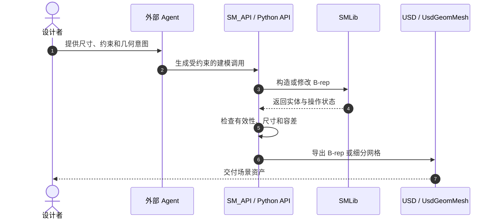

# NVIDIA USD BRep / SMLib

**NVIDIA USD BRep** 是一套独立的 C++/Python NURBS 边界表示（B-rep）实体建模库，核心 SMLib 负责拓扑与几何操作，SM_API 提供高层调用接口，SM_API_USD 负责 OpenUSD 数据交换。

## 英文缩写速查

| 缩写 | 英文全称 | 简要说明 |
|------|----------|----------|
| CAD | Computer-Aided Design | 计算机辅助设计 |
| NURBS | Non-Uniform Rational B-Splines | 非均匀有理 B 样条，可表示解析或自由曲线/曲面 |
| B-rep | Boundary Representation | 通过面、边、顶点及其邻接关系表示实体边界 |
| USD | Universal Scene Description | Pixar 开源的场景描述与交换格式 |
| API | Application Programming Interface | 程序调用接口 |
| GUI | Graphical User Interface | 图形用户界面 |

## 为什么重要

传统 CAD 应用通常将几何内核藏在产品内部；公开可编程内核降低了开发者构建 CAD 自动化、数据转换器和 Agent 工具的门槛。NVIDIA 的公开动作更准确地说是**将 USD BRep / SMLib 作为开源项目发布**，而不是证明整个 CAD 行业的内核均处于闭源垄断之下。

对机器人研发来说，精确 B-rep 可用于表达制造尺寸和工程曲面；转为网格后则便于渲染、碰撞近似和仿真资产构建。两类表示用途不同，转换不是无损同义替换。

## 核心结构与能力

- **SMLib：** 底层 C++ 几何内核，组织 shell、face、edge、vertex 等拓扑实体，并连接到解析曲面、NURBS 曲面和 B-spline 曲线。
- **SM_API：** 较高层的 C++ 调用接口，常用操作包括基本体构造、布尔、扫描/放样、倒角和曲面细分。
- **SM_API_USD：** OpenUSD 读写层；B-rep 以项目自定义的 `BrepArray` schema 编码，支持将 USD 场景中的几何导入内核并回写。
- **网格互操作：** 三角形/多边形网格以标准 `UsdGeomMesh` 读写，并映射为 `SmPolyBrep` / Python `PolyBrep`；从精确 B-rep 得到显示网格则通过 tessellation（曲面细分）和容差设置控制近似误差。
- **语言绑定：** 仓库公开 C++ 与 Python 接口，Python 绑定采用 pybind11。

## Agent 接入的可行模式

下图是开发者可构建的编排方式，不是仓库内置的 Agent 实现：

工程上应让 Agent 调用有限、可审计的工具，而不是无约束地执行模型生成的任意代码；失败的布尔、薄壁/自交几何、尺寸单位和容差问题应通过断言、可视化和人工检查暴露。

## 开源与工程实践

仓库于 **2026-10-08** 发布 1.0.0，许可证为 **Apache-2.0**。代码、文档、示例和构建测试脚本公开；但它不是“下载即用”的完整 CAD 应用，README 列出平台相关编译依赖与 OpenUSD/Python 插件配置。仓库当前说明暂不接受贡献。

作为内核项目，它能成为自建 CAD 编辑器或 Agent 工作流的底层部件，但不会自动提供装配约束 UI、工程图、完整特征树、DFM、公差链或供应商协同。其公开能力也不意味着输出自动达到制造精度：数值求解依赖 operation-specific tolerances，必须针对具体模型验证。

## 局限与风险

- **精确 B-rep 与网格要分清：** B-rep 保留曲面/拓扑定义；细分网格以容差离散近似表面，适合显示或仿真消费，不应误当成完整可编辑 CAD 真值。
- **USD 互操作存在表示转换：** 官方文档指出导入导出可能规范化实体容差、转换非 NURBS 曲线、规范化 knot 等；USD 往返并不保证每个拓扑细节完全恒等。
- **Agent 能力不随内核自动出现：** 语言模型可生成 API 调用，但意图解析、参数约束、错误恢复、尺寸校验和人审流程仍需集成方实现。
- **产品竞争预测尚无证据：** “24 个月内分流 Fusion/SolidWorks 核心用户”属于预测，现有仓库与发布说明不能证明其产品成熟度或市场替代速度，不应作为已验证结论。
- **不宜泛化历史叙述：** 项目公开的是 NVIDIA 自有 USD BRep/SMLib 实现；“打破数十年闭源垄断”属于过度概括，不能从此次开源发布本身推出。

## 关联页面

- [文字生成 CAD](../concepts/text-to-cad.md) — 制造向 B-rep 与网格生成路线、Agent 工作流和当前能力边界。
- [NVIDIA Omniverse](./nvidia-omniverse.md) — USD 生态与 NVIDIA 三维协作/仿真平台。
- [FreeCAD](./freecad.md) — 具备交互式 CAD 工作流的开源应用，和底层几何内核的产品层级不同。
- [OpenSCAD](./openscad.md) — 以代码描述参数化几何的脚本 CAD 路线。
- [CAD Skills](./cad-skills.md) — 将参数化 CAD 操作封装为 Agent 可用技能的示例。

## 推荐继续阅读

- [USD BRep GitHub 仓库](https://github.com/NVIDIA-Omniverse/usd-brep)
- [SMLib / API 总览](https://github.com/NVIDIA-Omniverse/usd-brep/blob/main/.agents/docs/OVERVIEW.md)
- [USD 导入导出操作说明](https://github.com/NVIDIA-Omniverse/usd-brep/blob/main/.agents/operations/usd_import_export.md)

## 参考来源

- [NVIDIA USD BRep / SMLib 仓库归档](../../sources/repos/nvidia-usd-brep.md)
