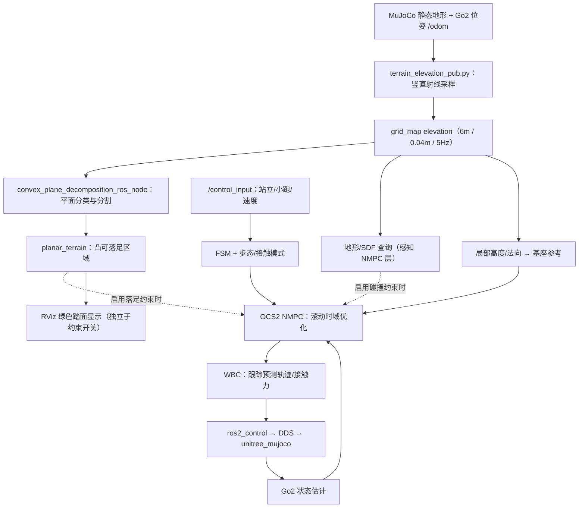
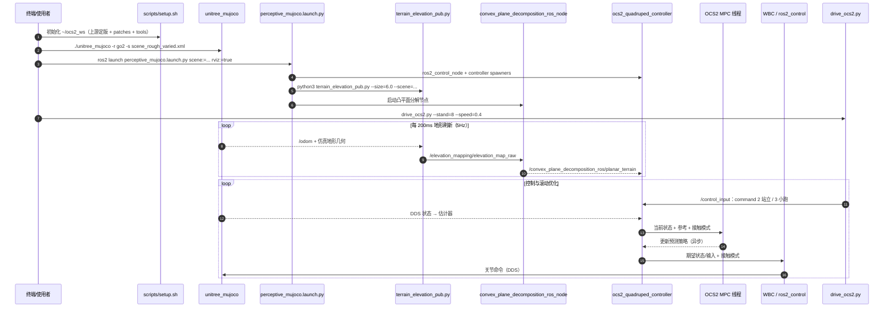

# OCS2 Perceptive NMPC on Unitree Go2｜四足机器人高程图凸分解感知型非线性模型预测控制

## 一句话定义

**这是 Grandia 等人感知型 NMPC 方法在 Unitree Go2 + MuJoCo + ROS 2 Jazzy 上的工程适配**：用局部高程图生成凸可落足区域、摆动避障信息和基座参考，服务于 OCS2 滚动规划与 WBC 跟踪；源码作者没有重新提出原始控制算法。

## 英文缩写速查

| 缩写 | 英文全称 | 简要说明 |
|------|----------|----------|
| NMPC | Nonlinear Model Predictive Control | 结合接触切换与地形约束的非线性滚动优化 |
| OCS2 | Optimal Control for Switched Systems | 适配实现采用的最优控制工具箱 |
| WBC | Whole-Body Control | 将规划状态/力转换到关节命令的全身控制 |
| SDF | Signed Distance Field | 地形障碍净空的可查询距离表示 |
| QP | Quadratic Programming | WBC 层的层级约束优化 |
| ROS 2 | Robot Operating System 2 | Go2 控制、感知和可视化节点运行框架 |
| DDS | Data Distribution Service | `unitree_mujoco` 与 Go2 硬件接口的通信方式 |

## 为什么重要

- 粗糙地形上仅让足端跟踪一个名义落足点不足以保证**踏面内落足**与**摆动过程不擦碰**；非凸、离散高度图也不适宜直接作为大量优化变量。
- 原论文 [Perceptive Locomotion Through Nonlinear Model-Predictive Control](https://arxiv.org/abs/2208.08373)（Grandia、Jenelten、Yang、Farshidian、Hutter；IEEE T-RO 2023）将可踩区域、腿部净空和机体参考变成 MPC 可处理的几何原语，在 **ANYmal** 上进行了仿真和真机实验。
- [Go2 适配仓库](https://github.com/Khaledsweid1/ocs2-perceptive-mpc-go2)提供重建 ROS 2 + OCS2 + MuJoCo 工作区的补丁和工具，是研究**几何感知如何落到控制代码**的工程入口，**不等同于原论文 ANYmal 真机结果**。

## 核心原理

### 高程图到可微地形约束

1. **高度采样**：`terrain_elevation_pub.py` 对 MuJoCo 静态几何体沿竖直方向射线采样，把 `elevation` 层发到 `/elevation_mapping/elevation_map_raw`；launch 取 **6.0 m × 6.0 m、0.04 m/格（150 × 150）、5 Hz**。
2. **可落足分类与凸分解**：`convex_plane_decomposition_ros_node` 对局部地图分类、分割平面和提取凸区域；每个多边形可写为一组半平面不等式 `A p_xy <= b`，供选定接触相中的落足点使用。接触面边缘、高度突变和过陡区域不应被视为稳定踏面。
3. **摆动净空**：SDF 给足端与腿部简化碰撞体提供距离查询，配合摆动足轨迹高度，避免“落足点合法，但途中撞到台阶立面”。
4. **基座参考变形**：局部高度与法向生成机体高度、俯仰/横滚参考；它独立于硬性落足点约束，能提前改变机体姿态与腿部可达域。
5. **接触切换 NMPC → WBC**：OCS2 在接触相位、摩擦与动力学条件下优化预测状态/输入，控制器在高频循环跟踪并输出关节命令。

**几何不是控制效果的充分条件：** 分割并显示绿色区域，证明的是感知输出可视化；还必须核查对应落足约束是否在优化中真正启用，以及求解器、执行层是否可持续跟踪。

### 基于原文与源码的项目流程图

图的项目入口以仓库 README、launch、工具脚本为准；虚线强调适配仓库默认没有打开所有地形约束，而非推断其全部参与优化。

## 工程实践

### 复现顺序与控制时序

项目 README 规定 Ubuntu 24.04 + ROS 2 Jazzy。先 `./scripts/setup.sh ~/ocs2_ws`（下载定版上游源码、施加 `patches/`、复制工具），`colcon build --symlink-install`；再按 **MuJoCo 仿真 → 感知+控制 launch → 站立/小跑驱动** 的顺序启动。具体命令见 [源码归档](../../sources/repos/ocs2-perceptive-mpc-go2.md)。

源码依据：`scripts/setup.sh`、`tools/launch/perceptive_mujoco.launch.py`、`tools/terrain_elevation_pub.py`、`tools/drive_ocs2.py` 及 README；OCS2/WBC 内部时序以项目文档所述调用层为界，**未声称逐行追踪外部依赖内部实现，也未运行本机控制实验**。

### 参数与状态分层

| 项 | 附件/源码给出的信息 | 使用时应核实 |
|---|---|---|
| 高程图 | 6.0 m、0.04 m，5 Hz；由 launch 覆盖 publisher 的 5.0 m 默认值 | 地图世界坐标与 `grid_map` 反向行列映射；静态物体过滤 |
| 速度命令 | `drive_ocs2.py` 20 Hz | `command=2` 站立；`command=3` 小跑；`ly` 控制前向 |
| WBC / 硬件 | 附件称 500 Hz / 1000 Hz | 是否占满实时预算、DDS 是否稳定 |
| NMPC | 附件报告平均 7.2 ms、峰值 12.1 ms（异步） | 与步态时限、约束启用状态对应，不把耗时当成功率 |
| 凸分解 | 附件报告约 3.6 ms | 分割区域质量与过约束风险 |
| 地形约束 | launch `fp:=0` 默认；`fp:=1`、`fc`、`both` 为实验开关 | README/指南说明**足端区域约束默认关闭** |

## 局限与风险

- **主要落足区域约束默认未启用**：`perceptive_mujoco.launch.py` 的 `fp` 缺省为 `0`；官方指南记载启用 FootPlacement 会使 Go2 过约束。项目已演示站立、小跑与部分粗糙地形通过，但**尚不能爬完完整楼梯**。不可把“凸区域图有输出”写成“四足已通过全部地形几何约束的真机验证”。
- **合成高程图不是真机感知**：`terrain_elevation_pub.py` 从 MuJoCo 几何体射线采样，并对未命中/机器人自身结构写入 0.0，尚非融合真实深度噪声与空洞的 elevation_mapping；边界采样错误可翻转坡度方向，直接扰乱基座俯仰。
- **维护归属**：本节点按独立维护者公开的 Go2 适配仓库归类为 `independent-maintainer`（仓库中的中性维护者类别）；这**不代表**原始 NMPC 方法作者所属机构，原论文与其 ETH Zürich 研究团队另见论文引用。
- **来源分层**：附件是 2026-11-14 的二次技术解读（部分公式/表格在导出 PDF 中缺失），原始算法论文是 ANYmal 上的 2023 工作；本仓是 Go2 ROS 2 的实现补丁，作者指南中的数据与附件数字**均未经本次独立复测**。附件未直接提供 Go2 仓库 URL；以公开 README 与启动代码相符作为关联线索，不能断言二者作者关系。
- **实时与可行性**：低频地图可能滞后于快速接触变化；非凸 NMPC 有初值与失败恢复问题。提高摆腿高度不能替代落足区域约束，反之亦然。

## 关联页面

- [OCS2：切换系统最优控制](./ocs2.md) — 求解器与模型层的独立工具箱
- [Nonlinear Model Predictive Control](../methods/nonlinear-model-predictive-control.md) — 非线性约束与滚动优化基础
- [质心 NMPC + WBC 控制栈](../methods/centroidal-nmpc-wbc-stack.md) — 规划器与关节层解耦
- [机器人视觉感知栈选型闭环](../queries/robot-perception-stack-selection-loop.md) — 对照真实传感/高程建图与本项目 MuJoCo 合成高程图的差异
- [Footstep Planning](../concepts/footstep-planning.md) — 名义落足点与局部可行集
- [楼梯与障碍感知行走](../tasks/stair-obstacle-perceptive-locomotion.md) — 感知越障技术路线
- [感知越障纵深路线](../../roadmap/depth-perceptive-locomotion.md) — Stage 1 地形表征与 Stage 3 模型控制替代路径

## 参考来源

- [Go2 原始适配仓库及入口核对](../../sources/repos/ocs2-perceptive-mpc-go2.md)
- [古月居技术解读（用户附件归档）](../../sources/blogs/wechat_guyueju_perceptive_nmpc_convex_decomposition_2026-11-14.md)
- [Grandia 等，Perceptive Locomotion Through Nonlinear Model-Predictive Control（arXiv:2208.08373）](https://arxiv.org/abs/2208.08373)；[IEEE T-RO 2023 DOI](https://doi.org/10.1109/TRO.2023.3275384)
- [OCS2 官方源码](https://github.com/leggedrobotics/ocs2)

## 推荐继续阅读

- [Go2 项目 README 与完整运行指南](https://github.com/Khaledsweid1/ocs2-perceptive-mpc-go2/blob/main/docs/PERCEPTIVE_MPC_GUIDE.md) — 特别关注默认落足约束开关、仿真能力上限及 DDS 环境
- [原始论文全文（方法、约束、求解器与 ANYmal 结果）](https://arxiv.org/abs/2208.08373)
