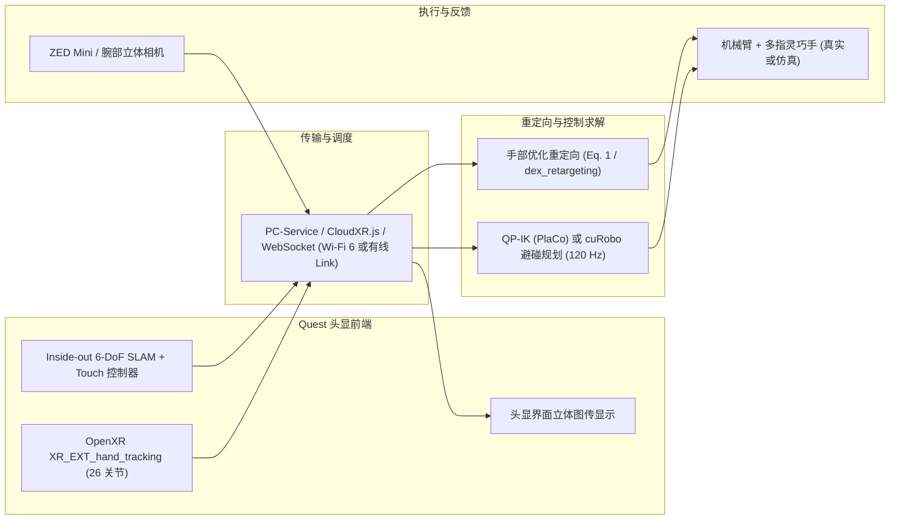
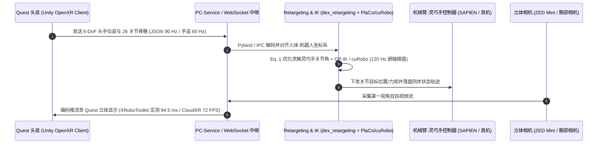

# Meta Quest（Oculus Quest）VR 遥操作与数采体系

在机器人 [模仿学习](../methods/imitation-learning.md) 与 [VLA](../methods/vla.md) 训练中，**Meta Quest（原 Oculus Quest）** 系列消费级 VR 头显已与开源 [OpenXR](./openxr.md) 遥操作软件栈深度耦合，以数百美元级硬件成本提供高帧率 6-DoF 头部/手柄位姿追踪、26 关节裸手骨架估计及第一视角双目立体图传反馈，成为学术与工程团队获取双臂及灵巧操作示范数据的主力载体。

## 一句话定义

**Meta Quest 遥操作体系是以消费级 VR 头显的 inside-out 6-DoF SLAM 位姿追踪与 OpenXR 26 关节手部骨架追踪为前端，经 PC/Orin 中继、运动学重定向与实时逆运动学（QP-IK / cuRobo）驱动机械臂及多指灵巧手的低成本具身数采架构。**

## 英文缩写速查

| 缩写 | 英文全称 | 简要说明 |
|------|----------|----------|
| SLAM | Simultaneous Localization and Mapping | 头显基于板载多目相机实现的 inside-out 6-DoF 空间定位 |
| OpenXR | OpenXR Standard (`XR_EXT_hand_tracking`) | 跨 XR 头显的开放硬件接口规范，标准输出 26 个手部关节位姿 |
| QP-IK | Quadratic Programming Inverse Kinematics | 二次规划逆运动学（如 PlaCo），在关节限位与避碰约束下实时解算臂端指令 |
| CloudXR | NVIDIA CloudXR Runtime | 将仿真器或真机渲染画面经 WebRTC/Wi-Fi 串流至 Quest 3 的底层方案（72 FPS / 25 Mbps） |
| VLA | Vision-Language-Action | 消费大规模高质量遥操作示范的视觉-语言-动作策略模型 |

## 为什么重要

- **打破工业主手成本壁垒：** 传统机械主手与动捕系统动辄数万至数十万美元，而 Quest 系列将全套 6-DoF 双手输入与立体视觉反馈压缩到消费级价位，使多实验室并联采集成为常态。
- **统一 OpenXR 标准与多平台迁移：** 通过 [OpenXR](./openxr.md) 的 `XR_EXT_hand_tracking` 接口输出 26 个手部关节与 Touch 手柄 6-DoF 姿态，同一套上层数采协议可横向兼容 Quest 3、PICO 等不同头显。
- **形成完整开源生态底座：** 围绕头显端追踪、跨机构灵巧手重定向（如 [AnyTeleop](../../sources/papers/anyteleop_arxiv_2307_04577.md) 的 `dex_retargeting`）、低延迟立体图传（[XRoboToolkit](./paper-xrobotoolkit.md)）与标准化数据集落盘（[Isaac Teleop](./isaac-teleop.md) 的 MCAP / LeRobot），已沉淀出可复现的工程工具链。

## 核心原理

### 技术分层：追踪输入、重定向与代表性系统对比

Quest 自身承担的是 **空间感知与立体显示**，真正决定机器人控制质量的是其下游的通信链路、重定向优化与逆运动学框架：

| 代表体系 | 输入与感知前端 | 传输 / 运行时 | 重定向与运动求解 | 关键实测指标（已核对来源） |
|---|---|---|---|---|
| **[XRoboToolkit](./paper-xrobotoolkit.md)**（`arXiv:2508.00097`） | Quest 3 / PICO 头显 6-DoF + OpenXR 26 关节手部 + Touch 手柄 | `Unity Client → PC-Service → Pybind`；JSON **90 Hz**，手部相机 **60 Hz** | `PlaCo` QP-IK + `dex_retargeting` | ZED Mini 到 Quest 3 端到端延时 **94.5 ms**（对比 Open-TeleVision 的 **121.5 ms**） |
| **AnyTeleop**（`arXiv:2307.04577v3`） | 单目 MediaPipe + FrankMocap/PnP 或多相机 `N=50` SMPL-X 融合 | WebSocket + **Meshcat / Three.js** Web Viewer | URDF 向量优化重定向（Eq. 1）+ **cuRobo** 避碰规划（**25 → 120 Hz**） | SAPIEN IL **5/6 胜出**；XArm6-Allegro 真机对比 Telekinesis **8/10 胜 2/10 平**；多相机消融 **109 s / 28.1% → 74 s / 12.5%** |
| **[Isaac Teleop](./isaac-teleop.md)**（NVIDIA） | Quest 3 控制器与裸手追踪 | **CloudXR.js** 串流（**72 FPS / 25 Mbps**） | OpenXR 重定向至 Isaac Sim / Lab 与真机控制器 | 标准输出 **MCAP** 与 **LeRobot** 格式数据集，直接衔接策略训练 |

## 源码运行时序图

以下时序综合开源框架 [XRoboToolkit](../../sources/papers/xrobotoolkit_arxiv_2508_00097.md) 与 [AnyTeleop](../../sources/papers/anyteleop_arxiv_2307_04577.md) 的实际公开运行入口与模块化数据流：

## 工程实践

- **硬件与网络选型：** 为抑制头显视觉反馈滞后引发的晕动症与误碰，通常将 Quest 与工控机置于独占 **Wi-Fi 6/6E** 局域网或采用有线 Link 连接；立体第一视角相机（如 ZED Mini）需保证硬件时间同步与低延迟编码。
- **裸手 vs 手柄分流：** 面对二指夹爪与高节拍 [双臂操作](../tasks/bimanual-manipulation.md)，Touch 手柄的物理扳机与摇杆在起停/夹持开关信号上更可靠；面对多指灵巧手抓取，采用 OpenXR 裸手追踪并叠加 AnyTeleop 式运动学优化重定向（[Motion Retargeting](../concepts/motion-retargeting.md)）。
- **开源与闭源边界：** 下游遥操作与数采栈（AnyTeleop、`dex_retargeting`、XRoboToolkit、Isaac Teleop 数据管线）已广泛开源可复现；而 Quest 头显端操作系统、inside-out SLAM 算法与专有追踪固件属 Meta 商业闭源，应用层仅通过标准 OpenXR / Unity SDK 消费输出状态。

## 局限与风险

- **缺失真实物理力反馈：** 操作者无法通过 Quest 手柄或裸手感知桌面法向冲击与物体滑移阻力，易在插拔、装配等接触密集任务中施加过大接触力（over-torquing）或击碎易碎件。
- **手部追踪遮挡与帧率上限：** Quest 端基于头显相机的手部追踪在双手交叠、伸出视场边缘或强反光下容易丢失置信度；在 XRoboToolkit 实测流中手部相机更新率为 **60 Hz**（对比头显端更窄的高速控制环仍存在采样上限），这也是 AnyTeleop 在多相机消融中证明单一视角易发生 **28.1%** 失败率的原因。
- **依赖低延迟链路：** 一旦无线信道拥塞造成图传突破百毫秒（如从 **94.5 ms** 退化至更高波动抖动），操作者会主动降速甚至产生操作失误，影响 [Teleoperation](../tasks/teleoperation.md) 数据分布一致性。

## 与其他页面的关联

- [Teleoperation](../tasks/teleoperation.md) — VR 遥操作在机器人全身与末端控制中的定位
- [Manipulation](../tasks/manipulation.md) — 单臂灵巧抓取与接触操作目标任务
- [Bimanual Manipulation](../tasks/bimanual-manipulation.md) — 双手/双臂协同遥操作主要落地场景
- [Imitation Learning](../methods/imitation-learning.md) — 消费 Quest 数采轨迹的核心训练范式
- [Motion Retargeting (GMR)](../methods/motion-retargeting-gmr.md) — 跨形态运动学重定向方法延伸
- [VLA](../methods/vla.md) — 大规模 VR 遥操作数据集服务的具身基础模型
- [XRoboToolkit](./paper-xrobotoolkit.md) — 支持 Quest 3 / PICO 的跨平台开源数采参考架构
- [Isaac Teleop](./isaac-teleop.md) — 基于 CloudXR.js 与 MCAP/LeRobot 的仿真/真机遥操框架
- [OpenXR](./openxr.md) — 屏蔽头显硬件差异的 26 关节手部追踪标准接口
- [Pico 4 Ultra（Egocentric 采集）](./pico-4-ultra-egocentric-capture.md) — 消费级 XR 头显横向对照

## 参考来源

- [AnyTeleop 论文全文精读归档（arXiv:2307.04577v3）](../../sources/papers/anyteleop_arxiv_2307_04577.md)
- [XRoboToolkit 论文全文精读归档（arXiv:2508.00097）](../../sources/papers/xrobotoolkit_arxiv_2508_00097.md)
- [模仿学习与数采文献基础归档](../../sources/papers/imitation_learning.md)

## 推荐继续阅读

- AnyTeleop 官方项目页：<https://yzqin.github.io/anyteleop/>
- [演示数据采集指南](../queries/demo-data-collection-guide.md)
- [灵巧操作数据采集指南](../queries/dexterous-data-collection-guide.md)
