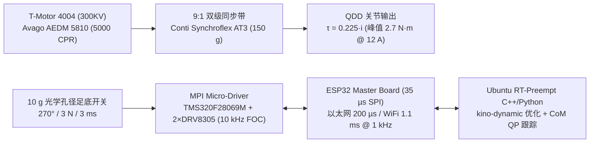
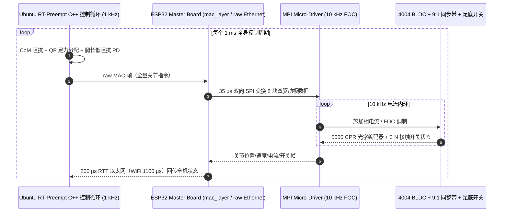

# ODRI Solo / Bolt（开源腿式平台）

## 一句话定义

**ODRI（Open Dynamic Robot Initiative）** 提供面向研究的开源 **扭矩控制** 腿足平台：**Solo**（四足）与 **Bolt**（双足）常被引作 **低惯量、高带宽力控** 的学术基线；主线入口在 **[open-dynamic-robot-initiative](https://github.com/open-dynamic-robot-initiative)**，关节硬件深读仓为 **[open_robot_actuator_hardware](https://github.com/open-dynamic-robot-initiative/open_robot_actuator_hardware)**。

## 英文缩写速查

| 缩写 | 英文全称 | 简要说明 |
|------|----------|----------|
| ODRI | Open Dynamic Robot Initiative | 开源力控腿足与执行器硬件倡议 |
| QDD | Quasi-Direct Drive | 准直驱，低减速比、高背驱动性的作动方案 |
| FOC | Field-Oriented Control | 无刷电机的磁场定向控制 |
| CAN | Controller Area Network | 电机/关节常用的现场总线通信协议 |
| Locomotion | Robot Locomotion | 足式/人形等无轮移动能力的总称 |

## 为什么重要

- **执行器与软件栈解耦**：组织下多仓覆盖驱动、固件、TriFinger 周边与 Solo 等子项目，是 **OCS2 / Pinocchio** 等学术栈常见底层参照（亦见 [开源人形硬件对比](./open-source-humanoid-hardware.md)）。
- **完整开源力控关节**：`open_robot_actuator_hardware` 覆盖机械结构、行星或皮带减速、电机驱动 PCB、编码器、电流环与关节力矩控制、CAN/以太网、装配与测试——是 [开源 QDD 学习路线](../comparisons/open-source-qdd-actuator-projects.md) 中**最优先**的完整关节教材。
- 架构可迁移到小型/中型人形髋、膝、踝原型（原平台为四足，不限于四足形态）。

## 核心原理与执行器硬件要点

| 模块 | 原文实证与开源要点（`arXiv:1910.00093v2` + `open_robot_actuator_hardware`） |
|------|------|
| 机械与传动 | `mechanics/actuator_module_v1`、`quadruped_robot_8dof_v1/v2`、`12dof`：3D 打印壳体 + **9:1** 双级 Conti AT3 同步带；仅电机轴与带轮机加；Solo 整机 **2.2 kg**（~€4,000） |
| 电机与传感 | T-Motor Antigravity 4004（$k_i=0.025\,\text{N}\cdot\text{m/A}$）+ Avago AEDM 5810（5000 CPR 光学编）；足底 **10 g** 光学孔径开关 **3 N / 3 ms**（vs 纯电流估计 ~31 ms） |
| 电气与驱动 | `electronics/micro_driver_electronics`（TMS320F28069M + 2×DRV8305，40 V，10 kHz 双电机 FOC）；ESP32 Master Board 单次 35 µs 双向 SPI 轮询 8 块板 |
| 控制与表征 | 准静态足端刚度指令 20–360 N/m 下最高实测 **266 N/m**（无量纲腿刚度 $\tilde{k}=10.8$，与人类跑步 10–22 可比）；垂直跳跃 **0.65 m** |

## 源码运行时序图

仓库目录 `mechanics/` 与 `electronics/`（`micro_driver_electronics`、`ti_electronics`）提供硬件原理图、PCB 与 STL/CAD，配套固件与 SDK 位于同组织 `master-board`、`odri_control_interface`（BSD-3-Clause）。

## 工程实践

| 项 | 设计启示与验收方法 |
|---|---|
| 接触检测不能只靠电流 | 实测电机电流估力在低阻抗或构型变化时触发阈值延迟约 **31 ms**，足底 **10 g** 光学开关可将延迟压到 **3 ms** |
| 高比功轻量设计 | 2.2 kg 轻质量 + 9:1 同步带抗冲击特性支持高动态跳跃（0.65 m）且可 ±3 圈连续旋转，方便跌倒翻身重构 |
| 网络鲁棒协议 | ESP32 采用无 ACK 多播/广播 raw MAC 帧全量状态覆盖包，即使 WiFi 丢包 4% 仍维持 **1 kHz** 实时性 |

## 常见误区或局限

- **不含电机本体电磁设计**：电机采购成品航模无刷外转子（T-Motor 4004），非自研定转子电磁设计。
- **小功率尺度约束**：单模组峰值 2.7 N·m 适合 2–4 kg 级研究实验平台，无法直接外推至全尺寸成人形高负载关节。
- **低速齿槽转矩**：使用低成本航模无刷电机在极低速精控时会出现一定转矩脉动，文中标注精密慢速操作需主动补偿。

## 开源入口

| 类型 | 链接 |
|------|------|
| 项目门户 | [open-dynamic-robot-initiative.github.io](https://open-dynamic-robot-initiative.github.io) |
| 执行器硬件仓 | [open_robot_actuator_hardware](https://github.com/open-dynamic-robot-initiative/open_robot_actuator_hardware)（BSD-3-Clause） |
| 架构论文 | [arXiv:1910.00093](https://arxiv.org/abs/1910.00093) → 实体页 [Solo 架构论文](./paper-open-torque-controlled-modular-robot-solo.md) |
| 组织 GitHub | [open-dynamic-robot-initiative](https://github.com/open-dynamic-robot-initiative) |

## 关联页面

- [Inverse Dynamics Control（逆动力学控制，IDC）](../methods/inverse-dynamics-control.md) — 扭矩平台将模型和参考转成关节力矩时，需和双编码器、驱动环及接触状态一并验收。

- [Solo 架构论文（arXiv:1910.00093）](./paper-open-torque-controlled-modular-robot-solo.md)
- [开源 QDD 执行器项目对比](../comparisons/open-source-qdd-actuator-projects.md)
- [执行器驱动链选型闭环](../queries/actuator-drive-chain-selection-loop.md)
- [Berkeley Humanoid Lite](./berkeley-humanoid-lite.md)
- [四足机器人](./quadruped-robot.md)
- [开源人形硬件方案对比](./open-source-humanoid-hardware.md)
- [Locomotion](../tasks/locomotion.md)
- [力矩电机设计纵深](../../roadmap/depth-torque-motor-design.md)

## 推荐继续阅读

- 执行器硬件仓 README 与装配/测试文档（以当前主推版本为准）

## 参考来源

- [Solo 架构论文归档（arXiv:1910.00093）](../../sources/papers/open_torque_controlled_modular_robot_solo_arxiv_1910_00093.md)
- [open_robot_actuator_hardware.md](../../sources/repos/open_robot_actuator_hardware.md)
- [open_dynamic_robot_initiative.md](../../sources/sites/open_dynamic_robot_initiative.md)
- [开源 QDD 执行器学习策展](../../sources/personal/open_source_qdd_actuator_learning_curator.md)
- [wechat_jixie_robot_open_source_treasury_issue01_10_robots.md](../../sources/blogs/wechat_jixie_robot_open_source_treasury_issue01_10_robots.md)
