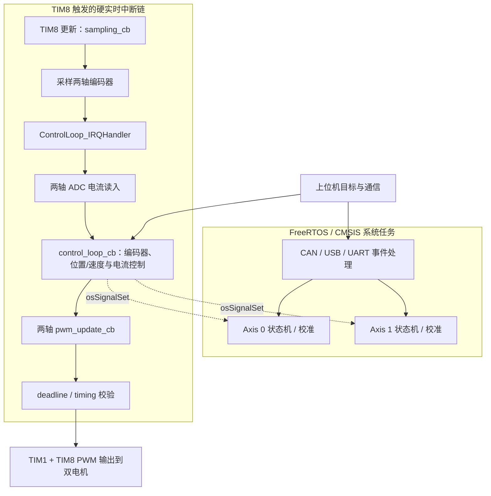
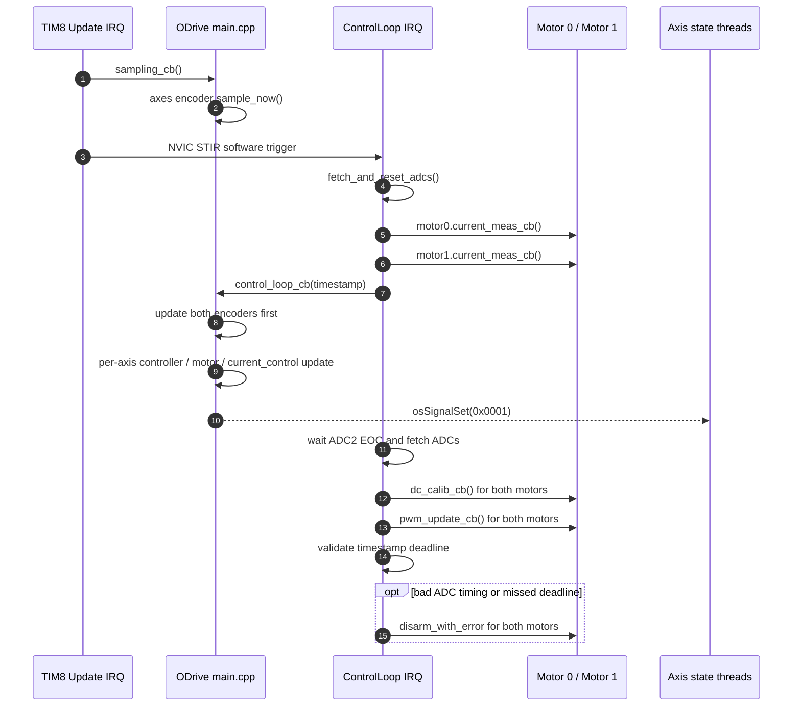

# ODrive v3 Firmware 0.5.6：FreeRTOS 与双轴硬实时控制（RTOS and Dual-Axis FOC）

## 一句话定义

**ODrive v3.x / Firmware 0.5.6** 是公开源码的双轴电机控制器固件：**RTOS 管状态机与通信等后台任务，定时器/ADC/中断保证两轴 FOC 的固定采样与 PWM 更新节拍**。这是针对锁定版本的源码解读，不是对所有 ODrive 产品固件的描述。

## 英文缩写速查

| 缩写 | 英文全称 | 简要说明 |
|---|---|---|
| RTOS | Real-Time Operating System | 负责调度状态机、通信等任务 |
| FOC | Field-Oriented Control | dq 坐标电流控制及调制 |
| ISR | Interrupt Service Routine | 以硬件/软件触发的中断处理例程 |
| ADC | Analog-to-Digital Converter | 采集两轴相电流信号 |
| PWM | Pulse-Width Modulation | 通过 TIM1/TIM8 更新三相功率驱动 |
| WCET | Worst-Case Execution Time | 用于检验控制任务 deadline 的最坏执行时间 |
| CMSIS | Cortex Microcontroller Software Interface Standard | 固件中调用的 RTOS 抽象 API |

## 项目身份

| 项目 | 内容 |
|---|---|
| 机构 | ODrive Robotics（ODrive 机器人公司；官方 GitHub 账号 odriverobotics） |
| 代码版本 | 官方 Git 标签 `fw-v0.5.6`，v3.x 固件 |
| 开源范围 | 公开仓库的 v3.x Firmware；不含新代产品固件 |

## 为什么重要

- **从裸机 FOC 走向完整驱动器**：单环用定时器 + 中断可以实现；双轴校准、状态机、USB/CAN、故障处理共存时，多任务结构提升系统的组织能力。
- **避免将实时性误归功于 RTOS**：在该版本中，电流环的截止时间由 TIM8 触发的控制中断链负责，不是 Axis 线程在固定频率上被调度。
- **理解真机的延迟边界**：一拍内要串行完成两轴控制并安全处理异常；机器人上位机仍要管理轨迹段、插补和通讯周期。

## 核心机制

### 两套时序：RTOS 任务与控制 ISR

| 层 | 执行入口（fw-v0.5.6） | 职责 / 约束 |
|---|---|---|
| RTOS | `main.cpp: main()` 初始化 `osKernelStart()`；`axis.cpp: Axis::start_thread()` → `run_state_machine_loop()` | Axis 状态机、校准、USB/UART/CAN 管理；Axis 线程等待 `osSignalWait` 控制迭代信号 |
| 高优先级采样 | `board.cpp: TIM8_UP_TIM13_IRQHandler()` → `odrv.sampling_cb()` | 在向上计数的时刻采样两轴编码器并触发 `NVIC->STIR`；`sampling_cb` 源码明确不能调用 FreeRTOS API |
| 周期控制 | `board.cpp: ControlLoop_IRQHandler()` → `odrv.control_loop_cb()` | 检查 ADC、输入两轴电流、逐轴更新控制与 FOC、电流校准、写两路 PWM，检查控制截止时间 |
| 失时保护 | `ERROR_BAD_TIMING` / `ERROR_TIMER_UPDATE_MISSED` / `ERROR_CONTROL_DEADLINE_MISSED` | 核对的异常路径都对两台电机执行 `disarm_with_error` |

> ISR 优先级、准确执行时间须基于板级配置与实测；“控制中断优先于通讯任务”不等于整颗 MCU 无中断干扰。

### 周期预算：125 μs，不是 125 μs 全归 FOC 使用

官方 v3 `main.h` 与 `board.h`：

```text
TIM_1_8_CLOCK_HZ      = 168000000
TIM_1_8_PERIOD_CLOCKS = 3500
TIM_1_8_RCR           = 2

CURRENT_MEAS_PERIOD = 2 * 3500 * (2+1) / 168000000
                    = 125 µs = 8 kHz
中心对齐 PWM 载波      = 168000000 / (2 * 3500) = 24 kHz
```

- 一次控制周期相当于 **21,000 个 168 MHz 计数 tick**，并不等于可自由使用的 CPU 预算；中间有 TIM8 的下一次更新事件、ADC 等待等。
- 两轴 PWM 波形由 **TIM1 和 TIM8** 分别产生；两轴电流回调、控制更新与 PWM 写回则在**同一** `ControlLoop_IRQHandler` 中依序进行。
- `board.cpp` 的控制中断收尾用 `timestamp_` 与期望更新进度比较；错过周期时**两轴卸力**。不能只看平均运行时间，需测最坏路径与剩余余量。

### 梯形轨迹：当前目标即时规划，不是多段运动队列

- `Controller::move_to_pos(goal_point)` 调用 `trap_traj_.planTrapezoidal(...)`，并重置 `t_` 与 `trajectory_done_`。
- `INPUT_MODE_TRAP_TRAJ` 检测到新的 `input_pos` 即重新调用 `move_to_pos()`；`TrapezoidalTrajectory::eval()` 在终点给出零速度。
- 因此**等当前段 `trajectory_done` 才发送下一目标**会出现段间停顿，特别是通信有延迟时。需要连续多段运动时可由上位机固定节拍插补，配合 `INPUT_MODE_PASSTHROUGH` / `INPUT_MODE_POS_FILTER`；两轴轨迹同步也应在上层规划。
- 这一限制指此版本内置的梯形轨迹模式，**不代表无法连续位置更新，更不代表外部控制器不能实现插补**。

## 流程总览



## 源码运行时序图

来自 [ODrive 官方固件 fw-v0.5.6](https://github.com/odriverobotics/ODrive/tree/fw-v0.5.6/Firmware) 的实际函数调用；此图表征**一个控制周期的代码路径**，不是 RTOS 抢占调度或真机示波器实测。



**运行入口与复核路径**：`Firmware/MotorControl/main.cpp` 的 `main()` 建立 CMSIS 任务后 `osKernelStart()`；真正的双轴控制从 `Firmware/Board/v3/board.cpp` 的 `TIM8_UP_TIM13_IRQHandler()` 触发，并在 `ControlLoop_IRQHandler()` 串行完成，`axis.cpp` 线程响应完成通知。该图只画已经对照到源码的调用关系。

## 工程实践

1. **做固件剖析时先锁定版本和板型**：该页专指 v3.x / `fw-v0.5.6`。用官方 Board/v3 宏检查 PWM 与 `CURRENT_MEAS_PERIOD`，不要拿其他产品的参数直接套用。
2. **计算时序预算**：在两轴同时带载、通信高负载以及极端路径下测 `task_times`、ISR 运行区间与错过 deadline 次数；对比 125 μs 的真实余量，不能仅用频率倒数证明“够用”。
3. **验证故障处理**：模拟 ADC 不就绪/控制超时，确认两轴能安全停机；双轴机械耦合机构需在上层规划故障后的制动和重启。
4. **设计连续轨迹**：上位机周期插补输入 `input_pos`，记录时间戳、通讯抖动、双轴目标一致性；内置梯形轨迹适合单段点到点，不应假设存在 FIFO 与 lookahead。

## 局限与风险

- **版本边界**：官方公开 GitHub 仓库针对 v3.x，README 标注该系列不再积极开发，新代 ODrive Pro/S1/Micro 固件不包含在公开源码中。
- **静态核查不等于性能实测**：8 kHz 是从宏计算的周期，不是双轴带载 WCET、CAN 通讯上限或闭环带宽测量。
- **非独立任务**：两轴 FOC 在同一中断中前后执行，Axis 任务不是高速电流控制的运行入口；把 RTOS 优先级调高不能替代 ISR 时序设计。
- **运动层缺口**：`INPUT_MODE_TRAP_TRAJ` 缺多段队列/两轴插补器，连续轨迹需额外上位机算法、缓冲与同步机制。

## 关联页面

- [磁场定向控制 FOC](../concepts/field-oriented-control.md) — 电流环与 dq 变换
- [控制环路延迟建模](../formalizations/control-loop-latency-modeling.md) — deadline、采样与 PWM 更新预算
- [PID Control](../methods/pid-control.md) — 位置/速度/电流控制器调节
- [关节执行器参数辨识](../methods/joint-actuator-parameter-identification.md) — 驱动建模与台架验证
- [电机底软总线与协议](../overview/motor-drive-firmware-bus-protocols.md) — 运动命令与底层控制边界
- [SimpleFOC](./simplefoc.md) / [moteus](./moteus.md) — 不同嵌入式 FOC 架构对照
- [执行器驱动链选型闭环](../queries/actuator-drive-chain-selection-loop.md) — 解释 FOC/协议与上层指令的工程分界
- [力矩电机设计纵深 Stage 3](../../roadmap/depth-torque-motor-design.md) — 电流环和嵌入式固件的工程路线

## 参考来源

- [ODrive v3 Firmware 0.5.6 官方源码通读归档](../../sources/repos/odrive-v3-firmware-v0-5-6.md) — 锁定版本、文件、函数与核对范围
- [比特Z：《ODrive 跑实时操作系统，真妙！》](../../sources/blogs/wechat-bitz-odrive-freertos-2026-09-24.md) — 2026-09-24 文章来源及摘要，二手观点已与官方代码分开
- [官方仓库 `fw-v0.5.6`](https://github.com/odriverobotics/ODrive/tree/fw-v0.5.6) — 全部代码、CHANGELOG、许可证

## 推荐继续阅读

- [`Board/v3/board.cpp`：时钟采样与控制中断](https://github.com/odriverobotics/ODrive/blob/fw-v0.5.6/Firmware/Board/v3/board.cpp)
- [`MotorControl/main.cpp`：采样与控制回调](https://github.com/odriverobotics/ODrive/blob/fw-v0.5.6/Firmware/MotorControl/main.cpp)
- [`controller.cpp`：梯形轨迹与多种输入模式](https://github.com/odriverobotics/ODrive/blob/fw-v0.5.6/Firmware/MotorControl/controller.cpp)
