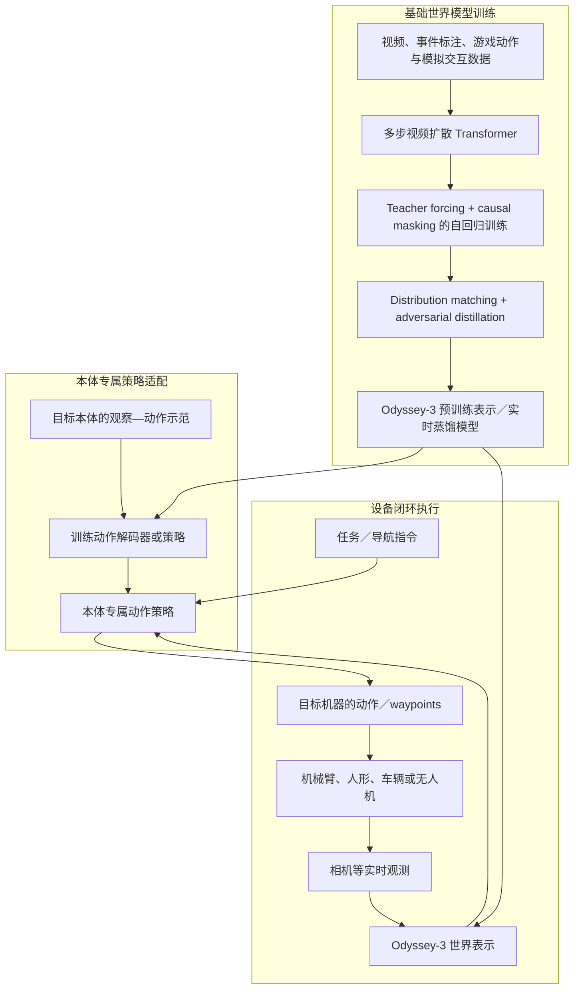

# Odyssey-3：通用物理智能基础世界模型

## 一句话定义

**Odyssey-3** 是 Odyssey 于 2026-09-15 首次公布、2026-10-08 开放研究预览的自回归视频扩散 Transformer 基础世界模型。它学习视觉世界的时序演化；要执行机器人任务，仍须用**本体专属的观察—动作数据**训练动作解码器或策略，并进行闭环评测。

## 英文缩写速查

| 缩写 | 英文全称 | 简要说明 |
|---|---|---|
| WM | World Model | 从历史观测及条件输入预测世界演化的模型 |
| AR | Autoregressive | 自回归：以历史观测继续预测下一段状态 |
| DiT | Diffusion Transformer | 使用 Transformer 骨干的视频扩散模型 |
| VLA | Vision-Language-Action | 官方人形实验所测试的视觉语言动作基线类别 |
| V2V | Video-to-Video | Physics-IQ 的视频续写评测设置 |
| I2V | Image-to-Video | Physics-IQ 的图像生成视频评测设置 |
| WBC | Whole-Body Control | 人形机器人全身控制，属 Flexion 的适配与工程范围 |

## 为什么重要

它检验了一条不同于「每类机器人各自大规模收集动作数据」的路径：从跨场景视觉观察中预训练可迁移的物理表征，再让本体/任务特有的动作策略学习如何使用这些表征。官方把机械臂、人形、驾驶、无人机与游戏放在同一个基础模型家族之上，但**不是说统一的动作头可以直接控制所有设备**。

对机器人研究，真正值得验证的是：同样演示数据预算下的任务成功率、异常恢复与分布外泛化，以及视觉世界模型所带来的推理时延和控制频率代价，而不只是生成视频的质量。

## 核心原理

### 1. 视觉世界模型的学习

2026-10-08 官方文章把训练过程划为以下技术阶段：

1. **数据构成：** 网络视频及时间定位的结构化事件标注、与键鼠输入对齐的游戏视频、带描述和元信息的模拟刚体交互数据。
2. **扩散建模：** 用多步视频扩散 Transformer 学习场景和物体随时间的运动、相互作用，以时序 prompt/control 条件化。
3. **自回归扩展：** 通过 teacher forcing 和 causal masking，从既有观测继续预测未来状态，允许动作输入影响场景进展。
4. **加速：** 后训练使用 distribution matching 与 adversarial distillation，形成可少步实时交互的蒸馏模型。

公开文章描述了**方法层级**，并未给出可复现的完整网络配置、算力预算或训练脚本，不应补造隐藏层数或部署推理频率。

### 2. 世界知识如何变成动作

把基础世界模型的内部表示送入**针对目标系统训练的 action decoder / policy**，用该系统的观察—动作样本教会它输出机器所需控制。

- **机械臂：** 官方用数十小时示范适配多个操作任务；观察到失误抓取后重新调整夹爪等演示之外的恢复动作。
- **人形：** 合作方 **Flexion** 使用数十小时遥操作数据，在 Odyssey-3 表示上研发自身的机器人学习及控制策略；Flexion 的全身控制研发不能算作 Odyssey-3 单独完成的底层控制能力。
- **驾驶：** 冻结预训练主干，以 20 小时**模拟驾驶数据**训练轻量 waypoint policy 并在印度道路闭环运行。
- **无人机：** 依据最近的相机画面、运动状态与导航提示，利用数十小时**模拟飞行**样本训练 waypoint policy，演示在室内模拟场景。
- **游戏：** 以视频帧与键鼠输入训练游戏策略；官方举例约 2 小时 GTA V 移动演示迁移至 Red Dead Redemption 2 骑马表现。

特别注意：文章明确写到驾驶、游戏实验冻结基础模型；不能未经资料支持便宣称**所有**人形/机械臂适配实验都冻结 backbone。

## 流程总览

以下为两篇官方文章共同支持的**方法级**数据与控制流；不是开放源码的运行调用图。

不同任务的输入、输出空间和执行器各不相同；上图仅抽象官方明确描述的公共主干与独立动作策略，**不代表多个本体共用同一控制权重**。

## 实验与评测

| 官方展示 | 已公开的数字/结果 | 正确解读 |
|---|---|---|
| 机械臂操作 | 数十小时示范；演示失误恢复 | 未公开统一多任务成功率及独立复现协议 |
| Flexion 人形操作 | 数十小时遥操作；光照扰动下优于被测 VLA 基线 | 未披露具体 VLA 名称、逐任务数值；效果包含 Flexion 的研究与工程 |
| 印度真实道路闭环 | 20 小时模拟驾驶训练；sim-only 策略在两次安全员接管间行驶距离约为 real-data 策略的 **77%** | **不是 77% 成功率**，也不是无安全员自动驾驶 |
| 无人机导航 | 数十小时仿真数据；仿真室内避障飞行 | 不等于真机无人机验证 |
| 游戏跨场景迁移 | 约 2 小时 GTA 录像训练的移动策略在 RDR2 展示骑马 | 定性演示，不是系统性跨游戏 benchmark |
| Physics-IQ Verified V2V | **Odyssey-3 Pro 66.1**（2026-10-07 官方引用榜单） | Pro、V2V、特定时间点；并非机器控制分数 |
| Physics-IQ I2V | **Odyssey-3 Pro 54.7** | 与 V2V 不可混为同一指标 |
| WorldMark | Odyssey-3 在四类中三类排名第一：第一人称风格化 **77.2**，第三人称真实 **79.0**，第三人称风格化 **76.3** | 第一人称真实为 **80.6**，**不是第一**；官方按 13 个指标平均 |
| 多相机合成 | 模型训练 checkpoint 在 **100 步**后可同时生成三个前向相机视图 | 早期生成实验，并非真实传感器保真度认证 |

所有排名和控制能力数据均来自 Odyssey 官方披露。世界生成 benchmark 不直接证明真实物理准确性、安全性或 Sim2Real 成功率。

## 工程实践

对于希望借鉴其技术路线的机器人研究者：

1. **先分清任务：** 世界模型负责预测/表征环境；动作专家负责输出某个机器的控制变量。
2. **明确数据预算：** 记录设备特定示范小时数、相机/状态输入、动作类型与采样频率；原文没有公布的参数应标为未知。
3. **隔离比较项：** 同一机器人、相同示范数据、同一任务与扰动集合，对比世界模型预训练表征与直接 VLA/模仿学习策略。
4. **真机部署门槛：** 单独测试闭环延迟、碰撞/急停、恢复、泛化与安全接管；驾驶的安全员接管间距离不能被替代成通用成功率。
5. **获取状态：** 官网开放 [研究预览](https://experience.odyssey.systems/) 与 [开发者入口](https://developer.odyssey.ml/)，但截至 2026-11-08 官方项目文章未提供 Odyssey-3 模型权重、训练/推理代码或完整训练数据下载。研究预览/API 接洽不等于开源。

## 源码运行时序图

**不适用（截至本次核查未公开 Odyssey-3 可运行训练或部署源码）**。上述 Mermaid 是根据官方技术描述归纳的方法流程，不能冒充代码级运行时序。

## 局限与风险

- 官方展示了不同**专用**策略共用基础世界模型的可能性；没有公布跨所有本体的统一动作空间或单策略部署证据。
- 对 Flexion 人形的光照泛化比较，缺少具体 baseline 名称和可独立复核的成功率表，不能夸大为全面超越 VLA。
- 对于驾驶，20 小时训练数据来自模拟，评估道路为真实印度道路且存在安全员；不可将现场演示视为自动驾驶产品级安全验证。
- 生成效果与物理保真度存在区别；Physics-IQ/WorldMark 只能支持各自测试协议下的结论。
- 论文式完整架构、复现配置和模型权重尚不可公开核查。此节点是**官方技术说明深读**，不是开源论文复现。

## 关联页面

- [World Action Models（世界-动作模型）](../concepts/world-action-models.md) — 区分世界预测与行动决策
- [Video Prediction Policy 2（VPP2）](./video-prediction-policy-2.md) — 视觉预测与动作专家结合的另一条研究路线

## 参考来源

- [Odyssey-3：2026-09-15 首发原文归档](../../sources/sites/odyssey-3-introducing.md)
- [Odyssey-3：2026-10-08 发布与评测原文归档](../../sources/sites/odyssey-3.md)
- [官方首发全文](https://odyssey.systems/introducing-odyssey-3)
- [官方研究预览发布全文](https://odyssey.systems/meet-odyssey-3)

## 推荐继续阅读

- [Introducing Odyssey-3: A General-Purpose Physical Intelligence](https://odyssey.systems/introducing-odyssey-3)
- [Meet Odyssey-3: Our Most Powerful Foundation World Model](https://odyssey.systems/meet-odyssey-3)
