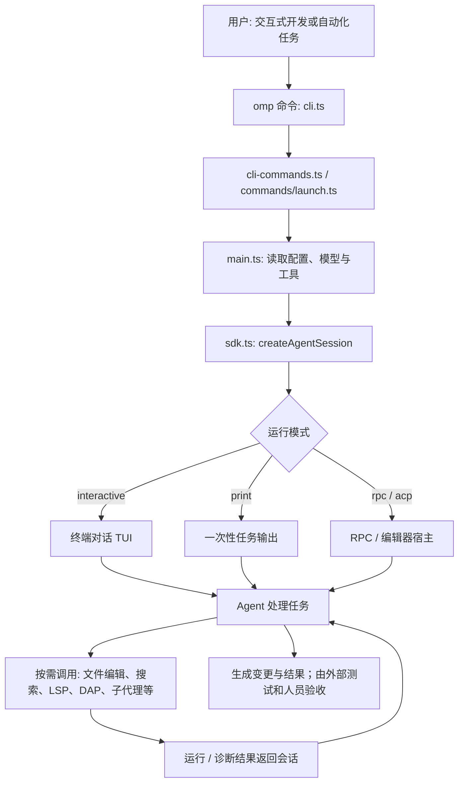
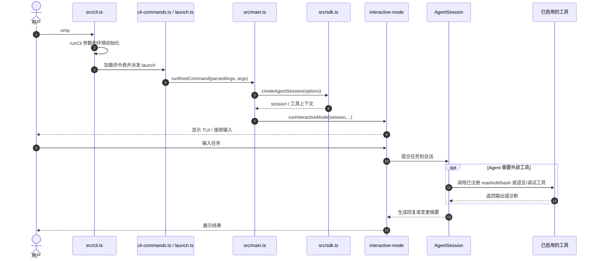

# oh-my-pi：将 IDE 能力接入终端的编码代理 / Oh My Pi — Coding Agent with the IDE Wired In

## 一句话定义

**oh-my-pi（OMP）** 是 [can1357/oh-my-pi](https://github.com/can1357/oh-my-pi) 开源的终端 **Coding Agent**：基于 [Pi](https://github.com/badlogic/pi-mono)，把 IDE 级语言服务与调试能力、代码/文件工具、子代理和多模型会话编排合到同一个可操作的开发代理运行时；它**不是机器人策略或实时控制器**。

## 英文缩写速查

| 缩写 | 英文全称 | 简要说明 |
|------|----------|----------|
| OMP | Oh My Pi | 本项目简称与 `omp` CLI 命令名称 |
| IDE | Integrated Development Environment | 通过语言服务、调试和工程导航提供编辑器级信息 |
| LSP | Language Server Protocol | 用语言服务器反馈符号、诊断等代码信息 |
| DAP | Debug Adapter Protocol | 通过调试适配器接入断点、调试状态等操作 |
| MCP | Model Context Protocol | 接入外部工具与资源的协议 |
| ACP | Agent Client Protocol | 使编辑器等宿主能够驱动 Agent 的协议 |
| TUI | Terminal User Interface | 交互式终端界面 |

## 为什么重要

- **代码执行与反馈在一个闭环中：** OMP 的定位不只是对 LLM 发送代码片段，而是让代理在代码工具、LSP 诊断、DAP 调试和评审之间迭代。是否启用对应能力取决于环境与任务，并非每轮都调用。
- **复杂仓库可拆分上下文：** 官方 README 的 `task` 子代理在隔离工作树处理任务，可回传结构化结果；相较纯粹串行对话，这提供了更明确的任务分工，但会增加协调、资源与审查成本。
- **对 Robotics_Notebooks 与机器人软件有迁移价值：** 可协助处理 ROS 2、Python/C++、仿真工具链的代码导航和 PR 检查；合并前仍应遵守 [Coding Agent 验证闭环](../methods/coding-agent-verification-loops.md)，核对 lint、测试、仿真与必要的真机安全条件。

## 核心原理

### 模块与边界

| 层次 | 官方机制 / 代码位置 | 作用 |
|---|---|---|
| 运行分发 | `packages/coding-agent/package.json` → `src/cli.ts` | 命令 `omp` 的可运行入口，Bun 环境初始化与子进程分流 |
| CLI 路由 | `src/cli-commands.ts` → `src/commands/launch.ts` | 将普通终端输入路由到启动命令，解析参数 |
| 会话与模型 | `src/main.ts` → `src/sdk.ts:createAgentSession` | 加载模型、认证、工具与扩展，创建 AgentSession |
| 交互和自动化 | `src/modes/interactive-mode`、`print-mode`、`rpc/rpc-mode`、`acp/acp-mode` | TUI 对话、一次性任务、RPC、编辑器接入；按启动模式择一 |
| 代码与系统工具 | README 所述 LSP/DAP、read/edit/bash/grep、原生检索 | 代理的工具面；执行结果进入会话反馈 |
| 并行与记忆 | README 所述 `task`、advisor、memory | 可选子代理分工、第二意见与上下文沉淀 |

**开源状态：** 官方仓库公开源代码与 MIT LICENSE；包清单声明 npm `@oh-my-pi/pi-coding-agent`（本次查看版本为 19.1.0）；README 说明第三方或 vendored 部分受各自条款约束。官方宣称的性能和基准未由本站独立复测。

### 流程总览（按官方 README 和入口代码整理）



## 工程实践

**最小使用示例（官方 README）：**

```bash
# macOS / Linux 官方安装入口；执行前先检查脚本来源与权限
curl -fsSL https://omp.sh/install | sh

# 或使用 Bun 包管理器安装（README 推荐）
bun install -g @oh-my-pi/pi-coding-agent

# 启动交互式编码代理
omp
```

README 另给出 Homebrew、Nix 与 Windows PowerShell 入口；使用 Bun 源码分发时，官方标注 Bun 版本至少 1.4.4。开始工作前配置模型 Provider / 密钥，并确认工作区权限，不应给不可信代码库默认的无限制 shell / 网络访问。

**源码入口：** `packages/coding-agent/src/cli.ts:runCli` → `src/cli-commands.ts` → `src/commands/launch.ts:Index.run` → `src/main.ts:runRootCommand` → `createAgentSession`。运行后按交互、print、RPC 或 ACP 模式分流；这是从公开源码确认的入口级执行路径，不是实际运行 profiling。

**机器人仓库建议（迁移推论，非项目官方基准）：** 将 OMP 限定在仿真、文档、测试和代码修改等研发环境；对 C++ 实时控制、驱动器通信和安全限位应另设可复现测试、代码评审、最小权限与真机审批。不要用 LSP 零错误等价于“可安全上机”。

## 源码运行时序图

以下为官方可运行入口的**交互模式关键时序**，依据 [`src/cli.ts`](https://github.com/can1357/oh-my-pi/blob/main/packages/coding-agent/src/cli.ts)、[`src/cli-commands.ts`](https://github.com/can1357/oh-my-pi/blob/main/packages/coding-agent/src/cli-commands.ts)、[`src/commands/launch.ts`](https://github.com/can1357/oh-my-pi/blob/main/packages/coding-agent/src/commands/launch.ts)、[`src/main.ts`](https://github.com/can1357/oh-my-pi/blob/main/packages/coding-agent/src/main.ts) 和 [`src/sdk.ts`](https://github.com/can1357/oh-my-pi/blob/main/packages/coding-agent/src/sdk.ts) 绘制；工具调用分支表示**可选**行为。



## 局限与风险

- **安全边界：** 代理可操作终端、浏览器、桌面和项目文件。对外部仓库提示注入、恶意脚本、凭证暴露与工具权限应按最小权限原则隔离；不应把功能丰富误当作默认安全。
- **验证边界：** 上游 README 描述的性能、benchmarks 和工具数量是**发布者自述**，且随版本变化；本文没有独立执行性能评测、安装、真实代码任务或安全审计。
- **实时边界：** 这是软件开发代理，不支持以 LSP/DAP 或 shell 测试结果证明 ROS 2 控制环时延、动力学可行性、仿真到真机可靠性。
- **版本变化：** 项目处于活跃迭代，文档、Provider、编译方式、功能开关与 CLI 标志应以对应版本官方源码与说明为准。

## 关联页面

- [Coding Agent 验证闭环](../methods/coding-agent-verification-loops.md) — 区分自动生成代码与实际验收证据。
- [Claude Code 动态多 Agent 工作流](../methods/claude-code-dynamic-workflows.md) — 从编排方式比较子代理与任务隔离。
- [Agentic Coding 时代的软件工程基础](../concepts/agentic-coding-software-fundamentals.md) — 代码产出之外的人类取舍能力。
- [Open Code Review](open-code-review.md) — 与 OMP 内置代码评审做工具链对照。

## 参考来源

- [oh-my-pi 官方 GitHub README 与源码研读归档](../../sources/repos/oh-my-pi.md)
- [omp.sh 官方项目页核对](../../sources/sites/omp-sh.md)
- [官方源码与安装说明](https://github.com/can1357/oh-my-pi)

## 推荐继续阅读

- [OMP 官方 README（英文）](https://github.com/can1357/oh-my-pi/blob/main/README.md)
- [OMP 官方 README（中文）](https://github.com/can1357/oh-my-pi/blob/main/README.zh-CN.md)
- [项目文档](https://omp.sh/)
