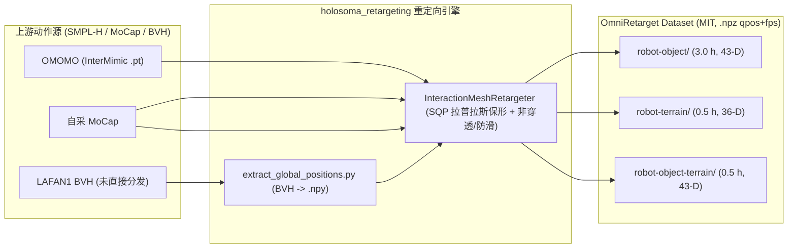
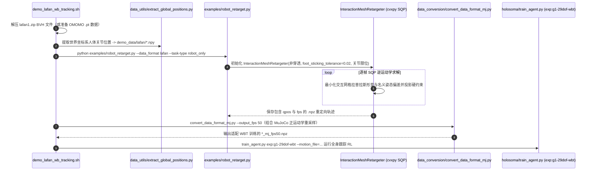

# OmniRetarget Dataset（G1 交互重定向轨迹）

## 一句话定义

**OmniRetarget Dataset**（<https://huggingface.co/datasets/omniretarget/OmniRetarget_Dataset>）是 Amazon FAR 为 **[OmniRetarget](./paper-hrl-stack-03-omniretarget.md)**（arXiv:2509.26633）在 Hugging Face 发布的 **MIT 许可** Unitree G1 交互式重定向轨迹数据集（公开总规模 **4.0 小时**，36/43 维 `.npz` 广义坐标与帧率），其未发布的 LAFAN1 子集与多格式自主重定向管线开源托管在 [holosoma](./holosoma.md) 的 `holosoma_retargeting/` 模块中。

## 英文缩写速查

| 缩写 | 英文全称 | 简要说明 |
|------|----------|----------|
| HF | Hugging Face | 托管 OmniRetarget 公开 4.0 小时轨迹与模型的平台 |
| G1 | Unitree G1 Humanoid | 数据集面向的 29 自由度人形机器人平台 |
| MoCap | Motion Capture | 动作捕捉，自采与 OMOMO / LAFAN1 源动作来源 |
| WBT | Whole-Body Tracking | 下游全身跟踪强化学习任务（如 `holosoma` `exp:g1-29dof-wbt`） |
| SQP | Sequential Quadratic Programming | `InteractionMeshRetargeter` 用于线性化求解接触与碰撞约束的方法 |
| OMOMO | Object Motion with Object interaction | `robot-object/`（3.0 h）子集所源自的人–物搬运动捕数据集 |

## 为什么重要

- **填补交互保持重定向公开数据缺口**：相比仅覆盖平地行走的常规人形动捕库，数据集直接提供 **搬运物体（`robot-object`）**、**复杂地形攀爬（`robot-terrain`）** 与 **人–物–地形联合交互（`robot-object-terrain`）** 三类高接触密度的 G1 广义位姿序列。
- **开箱即用且可复现补全**：虽然 Ubisoft LAFAN1 因授权限制未能打包上线，但官方在 `amazon-far/holosoma` 中完整公开了交互网格重定向器（`InteractionMeshRetargeter`）及 `demo_lafan_wb_tracking.sh` 一键式 BVH 提取、重定向与 50 Hz 转换训练链路。
- **轻量简洁的数据契约**：全部轨迹统一为仅含 `qpos` 与 `fps` 的 `.npz` 文件，可视化所需的 URDF/SDF/OBJ 剥离至独立的 `models/` 目录，便于对接不同物理引擎和 RL 框架。

## 核心原理与数据规范

### 1. 数据集元信息与公开子集规模

| 属性 / 子集 | 说明与数值 |
|-------------|------------|
| **许可证** | **MIT**（HF 仓库公布子集；LAFAN1 原始动作因 Ubisoft 许可条款需用户自行下载重定向） |
| **模态与文件格式** | 单轨迹 `.npz`，包含 `fps`（标量帧率，如 `30.0`）与 `qpos`（`[T, D]` NumPy 数组） |
| **`qpos` 状态定义** | 机器人 **36-D**（浮动基 `[qw, qx, qy, qz, x, y, z]` 7-D + 29 关节角）+ 可选交互物体 **7-D** 位姿（`D = 36` 无物体 / `D = 43` 含物体） |
| **`robot-object/`** | 搬运交互物体轨迹（源数据：OMOMO，**3.0 小时**） |
| **`robot-terrain/`** | 复杂障碍与台面攀爬动态动作（源数据：自采 MoCap，**0.5 小时**） |
| **`robot-object-terrain/`** | 同时包含物体操作与地形交互（源数据：自采 MoCap，**0.5 小时**） |
| **重定向就绪度** | HF 公开版合计 **4.0 小时**（论文总规模约 8–9+ 小时，其中正文分项口径为约 2.78 h OMOMO + 1 h 自采 + 4.6 h LAFAN1，与 HF 页面标注分项存在统计口径差异） |

### 2. 数据生成与使用总览

## 源码运行时序图

以下时序基于 `amazon-far/holosoma`（`src/holosoma_retargeting/` 与 `demo_scripts/demo_lafan_wb_tracking.sh`）及 HF `OmniRetarget_Dataset` 实测链路。

## 工程实践

1. **直接拉取 HF 4.0 小时公开子集与可视化验证**
   - 通过 `git lfs install && git clone https://huggingface.co/datasets/omniretarget/OmniRetarget_Dataset` 拉取数据，使用 `np.load(...)` 读取 `qpos` 与 `fps`；如需排查碰撞或足底接触，可在安装 `drake` 后于数据根目录运行 `python visualize.py`（支持切换 `task = "object" | "terrain" | "object-terrain"`）并在 Meshcat 中查看 `models/` 资产渲染效果。
2. **自主补全 LAFAN1 或自定义 MoCap 数据**
   - 当需要论文完整的 LAFAN1 动作覆盖或迁移到自定义机器人骨架时，使用 `amazon-far/holosoma` 中的 `demo_scripts/demo_lafan_wb_tracking.sh` 或 `holosoma_retargeting/examples/parallel_robot_retarget.py`；针对 LAFAN1 数据的足滑特性，需参照官方 README 显式调松 `--retargeter.foot-sticking-tolerance 0.02`。
3. **接入全身跟踪（WBT）训练前必须执行 50 Hz MuJoCo 格式转换**
   - 公开的 HF `.npz` 与 `robot_retarget.py` 原始输出仅记录 `qpos` 与 `fps`，接入 `holosoma` 的 `exp:g1-29dof-wbt` RL 训练器前需经过 `convert_data_format_mj.py --output_fps 50` 重采样并生成全连杆运动学参考。

## 常见误区与局限

- **公开版并非完整的 8–9+ 小时全量集合**：HuggingFace 数据集仅提供 MIT 许可且获准分发的 **4.0 小时**子集（`robot-object` 3.0 h + `robot-terrain` 0.5 h + `robot-object-terrain` 0.5 h）；另外论文正文的时长统计（约 2.78 h OMOMO + 1 h 自采 + 4.6 h LAFAN1）与 HF 数据卡分项数字存在约 0.2 h 的汇总口径差异，引用时需指明来源。
- **运动学保形不等于真机动力学可行**：`InteractionMeshRetargeter` 本质上是在几何层面求解带接触与关节约束的 SQP 逆运动学（`cvxpy`），不会直接保证闭环力矩或高频动力学冲击完全满足真机限制，上机部署前仍需通过 `holosoma` 等 RL 全身跟踪策略弥合动力学差距。
- **LAFAN1 不可免下载直用**：数据集卡明确禁止直接二次打包发布 LAFAN1 重定向轨迹，必须先从 Ubisoft 原仓获取 `.bvh` 再经 `extract_global_positions.py` 与 `robot_retarget.py` 本地重跑。

## 关联页面

- **对应方法论文**：[OmniRetarget 论文实体](./paper-hrl-stack-03-omniretarget.md)
- **官方代码与重定向引擎**：[holosoma](./holosoma.md)
- **上游动作数据源**：[OMOMO 数据集](./omomo-dataset.md)、[LaFAN1 数据集](./lafan1-dataset.md)
- **领域横向对比与概念**：[人形参考运动数据集对比](../comparisons/humanoid-reference-motion-datasets.md)、[Motion Retargeting](../concepts/motion-retargeting.md)、[Loco-Manipulation](../tasks/loco-manipulation.md)、[Unitree G1](./unitree-g1.md)

## 参考来源

- [holosoma_omniretarget_reading.md](../../sources/repos/holosoma_omniretarget_reading.md)（`amazon-far/holosoma` 重定向代码与 HF 数据集卡精读归档）
- [omniretarget_arxiv_2509_26633.md](../../sources/papers/omniretarget_arxiv_2509_26633.md)（OmniRetarget 论文全文归档）
- [omniretarget-dataset-huggingface.md](../../sources/sites/omniretarget-dataset-huggingface.md)

## 推荐继续阅读

- [OmniRetarget Dataset (Hugging Face)](https://huggingface.co/datasets/omniretarget/OmniRetarget_Dataset)
- [amazon-far/holosoma 官方代码库](https://github.com/amazon-far/holosoma)
- [OmniRetarget 论文 arXiv:2509.26633](https://arxiv.org/abs/2509.26633)
