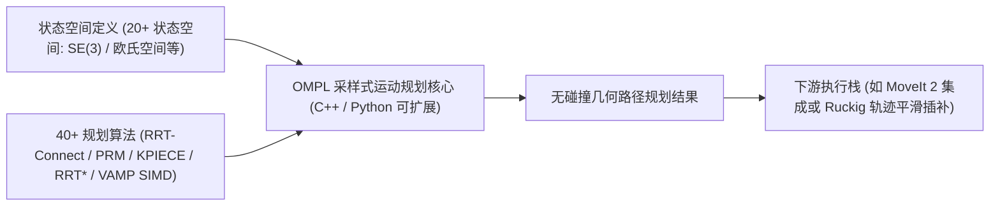
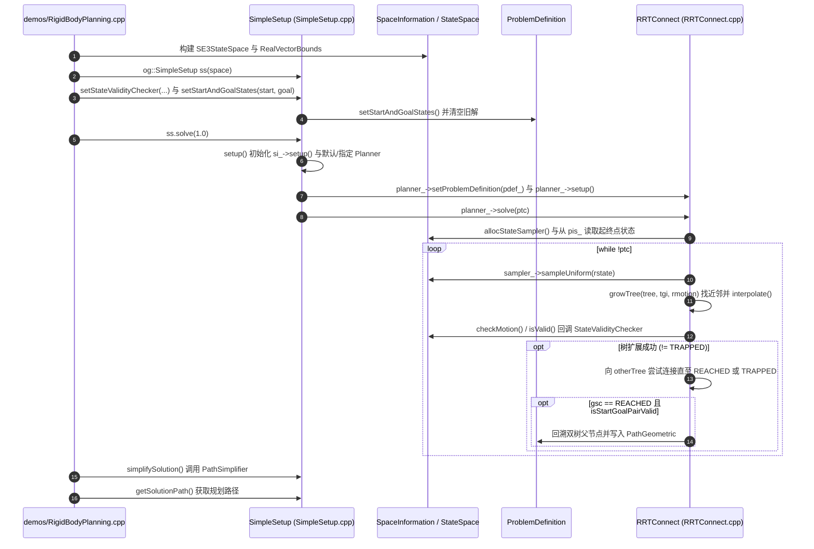

# OMPL（Open Motion Planning Library）

**OMPL（Open Motion Planning Library）**（[https://github.com/ompl/ompl](https://github.com/ompl/ompl)）是 [Qt历险记《C/C++ 运动控制开源库分类整理》](https://mp.weixin.qq.com/s/RIXXIltQ0ABoBO_OVLZTZw) 中「ROS / ROS2 运动控制栈」一类的项目。本页以**一手资料**为准，文章说法放在「文章说法核对」里对照。

## 一句话定义

**OMPL 是开源的采样式运动规划库：提供 40 多种规划算法（RRT-Connect、PRM、KPIECE、RRT* 等）与 20 多种状态空间（SE(3)、欧氏空间等），可用 Python 与 C++ 扩展自定义规划器与状态空间。**

## 英文缩写速查

| 缩写 | 英文全称 | 简要说明 |
|------|----------|----------|
| OTG | Online Trajectory Generation | 在线轨迹生成 |
| PTP | Point-To-Point | 点到点运动 |

## 为什么重要

- 在文章的选型建议里属于「ROS / ROS2 运动控制栈」；横向对比见 [C/C++ 运动控制开源库地图：轨迹生成、动力学、工业总线与 ROS 栈（一手资料核对版）](../overview/cpp-motion-control-open-source-libraries-map.md)。

## 一手资料

| 项 | 内容 |
|----|------|
| **仓库 / 官方来源** | [https://github.com/ompl/ompl](https://github.com/ompl/ompl) |
| **许可（核查）** | BSD（LICENSE：OMPL released as Open Source under the terms of a 3-clause BSD license） |
| **最近提交** | 2026-10-31 |
| **论文 / 文档** | Şucan、Moll、Kavraki，The Open Motion Planning Library（IEEE RA Magazine 2012，DOI 10.1109/MRA.2012.2205651，README 徽章给出） |

**一手描述：** README：over 40 sampling-based planning algorithms across more than 20 state spaces；easily extensible（Python 与 C++）；README 另提 VAMP 的 SIMD 加速规划可达毫秒级。

## 文章说法核对

- **文章：** C++；BSD；采样型路径规划（RRT、PRM 等），避障路径规划，不做平滑插补。
- 许可：LICENSE 写 3-clause BSD，与文章一致。
- 「不做平滑插补」是文章对 OMPL 与 Ruckig / pyplcopen 的分工说法（路径规划 vs 轨迹插补）；README 描述的是规划，未讨论插补，该分工按文章保留。

## 机制与架构图

## 源码运行时序图

以下时序基于官方仓库 `ompl/ompl`（`main` 分支）中 `demos/RigidBodyPlanning.cpp`、`src/ompl/geometric/src/SimpleSetup.cpp` 与 `src/ompl/geometric/planners/rrt/src/RRTConnect.cpp` 核对整理：

关键复现入口：编译运行 `demos/RigidBodyPlanning.cpp` 中的 `planWithSimpleSetup()`（也可直接调用 `ob::SpaceInformation` + `ob::ProblemDefinition` + `og::RRTConnect` 完成显式组装）。

## 关联页面
- [RRT](../methods/rrt.md) / [RRT*](../methods/rrt-star.md) / [RRT-Connect](../methods/rrt-connect.md) / [Informed RRT*](../methods/informed-rrt-star.md) — OMPL 中常见采样规划算法的方法页

- [moveit2](../entities/moveit2.md)
- [robotics-library-rl](../entities/robotics-library-rl.md)
- [ruckig](../entities/ruckig.md)
- [cpp-motion-control-open-source-libraries-map](../overview/cpp-motion-control-open-source-libraries-map.md)

## 参考来源

- [ompl.md](../../sources/repos/ompl.md)
- [wechat_qt_adventure_cpp_motion_control_libs_2026-11-02.md](../../sources/blogs/wechat_qt_adventure_cpp_motion_control_libs_2026-11-02.md)
- [原文（微信公众号）](https://mp.weixin.qq.com/s/RIXXIltQ0ABoBO_OVLZTZw)
