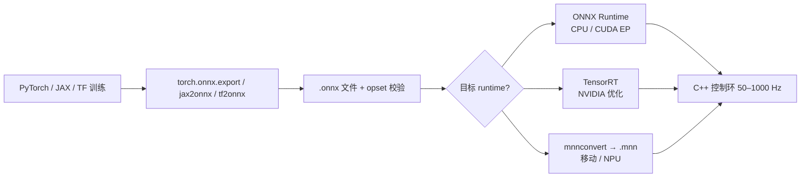

# ONNX

**ONNX**（**Open Neural Network Exchange**）是由社区维护、托管于 **LF AI & Data Foundation**（Linux Foundation 旗下）的 **开放模型交换标准**。它定义可扩展的 **计算图 IR**、内置 **operators** 与 **`.onnx` 文件格式**，让开发者在 [PyTorch](./pytorch.md)、TensorFlow、JAX 等框架中训练后，将同一模型交给 [ONNX Runtime](./onnxruntime.md)、TensorRT、[MNN](./mnn.md) 等运行时与硬件优化栈执行。在机器人研究与工程中，ONNX 最常作为 **Sim2Real 部署层的格式契约**——训练仍在 Python，机载控制环在 C++ 中以固定频率调用推理。本页以 onnx/onnx 仓库的 README、`docs/IR.md`、`docs/Versioning.md` 等官方文档为一手依据（2026-11-07 核对）。

## 一句话定义

跨框架的 **神经网络模型中间表示（IR）与文件格式**：解耦「在哪训练」与「在哪推理」。

## 英文缩写速查

| 缩写 | 英文全称 | 简要说明 |
|------|----------|----------|
| ONNX | Open Neural Network Exchange | 开放神经网络交换格式 |
| IR | Intermediate Representation | 中间表示：计算图 + 标准数据类型，规范见 `docs/IR.md` |
| opset | Operator Set | 算子集；以 (domain, version) 标识，模型须在 `opset_import` 中声明 |
| ONNX-ML | ONNX Machine Learning | 在 ONNX 算子集上加入非神经网络的经典 ML 算子 |
| ORT | ONNX Runtime | 微软主导的 ONNX 兼容推理引擎 |
| EP | Execution Provider | ORT 中对接 CPU/GPU/TensorRT 等的后端插件 |
| TRT | TensorRT | NVIDIA 推理编译器，ONNX parser 是其主要入口 |
| SSA | Static Single Assignment | ONNX 图要求节点输出名唯一（静态单赋值） |
| RL | Reinforcement Learning | 人形策略常经 ONNX 导出上机 |
| Sim2Real | Simulation to Real | 仿真训练策略迁移真机，ONNX 为常见导出格式 |

## 为什么重要

- **训练框架解耦**：机器人学习代码多默认 PyTorch/JAX；真机栈多为 C++/Rust + 固定控制周期。ONNX 是二者之间最通用的 **标准化桥梁**。官方 Overview 的动机是：各框架的图表示互相孤立，研究到生产需要转换，通用 IR 让开发者按阶段选框架、硬件厂商按统一格式做优化。
- **硬件优化入口**：NVIDIA TensorRT 的 ONNX parser、Intel OpenVINO、移动端 MNN 等均可直接或经一步转换消费 ONNX，便于触达 **FP16/INT8** 与算子融合。
- **生态成熟**：本库大量实体（[AMP_mjlab](./amp-mjlab.md)、[wbc-fsm 源](../../sources/repos/wbc_fsm.md)、[Open Duck Playground](./open-duck-playground.md)、[RF-DETR](./rf-detr.md)）的 README 均以 **导出 ONNX** 作为部署里程碑（这些页为二手引用，本页未逐个回查）。
- **规范透明**：算子、版本与 IR 文档公开，便于排查「导出成功但 runtime 缺算子」类问题。

## 核心原理

### 规范的三个组件与模型结构

`docs/IR.md` 把 ONNX 规范拆成：① 可扩展计算图模型，② 标准数据类型，③ 内置算子；前两者合称 IR。顶层是 `ModelProto`，主要字段：`ir_version`、`opset_import`、`producer_name/version`、`graph`、`metadata_props`、`functions` 等。

1. **图（GraphProto）**：描述无副作用的计算；节点按拓扑序排列、无环，**节点输出名必须唯一（SSA）**；`initializer` 保存权重，与同名 graph input 并存时表示该输入的默认值。
2. **算子集（Operator Sets）**：每个算子集由 (domain, version) 标识，空域名 `""` 是 ONNX 标准域。**模型必须显式列出所依赖的算子集，实现必须支持其中全部算子，否则拒绝该模型。** 已发布为 STABLE 的算子，其语法与语义不得在后续版本改变；算子以 `domain.op_type:since_version` 标识。
3. **形状与动态轴**：顶层图输入输出**必须带形状（至少给出秩）**；每一维可以是整数 `dim_value`，也可以是符号 `dim_param`（动态轴，同名符号在整张图里表示同一数值）。
4. **数据类型**：元素类型含 float16/32/64、bfloat16、多种 float8、float4/6、int2–int64、uint2–uint64、complex、string、bool；输入输出类型含稠密张量、sequence、map、optional。
5. **外部数据**：大常量张量可写到模型文件之外，路径相对于模型文件。
6. **语义**：推理模型是**无状态函数**（除随机数状态），同输入同输出；**自 IR 版本 7 起模型格式也能携带训练信息**（`TrainingInfoProto`），README 则说明当前项目重点仍是推理（scoring）。
7. **ONNX vs ONNX-ML**：前者覆盖神经网络；**ONNX-ML** 额外纳入经典 ML 的类型与算子，二者区别主要在默认算子集。
8. **Python 参考包**：`pip install onnx` 提供读写（`onnx.load` / `onnx.save`）、`onnx.checker` 校验、外部数据转换等；**不等于**推理引擎本身。wheel 为 abi3，Python 3.12 起。
9. **周边资源**：[Model Zoo](https://github.com/onnx/models)、[tutorials](https://github.com/onnx/tutorials)、[supported-tools 列表](https://onnx.ai/supported-tools)。

### 版本三层：IR、opset、模型

`docs/Versioning.md`：IR 规范、算子集与模型各自版本化；IR 版本用单调递增整数；opset 是算子集合的不可变快照；模型版本由生产者按语义化版本维护，输入输出的破坏性改动须升主版本号。**ONNX 软件包版本（如 1.22）≠ IR 版本 ≠ opset 版本**，三者要分开看。

### 与 runtime 的版本对应（2026-11-07）

| 项 | 取值 | 出处 |
|----|------|------|
| ONNX 软件包最新版 | 1.23.2（2026-10-06）；main 分支 1.24.0 | PyPI / `VERSION_NUMBER` |
| ORT 1.28.0 → 1.31.1 捆绑的 ONNX | 1.22.0；ORT main 已升 1.23.2 | 各 tag 的 `cmake/deps.txt` |
| TensorRT 11.x 的 ONNX parser | ONNX 1.20.0，**最大 opset 25，向后兼容到 opset 9** | TensorRT 文档 Opset Guide |
| ORT 的 opset 支持 | 支持最新发布 ONNX 规范的全部 opset，且至少 opset 7 以上 | ORT Compatibility 页 |
| main 分支算子集 | 已有 opset 28 的条目 | `docs/Operators.md` |

## 工程实践

### 与机器人研究与工程的关系

- **人形 RL / tracking**：[Whole-Body Tracking Pipeline](../concepts/whole-body-tracking-pipeline.md) 真机层普遍写「**ONNX / TensorRT @ ~50 Hz**」；策略冻结，观测构造需与训练 **字节级一致**。
- **感知**：[RF-DETR](./rf-detr.md) 等工作流 `model.export(format="onnx")` 后再接 TensorRT/Jetson；极小 ROI 分类见 [OCEC](./ocec.md)（24×40 开/闭眼 ONNX 级联）。
- **浏览器 Demo**：[BotLab MotionCanvas](../entities/botlab-motioncanvas.md) 用 **ONNX Runtime WASM/WebGPU** 在浏览器跑 policy。
- **格式 ≠ 运行时**：`.onnx` 文件需由 [ONNX Runtime](./onnxruntime.md)、[TensorRT](./tensorrt.md)、[MNN](./mnn.md) 等 **执行**；选型见 [机载推理 Runtime 选型](../comparisons/onnxruntime-vs-mnn-vs-tensorrt.md)。

### 导出与自检清单

1. **选 opset**：导出时取框架所能支持的较新 opset，同时落在目标 runtime 的支持区间内——例如要给 TensorRT 11.x 用，上限是 opset 25、下限 opset 9；ORT 至少 opset 7。实践上可从 17–21 试起（推测，非官方推荐值），再用目标 runtime 实测。
2. **固定控制环的形状**：为实时环导出 batch=1 与静态输入维；若保留 `dim_param`，后续 TensorRT 需要显式的 min/opt/max profile（见 [TensorRT](./tensorrt.md)）。
3. **三步校验**：`onnx.checker.check_model` 做规范合规检查（ORT 文档的 PyTorch 示例即如此）；用 ORT CPU 对拍 PyTorch 输出；再在目标 EP / TensorRT 上对拍，并统计 p95 延迟。
4. **记录元数据**：`metadata_props` 可写训练代码版本、观测归一化常数等（建议用反向域名前缀的键，规范推荐如 `ai.onnxruntime.key1` 的形式），减少上机时「模型与归一化脱节」。
5. **大模型**：权重超过 protobuf 单文件限制时用外部数据格式，部署时须把 `.onnx` 与数据文件一并拷贝，路径相对模型文件。

最小例（改写自 ORT 官方 Python 入门页的导出与校验片段；模型与路径为占位）：

```python
import torch, onnx, onnxruntime as ort
torch.onnx.export(policy, torch.randn(1, obs_dim), "policy.onnx",
                  input_names=["obs"], output_names=["action"], opset_version=17)
onnx.checker.check_model(onnx.load("policy.onnx"))
sess = ort.InferenceSession("policy.onnx", providers=["CPUExecutionProvider"])
action = sess.run(None, {"obs": obs_numpy})[0]
```

## 局限与常见误区

- **导出图 ≠ 训练图**：动态控制流、自定义 autograd、部分 RNN/注意力实现可能无法无损导出；应在目标 EP 上做 **代表性输入 benchmark**。
- **opset 与算子覆盖**：新算子可能仅部分 runtime 支持；runtime 声明的 opset 区间不等于每个算子在每个 EP 上都有高效实现，Jetson/ARM 上尤需提前验证。
- **规范里的两处易混点**：规范说推理模型是无状态函数，所以有状态的 RNN 隐状态须作为显式输入/输出在控制环里传递（推测的工程做法，规范本身只保证语义）；ONNX 规范校验通过也不保证数值与训练框架一致。
- **观测预处理不在 ONNX 内**：许多机器人仓库（如 [ProtoMotions](./protomotions.md)）选择把 obs 计算 bake 进 ONNX，或在外部 C++ 复刻；混用会导致 sim2real 隐性 gap。
- **版本锁定**：机载项目常固定 `onnxruntime==x.y.z`（见 [jackhan-feap-mujoco-deployment](./jackhan-feap-mujoco-deployment.md)）；升级需回归全链路。ORT 1.28–1.31 均捆绑 **ONNX 1.22.0**，但 ORT 官方兼容性页的版本对照表只更新到 1.20，查版本以 `cmake/deps.txt` 为准。
- **恶意模型**：ORT 文档提醒其只校验模型符合 ONNX 规范，不保证安全；不可信来源的 `.onnx` 应先检查并在隔离环境测试。
- **本页没有核对**：算子逐项语义（`docs/Operators.md` 体量巨大）、`onnx.proto` 具体字段号、各转换器（tf2onnx、skl2onnx）的覆盖度。

## 流程总览（训练框架 → 机载推理）



## 关联页面

- [ONNX Runtime](./onnxruntime.md)
- [TensorRT](./tensorrt.md)
- [MNN](./mnn.md)
- [PyTorch](./pytorch.md)
- [Exploy](./exploy.md)
- [TensorFlow](./tensorflow.md)
- [Sim2Real](../concepts/sim2real.md)
- [Whole-Body Tracking Pipeline](../concepts/whole-body-tracking-pipeline.md)
- [ONNX Runtime vs MNN vs TensorRT](../comparisons/onnxruntime-vs-mnn-vs-tensorrt.md)

## 参考来源

- [ONNX 官方站点与规范索引](../../sources/repos/onnx-official.md)（原文，已通读）
- [ONNX Runtime 官方站点与文档索引](../../sources/repos/onnxruntime-official.md)（opset 支持、版本对应）
- [NVIDIA TensorRT 官方站点与文档索引](../../sources/repos/tensorrt-official.md)（TensorRT 的 ONNX opset 区间）
- [ONNX Runtime v1.28.0 Release 归档](../../sources/repos/onnxruntime-v1.28.0.md)（旧版本锚点，Release Notes 本次无法复核）

## 推荐继续阅读

- [ONNX 官网](https://onnx.ai/)
- [ONNX IR 规范](https://github.com/onnx/onnx/blob/main/docs/IR.md) 与 [Versioning](https://github.com/onnx/onnx/blob/main/docs/Versioning.md)
- [ONNX 文档（Python / IR）](https://onnx.ai/onnx/)
- [ONNX Operators 索引](https://onnx.ai/onnx/operators/index.html)
- [Supported Tools](https://onnx.ai/supported-tools)
