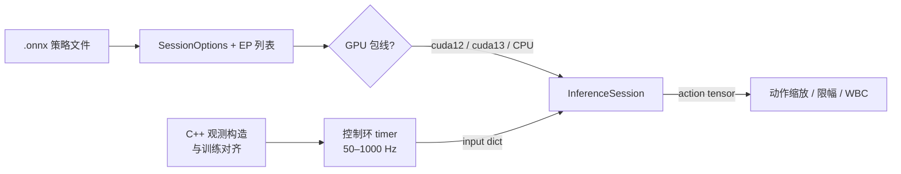

# ONNX Runtime

**ONNX Runtime**（常缩写 **ORT**）是由 **Microsoft** 主导的开源 **ONNX 推理与训练加速引擎**。它提供 **Python、C++、C#、Java、JavaScript** 等 API，运行于 **Linux、Windows、macOS、iOS、Android 与 Web 浏览器**，并通过 **Execution Provider（EP）** 将算子调度到 CPU、CUDA、TensorRT、OpenVINO、CoreML、NNAPI 等后端。在机器人栈中，ORT 是 **「PyTorch 训练 → ONNX 导出 → C++ 机载 50–1000 Hz 控制环」** 路径上最常见的 **生产级 runtime**。

本库此前的版本锚点是 **[v1.28.0](../../sources/repos/onnxruntime-v1.28.0.md)**（2026-07-25）— **CUDA 13 打包** 与 **轻量 CUDA 部署**。2026-11-07 核对 PyPI：此后又发布 1.29.0（2026-08-17）、1.30.0（2026-09-10）、1.31.0（2026-10-09）、**1.31.1（2026-10-26，当前最新，`requires_python >= 3.11`）**；`cmake/deps.txt` 显示 1.28.0 到 1.31.1 都捆绑 **ONNX 1.22.0**，main 分支已升到 1.23.2。1.29–1.31 的 Release Notes 本次无法取得（github.com 对本环境返回 403），其变更未核对。以下「1.28.0」小节仍据旧专档。

## 一句话定义

**执行 `.onnx` 模型的跨平台推理引擎**：用统一 Session API + 可插拔 EP，把同一模型跑到数据中心 GPU、Jetson、x86 工控机或浏览器 WASM。

## 英文缩写速查

| 缩写 | 英文全称 | 简要说明 |
|------|----------|----------|
| ORT | ONNX Runtime | ONNX 开源推理/训练加速引擎 |
| EP | Execution Provider | 算子后端插件（CPU、CUDA、TensorRT 等） |
| ONNX | Open Neural Network Exchange | ORT 消费的开放模型格式 |
| CUDA | Compute Unified Device Architecture | NVIDIA GPU 栈；1.28 起分 cuda12/cuda13 包 |
| GPU | Graphics Processing Unit | CUDA / TensorRT EP 的算力基础 |
| WASM | WebAssembly | ORT Web 在浏览器中的执行载体 |
| RL | Reinforcement Learning | 策略网络机载推理的主要应用场景 |
| FP16 | 16-bit Floating Point | 半精度推理，降延迟与显存 |

## 为什么重要？

- **机器人 C++ 部署事实标准**：本库 [wbc-fsm 源](../../sources/repos/wbc_fsm.md)（G1 WBC）、[AMP_mjlab](./amp-mjlab.md)、[Unitree RL mjlab 源](../../sources/repos/unitree_rl_mjlab.md) 等均默认 **ONNX Runtime** 在 x86/aarch64 上跑策略。
- **跨平台一份模型**：同一 `.onnx` 可在仿真工作站（CUDA EP）与真机 Orin/PC2（CPU 或 TensorRT EP）复用，降低 sim2real 分叉。
- **性能调优纵深**：除默认优化外，支持图优化、量化与 EP 特有配置；NVIDIA 场景常叠加 **TensorRT EP** 进一步融合算子。
- **Web / 边端扩展**：**ONNX Runtime Web**（WASM/WebGPU）支撑浏览器内 policy 演示（如 [BotLab MotionCanvas](./botlab-motioncanvas.md)）。
- **部署体积可收敛（1.28+）**：CUDA EP 将 **cuDNN / cuFFT** 改为运行时可选、**不再链接 `nvrtc`**，配合 **CUDA 13** 官方包，利于机载/边缘 **瘦镜像**。

## 核心结构（官方能力归纳）

官方推理路径可记为三步：**导出 ONNX → `InferenceSession` 加载运行 →（可选）EP/图优化调优**。运行时对图做优化后按 EP **划分子图** 到 CPU/GPU 等后端（详见 [文档首页](https://onnxruntime.ai/docs/) 与 [EP 文档](https://onnxruntime.ai/docs/execution-providers/)）。

1. **InferenceSession**：加载 `.onnx`，`session.run()` 喂入输入名→张量字典，得输出列表。
2. **Execution Providers**：构造时 `providers=['CUDAExecutionProvider','CPUExecutionProvider']` 按优先级注册；运行时可用 `set_providers()` 改序（会重建 session）。`get_providers()` / `get_provider_options()` 查询当前配置。
3. **包分发**：
   - `pip install onnxruntime` — CPU 默认构建
   - `onnxruntime-gpu` — CUDA 路径。**CUDA EP 文档：自 1.27 起 PyPI / NuGet 的 GPU 包默认用 CUDA 13.0 构建；另发 CUDA 12.x 包（用 12.8 构建，要求 CUDA ≥12.8）**；ORT 与 cuDNN 主版本必须匹配（8.x 与 9.x 不兼容，与 PyTorch 同环境时要对齐其 CUDA/cuDNN）；Python 入门页仍写「默认 CUDA 12.x」，两页口径不一致，以所装版本为准。
   - `onnxruntime-genai` — 生成式/LLM 扩展
   - **同一环境勿同时装 CPU 与 GPU 包**
4. **多框架导出**：PyTorch `torch.onnx.export`、TF `tf2onnx`、sklearn `skl2onnx`（[Python 入门](https://onnxruntime.ai/docs/get-started/with-python.html)）。
5. **语言绑定**：C++ 适合机载实时环；Python 适合导出后数值对齐与回归测试；官方提供 **Web JS** 与 **C# Console** QuickStart 模板。
6. **训练分支**：Large Model Training 与 On-Device Training（机器人控制环较少直接用）。
7. **验证责任**：ORT 校验 ONNX 规范；**精度、性能与恶意图风险** 由部署方自测（文档首页明确提示）。

## 版本锚点：1.28.0（CUDA 13 与轻量部署）

> 依据 [Release v1.28.0](https://github.com/microsoft/onnxruntime/releases/tag/v1.28.0) / [来源专档](../../sources/repos/onnxruntime-v1.28.0.md)。开源状态：**已开源（MIT）**。

| 维度 | 要点 |
|------|------|
| **格式依赖** | 捆绑 **ONNX 1.22.0**（已由 tag 的 `deps.txt` 证实）；旧专档另写 protobuf 6.33.5，而 `v1.28.0/cmake/deps.txt` 里 protobuf 为 v21.12（v1.31.1 为 v33.6），口径不同，未能判定；图优化器 opset 检查同步 |
| **CUDA 双线包** | Release 同时提供 **`gpu_cuda12`** 与 **`gpu_cuda13`** 预编译资产；NPM 改从 CUDA 13 pipeline 发布（CUDA EP 文档把「GPU 包默认 CUDA 13」的起点写作 1.27） |
| **轻量 redistributable** | CUDA EP：**cuDNN / cuFFT 运行时可选**；**取消 `nvrtc` 链接** → 所需 CUDA redistributable 显著缩小 |
| **体积信号（Linux x64）** | 官方 `gpu_cuda13` tgz **~230 MB** vs `gpu_cuda12` **~404 MB**（Release Assets；作选型参考，非延迟保证） |
| **API 边界** | `OrtModelPackageApi` 进入 **experimental** C API，机载生产勿依赖 |
| **破坏性清理** | SkipLayerNorm strict mode 废弃；CUDA EP 移除 TensorRT fused causal attention kernels 等 |

**机载选型口诀**：新 CUDA 13 / 瘦镜像优先评估 **cuda13 包 + 可选 cuDNN**；仍钉 JetPack/CUDA 12 栈则继续 **`cuda12` 资产**，并做全链路回归后再升 1.28。

## 工程实践

| 步骤 | 建议 |
|------|------|
| 1. 钉版本 | README / lockfile 写死 minor（如历史工程 `1.19.2` / `1.22.0`）；升 **1.28** 须单独回归 |
| 2. 选包 | CPU-only 工控 → CPU 包；NVIDIA 仿真/机载 → 按驱动选 **cuda12 或 cuda13** GPU 包 |
| 3. 验 EP | `session.get_providers()` 确认 CUDA/TensorRT 是否真正注册；勿假设装了 gpu wheel 就走 GPU |
| 4. 对齐观测 | 关节顺序、history、归一化在 C++ 侧与训练脚本一致（见 [robot-policy-debug-playbook](../queries/robot-policy-debug-playbook.md)） |
| 5. 固定 shape | 控制环优先 **batch=1 + 静态输入维**，利于 EP 优化与延迟抖动控制 |
| 6. 安全升级 | 1.28 含大量内存安全与输入校验修复；生产升级宜读完整 Release Notes |
| 7. 线程与自旋 | 官方默认 `intra_op_num_threads = 0`（物理核数）、`ORT_SEQUENTIAL`；线程池默认自旋等待，延迟更低但更耗 CPU 与功耗，可设 `session.intra_op.allow_spinning` 或 `spin_duration_us` / `spin_backoff_max`。在与 ROS 2、状态估计共享 CPU 的机载板上，应显式限线程并实测抖动（建议，推测） |
| 8. 图优化 | 默认 `ORT_ENABLE_ALL`：Basic（常量折叠、冗余节点消除、Conv 融合）在 EP 划分前，Extended 只作用于分到 CPU/CUDA/ROCm 的节点，Layout（NCHWc）仅 CPU；可离线保存优化后的图，缩短启动 |
| 9. CUDA Graph | CUDA EP 的 `enable_cuda_graph`（Preview）可去掉逐 kernel 启动开销，但要求整个模型都划到 CUDA EP、输入输出形状与地址固定、必须用 IOBinding——与固定 batch=1 的控制环契合 |
| 10. TensorRT EP | 注册顺序 `['TensorrtExecutionProvider','CUDAExecutionProvider']`（CUDA 兜底 TRT 不支持的节点）；首次建引擎很慢，**务必开 `trt_engine_cache_enable` / `trt_timing_cache_enable`**。官方 SD UNet 示例会话创建时间：无缓存 384 s → timing cache 42 s → engine cache 9 s → 嵌入式 EPContext 模型 1.9 s（不同模型数值不同）；缓存不可跨硬件、ORT 版本、TensorRT 版本移植；`trt_fp16_enable`、`trt_int8_enable`（非 QDQ 模型需校准表）；与 **TensorRT 11.x 配合须用 ORT ≥1.27** |

## 与机器人研究与工程的关系

- **全身控制**：[Whole-Body Tracking Pipeline](../concepts/whole-body-tracking-pipeline.md) 推理层常与 TensorRT 并列；ORT 负责 **通用 ONNX 算子执行**，TensorRT 负责 **NVIDIA 图优化**。
- **版本钉扎**：工程 README 常固定 minor 版本（如 `onnxruntime==1.19.2` / `1.22.0`），因算子支持与 ABI 随版本变化；**1.28.0** 是当前本库文档跟踪锚点，不等于各仓库已升级。
- **观测对齐**：ORT 只执行网络前向；**关节顺序、history stack、归一化** 须在 C++ 侧与训练脚本一致。
- **与格式分工**：[ONNX](./onnx.md) 定义文件；ORT 执行文件——勿混淆二者。1.28 捆绑 ONNX **1.22.0**，导出 opset 须与目标 runtime 对齐。

## 常见误区或局限

- **「装了 onnxruntime-gpu 就一定走 GPU」**：须确认 `session.get_providers()`、CUDA 驱动与 EP 注册顺序。
- **CUDA 13 包 ≠ 所有板卡可用**：Jetson / 旧 JetPack 可能仍在 CUDA 12；选错包线会直接无法加载。
- **TensorRT EP ≠ 纯 TensorRT**：仍经 ORT 调度，图被切成「TRT 子图 + CUDA/CPU 子图」，边界处有拷贝（推测）；极致延迟场景可能选择 **trtexec 独立引擎**（见对比页）。含 NonMaxSuppression、NonZero、RoiAlign 等数据依赖形状（DDS）算子的模型，官方建议用 `trt_op_types_to_exclude` 让它们回落 CUDA/CPU EP。
- **引擎缓存是「一次性资产」**：模型、精度、workspace、GPU、ORT 版本、TensorRT 版本任一变化都要清缓存重建；`trt_engine_hw_compatible` 不适用于 Jetson Orin（官方文档）。
- **官方兼容性页过期**：ORT 文档的「ORT–ONNX 版本对照表」只到 ORT 1.20，现行对应关系请看对应 tag 的 `cmake/deps.txt`。
- **动态 shape**：部分导出图带动态轴；机载实时环通常 **固定 batch=1 与固定输入 shape** 以利于 EP 优化。
- **浏览器与机载差异**：WebGPU/WASM 算子覆盖与桌面 CUDA 不同，不能假设 demo 与真机数值完全一致。
- **实验 API**：Model Package 相关 C API 仍可能变更，勿写入机载硬依赖。

## 流程总览（导出 → Session → 控制环）

## 关联页面

- [ONNX](./onnx.md)
- [TensorRT](./tensorrt.md)
- [MNN](./mnn.md)
- [OpenVINO](./openvino.md)
- [PyTorch](./pytorch.md)
- [AMP_mjlab](./amp-mjlab.md)
- [jackhan-feap-mujoco-deployment](./jackhan-feap-mujoco-deployment.md)
- [BotLab MotionCanvas](./botlab-motioncanvas.md)
- [Sim2Real](../concepts/sim2real.md)
- [ONNX Runtime vs MNN vs TensorRT](../comparisons/onnxruntime-vs-mnn-vs-tensorrt.md)
- [Lot Vulture](./lotvulture.md) — 设施侧边缘 CV：`vulturevision` 以 ORT 做车位占用推理（Community CPU / Commercial GPU）。

## 参考来源

- [ONNX Runtime 官方站点与文档索引](../../sources/repos/onnxruntime-official.md)（原文，已通读；2026-11-07 复核 README / 文档 / deps.txt / PyPI）
- [ONNX Runtime v1.28.0 Release 归档](../../sources/repos/onnxruntime-v1.28.0.md)（旧版本锚点，Release Notes 本次无法复核）
- [NVIDIA TensorRT 官方站点与文档索引](../../sources/repos/tensorrt-official.md)（TensorRT 11 与 ORT 配合要求）

## 推荐继续阅读

- [ONNX Runtime 文档：TensorRT Execution Provider](https://onnxruntime.ai/docs/execution-providers/TensorRT-ExecutionProvider.html) 与 [CUDA Execution Provider](https://onnxruntime.ai/docs/execution-providers/CUDA-ExecutionProvider.html)
- [ONNX Runtime Release Notes（GitHub Releases）](https://github.com/microsoft/onnxruntime/releases)
- [ONNX Runtime 官网](https://onnxruntime.ai/)
- [文档：Execution Providers](https://onnxruntime.ai/docs/execution-providers/)
- [ONNX Runtime Web](https://onnxruntime.ai/docs/tutorials/web/)
- [microsoft/onnxruntime（GitHub）](https://github.com/microsoft/onnxruntime)
