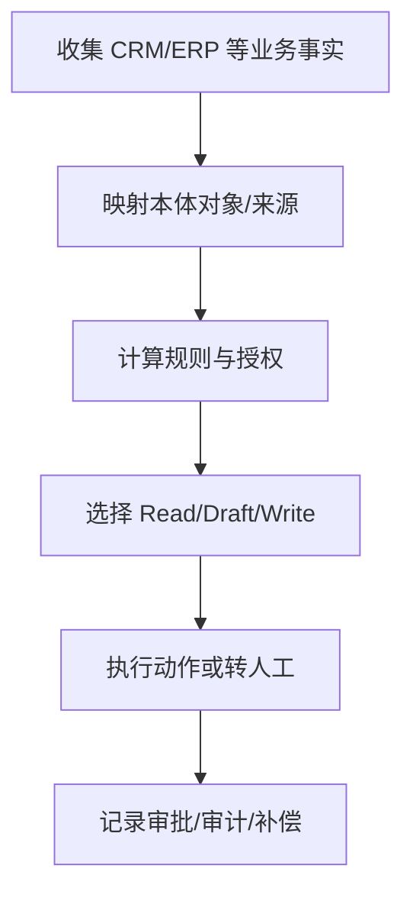
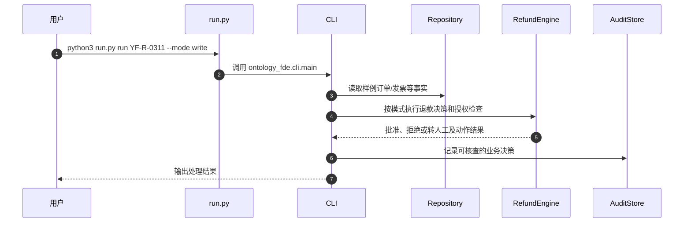

# 《企业本体论：人人都是 FDE》作者配套实现

## 一句话定义

这是黄佳《企业本体论：人人都是 FDE》公开配套的**可运行退款案例工程**，而不是图书完整文本；重点是将企业业务规则变成可被 Agent 检查的对象、状态与动作契约。

## 英文缩写速查

| 缩写 | 英文全称 | 简要说明 |
|---|---|---|
| FDE | Forward-Deployed Engineer | 前线部署工程师 |
| ERP | Enterprise Resource Planning | 企业资源系统 |
| CRM | Customer Relationship Management | 客户关系管理系统 |
| UAT | User Acceptance Testing | 可重放验收测试记录 |

## 为什么重要

当 ERP 查询发票得到 not_found 时，简单把它当作未开票可能导致违规支付；配套代码把状态保持为 unknown，并让人核实。此例说明企业本体不仅是数据库字段映射，还必须定义业务动作允许何时发生及如何审计。

## 核心原理

项目 README 的云帆案例从 Read、Draft、Write 三种模式展示事实读取、方案建议和执行。run.py 导入 ontology_fde.cli.main；命令分派到 RefundEngine、EnterpriseRepository、RefundPolicy 等模块，检查规则/身份/动作，并记录审计信息。官方案例中 347 元退款因发票未知转人工，500 元满足条件可批准，500.01 元超过自动审核上限。

### 课程/项目主线流程总览

## 源码运行时序图

以下是**核对过的代表性源码入口**，不代表全部示例运行或获得同等输出。

## 工程实践

运行入口 python3 run.py serve --port 8000 可打开本地工作台；python3 run.py run YF-R-0311 --mode write 用于演示人工审批分支。README 还给出 python3 tools/verify.py 检查策略样例和事故回放。未在当前环境执行这些命令，不宣称实测结果。

## 局限与风险

仓库用离线样例数据与模拟付款指令，批准不等于真实资金到账；本项目代码用于解释书中理念，不等同企业生产系统或书籍全文。

**原文通读范围：** 本节点以完整阅读过的官方 README 原文为主（配套内容有重点核验），不声称整本书或全部实验章节均逐篇精读。健康度描述的是知识节点的结构与已声明原文范围。

## 关联页面

- [agnes-harness](./agnes-harness.md) — 关联的工程知识或开源项目。
- [hello-agents](./hello-agents.md) — 关联的工程知识或开源项目。
- [fde-guidance-book](./fde-guidance-book.md) — 关联的工程知识或开源项目。

## 参考来源

- [官方入口文档通读记录](../../sources/repos/ontology-fde-course-overview-read-20261113.md)
- [项目来源索引](../../sources/repos/ontology-fde.md)
- [作者/维护者仓库](https://github.com/huangjia2019/ontology-fde)

## 推荐继续阅读

- [官方原文入口](https://github.com/huangjia2019/ontology-fde)
