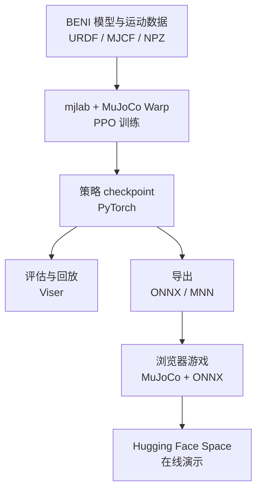

# Open-BENI（BENI 轮式双足机器人训练与仿真）

**Open-BENI** 由摩多机器人（Mondo Robotics）发布，是一个围绕 BENI 轮式双足机器人的开源项目：用 mjlab 和 MuJoCo Warp 训练速度跟踪、跌倒恢复与跳跃策略，并提供 Viser 回放、ONNX/MNN 导出和浏览器端 MuJoCo + ONNX 游戏。

## 英文缩写速查

| 缩写 | 英文全称 | 简要说明 |
|------|----------|----------|
| BENI | BENI Robot | 项目使用的轮式双足机器人本体 |
| PPO | Proximal Policy Optimization | 仓库用于训练 BENI 策略的强化学习算法 |
| RL | Reinforcement Learning | 通过仿真交互学习速度跟踪、恢复和跳跃行为 |
| MJCF | MuJoCo XML Model Format | 仓库提供的 BENI MuJoCo 模型格式 |
| ONNX | Open Neural Network Exchange | 浏览器推理及跨框架部署使用的策略格式 |
| MNN | Mobile Neural Network | 仓库导出流程支持的轻量推理格式 |
| GPU | Graphics Processing Unit | MuJoCo Warp 并行训练所用的加速硬件 |

## 为什么重要？

Open-BENI 把策略训练、机器人模型、回放、部署格式转换和可交互演示放在同一个可运行仓库中，适合用来观察一条较完整的机器人学习工程路径。在线 Space 让读者无需先搭建训练环境即可体验浏览器游戏；需要复现训练或修改任务时，则可以回到官方仓库和本地运行说明。

## 核心流程



## 工程实践

| 环节 | 仓库入口与说明 |
|------|----------------|
| 本体模型 | assets/beni_base/ 提供 BENI 的 URDF、MJCF、网格和纹理 |
| 训练任务 | python/beni_rl/ 注册 Beni-Jump-Flat，包含速度跟踪、恢复和跳跃相关配置 |
| 训练 | 官方示例使用 PPO 训练 15,000 次迭代、4,096 个并行环境；小型 smoke run 可用 4 个环境、10 次迭代 |
| 环境 | README 建议 Linux x86_64、Python 3.12、uv；GPU 训练需兼容 CUDA 12.8 的 NVIDIA 驱动，建议至少 8 GB 显存 |
| 回放 | uv run play ... --viewer viser 可在 Viser 中检查训练策略 |
| 导出 | beni_rl.headless_export 支持 checkpoint → ONNX → MNN |
| 在线体验 | web/ 实现 MuJoCo + ONNX 浏览器游戏；Space 部署此项目 |

训练代码示例：

```bash
uv sync --locked
uv run python -m beni_rl.train Beni-Jump-Flat \
  --env.scene.num-envs 4096 --agent.max-iterations 15000 --agent.seed 42
```

## 开源状态与局限

官方 README 声明仓库包含训练源码、机器人资产、策略文件和浏览器游戏，并采用 MIT 许可证；Hugging Face Space 是代码仓库的部署版本。仓库 README 还说明依赖项保留各自许可证。

仓库公开了训练和仿真入口，但这不能单独证明策略已在真实 BENI 硬件上完成验证，也不等于提供了完整的真机部署驱动与安全认证。训练结果受 GPU、依赖版本和 checkpoint 影响；复现实验时应以仓库当前 README、配置和具体 checkpoint 为准。

## 关联页面

- [mjlab](./mjlab.md) — Open-BENI 使用的训练仿真框架
- [强化学习](../methods/reinforcement-learning.md) — PPO 策略训练的基础方法
- [Locomotion](../tasks/locomotion.md) — 速度跟踪等移动任务
- [Balance Recovery](../tasks/balance-recovery.md) — 与跌倒恢复行为相关的任务知识

## 参考来源

- [Open-BENI 项目页与在线演示](../../sources/sites/open-beni.md)
- [Mondo-Robotics/open-beni 仓库归档](../../sources/repos/mondo-robotics-open-beni.md)
- [官方 README](https://github.com/Mondo-Robotics/open-beni/blob/main/README.md)
- [Hugging Face Space](https://huggingface.co/spaces/mondo-robotics/open-beni)

## 推荐继续阅读

- [Open-BENI 官方仓库](https://github.com/Mondo-Robotics/open-beni)
- [Hugging Face 在线演示](https://huggingface.co/spaces/mondo-robotics/open-beni)
