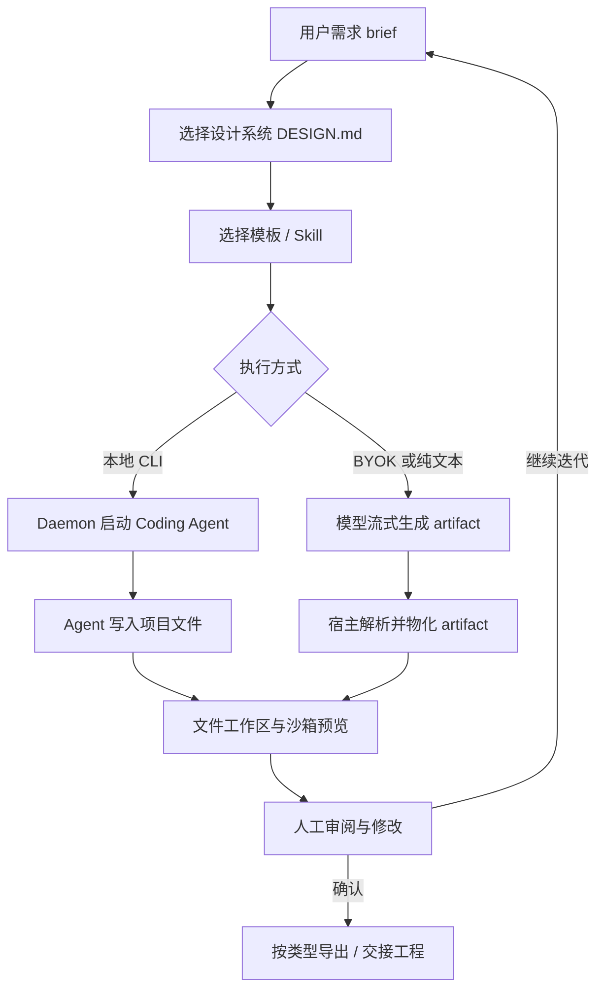
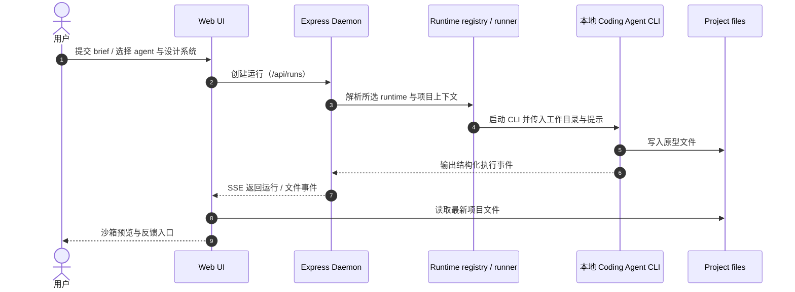

# OpenDesign：协作式 AI 设计智能体工作区

## 一句话定义

**OpenDesign** 是开源、本地优先的协作式 AI 设计工作区：将需求 brief、可复用设计系统和现有 Coding Agent 连接起来，生成、预览、修改并导出网站、应用界面、仪表盘或演示文稿等产物。

## 英文缩写速查

| 缩写 | 英文全称 | 简要说明 |
|------|----------|----------|
| AI | Artificial Intelligence | 调用外部模型或本地 Agent 辅助制作设计产物 |
| CLI | Command-Line Interface | 通过本地命令行接入 Claude Code、Codex 等 agent |
| MCP | Model Context Protocol | 将 OpenDesign 能力接入支持该协议的 agent 客户端 |
| BYOK | Bring Your Own Key | 用户自备模型服务密钥的调用模式 |
| SSE | Server-Sent Events | Daemon 到前端的流式运行事件通信 |
| UI | User Interface | 最终设计/编辑与交付的界面 |

## 为什么重要

- **从设计建议到可编辑产物：** 官方工作流串联 brief、选定品牌规则、代码生成、实时预览、评论反馈与再次迭代，避免停留在一次性图片。
- **可以复用既有 Coding Agent：** 无需把设计能力绑定在单一模型；官方提供多 CLI adapter、Skills、Templates 和设计系统。
- **对 Robotics_Notebooks 的工程启发：** 可以用来探索机器人上位机监控面板、遥操作台或知识库前端的 UI 原型。这是**可能的工具应用**，不是官方已验证的机器人系统集成。

## 核心原理

| 层 | 经一手资料核对的职责 |
|----|----------------------|
| 设计输入 | Brief + 选用的 `DESIGN.md` 设计系统、设计模板和功能 Skill |
| 前端 | `apps/web` 提供项目、会话、文件工作区、预览和导出入口 |
| Daemon | `apps/daemon` 负责项目状态、运行/模型调度、文件和沙箱边界 |
| 运行时 | `apps/daemon/src/runtimes/registry.ts` 注册编码 Agent 的执行适配器 |
| 产物 | 文件型运行直接写工作区；纯文本/BYOK 运行以完整 `<artifact>` 交接并物化预览 |
| 协作与输出 | 人工反馈迭代；按产物类型支持 HTML、PDF、PPTX 等不同导出路径 |

四个资源目录的职责应分开理解：`skills/` 为 Agent 执行能力、`design-templates/` 为产物模板、`design-systems/` 为品牌规范、`plugins/` 为可安装扩展。

## 流程总览

以下为官方 README、QUICKSTART 和 Architecture 描述的共性流程；本地 CLI 与 BYOK 在产物交接处存在分支。

## 源码运行时序图

依据官方 `QUICKSTART.md`、`docs/architecture.md`，并核对 `apps/web/src/providers/daemon.ts`、`apps/daemon/src/routes/runs.ts` 与 `apps/daemon/src/runtimes/registry.ts` 的相关入口。下图**仅对应本地文件型 CLI 路径**，不将 BYOK 流误写成 CLI 文件调用。未在本环境实际启动程序。

## 工程实践

1. **本地源码启动：** 使用 Node 24、Corepack/pnpm，执行 `corepack enable`、`pnpm install`、`pnpm tools-dev run web`；后者启动 Web 与 Daemon，实际 URL 以启动输出为准。
2. **选择执行模式：** 本地安装并认证 Coding Agent 后由工作区检测；没有 CLI 则可配置 BYOK。两类执行链路的文件编辑和预览能力并不等价。
3. **设计约束：** 为仪表盘原型单独定义 `DESIGN.md` 的配色、字体、密度和组件规则，再选模板/Skill，审查响应式、可访问性与数据正确性。
4. **交付边界：** 对机器人场景仅作为非安全关键 UI 原型；接入 ROS 2、真实控制指令、告警链路时仍需额外工程开发、安全审查和闭环测试。

## 局限与风险

- **不属于机器人算法/仿真栈：** 没有依据表明 OpenDesign 能直接解析 URDF/MJCF、提供动力学仿真或控制策略部署；不能把生成 UI 等同于具身智能能力。
- **预览不等于生产交付：** 官方 FAQ 明确仍需工程化；生成结果的可访问性、数据安全、视觉正确性与性能应人工验证。
- **运行依赖：** Local CLI 需要本地 Agent 可用且已认证；BYOK 依赖外部服务及费用；公开部署须配置鉴权、允许来源、SSE 反向代理与沙箱边界。
- **平台限制：** 2026-11-17 核对的 README 提供 macOS、Windows 桌面发行版；Linux 目前须从源码运行。具体模型、插件及服务额度随版本变化。

## 关联页面

- [Tidy Design](tidy-design.md) — 同为 agent 参与的设计工作区，可对照两者画布编辑与执行模式。
- [frontend-design（Anthropic 官方 Skill）](anthropic-frontend-design-skill.md) — 设计规约，不是完整工作区。
- [Model Context Protocol](../concepts/model-context-protocol.md) — MCP 接口及工具权限边界。
- [Agentic Coding 时代的软件工程基础](../concepts/agentic-coding-software-fundamentals.md) — 设计转生产代码所需的软件工程保障。

## 参考来源

- [OpenDesign 官方仓库一手归档](../../sources/repos/nexu-io-open-design.md)
- [OpenDesign 官方网站归档](../../sources/sites/open-design-ai.md)
- [官方 README](https://github.com/nexu-io/open-design/blob/main/README.md)
- [Quickstart](https://github.com/nexu-io/open-design/blob/main/QUICKSTART.md)
- [Architecture](https://github.com/nexu-io/open-design/blob/main/docs/architecture.md)

## 推荐继续阅读

- [官方仓库](https://github.com/nexu-io/open-design)
- [官方架构文档](https://github.com/nexu-io/open-design/blob/main/docs/architecture.md)
- [官方项目页](https://open-design.ai/)
