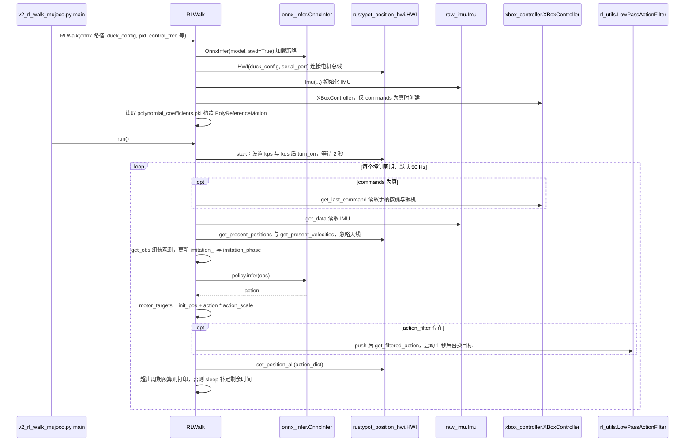

---

type: entity
tags: [deployment, sim2real, embedded, raspberry-pi, open-source, biped, disney, open-duck]
status: complete
updated: 2026-09-07
related:
  - ./open-duck-mini.md
  - ./open-duck-playground.md
  - ./tnkr.md
  - ./xpad.md
  - ../concepts/sim2real.md
  - ../concepts/processor-in-the-loop-sim2real.md
  - ./open-duck-mini-viewer.md
sources:
  - ../../sources/repos/open_duck_mini_runtime.md
  - ../../sources/sites/tnkr-open-duck-mini-v2.md
summary: "Open Duck Mini Runtime 在 Raspberry Pi Zero 2W 上运行 ONNX 行走策略，负责 Feetech 舵机 I2C、IMU、Xbox 手柄与关节偏置标定，是 Open Duck sim2real 的机载最后一环。"
---

# Open Duck Mini Runtime

**Open Duck Mini Runtime** 负责在 **Raspberry Pi Zero 2W** 上将 [Open Duck Playground](./open-duck-playground.md) 导出的策略部署到真机：舵机总线、IMU 融合、手柄遥操作与上机前 checklist。

## 英文缩写速查

| 缩写 | 英文全称 | 简要说明 |
|------|----------|----------|
| Sim2Real | Simulation to Real | 把仿真中学到的策略迁移落地真机的工程主线 |
| ONNX | Open Neural Network Exchange | 跨框架神经网络模型交换格式 |
| IMU | Inertial Measurement Unit | 惯性测量单元，提供加速度与角速度 |
| MuJoCo | Multi-Joint dynamics with Contact | 接触丰富的刚体物理仿真引擎 |
| PWM | Pulse-Width Modulation | 脉宽调制，驱动电机与功率器件 |

## 为什么重要

- **极低算力部署范例：** 在 Zero 2W 级 SBC 上跑 locomotion ONNX，对「策略频率 vs 控制频率分频」有现实约束。
- **硬件—软件对齐：** 关节软偏置标定（`find_soft_offsets.py`）直接写入驱动层，弥补廉价舵机零位不一致。
- **与 Hub 仓预训练策略衔接：** 可直接使用 `BEST_WALK_ONNX*.onnx` 或自训 ONNX，经 MuJoCo 脚本预演后再上机。

## 核心结构/机制

| 环节 | 说明 |
|------|------|
| OS | Raspberry Pi OS Lite 64-bit；SSH / WiFi 预配置 |
| 总线 | I2C 启用；Feetech PWM 控制（`hwi_feetech_pwm_control.py`） |
| 低延迟 USB | udev 将 FTDI `latency_timer` 设为 1 |
| 输入 | Xbox One **蓝牙**配对（走 HID，非 xpad）；`test_xbox_controller.py`；USB 有线 Xbox 手柄见 [xpad](./xpad.md) |
| 推理 | `v2_rl_walk_mujoco.py` + ONNX；部署 checklist |
| 标定 | `find_soft_offsets.py` → 各关节 `joints_offsets` |

## 14 路舵机 ID（v2）

装配前须用 `configure_motor.py --id <id>` 逐台配置（[Tnkr 文档](https://tnkr.ai/open-duck-mini/open-duck-mini-v2) 与 Runtime 一致）：

| 关节 | ID | 关节 | ID |
|------|-----|------|-----|
| right_hip_yaw | 10 | left_hip_yaw | 20 |
| right_hip_roll | 11 | left_hip_roll | 21 |
| right_hip_pitch | 12 | left_hip_pitch | 22 |
| right_knee | 13 | left_knee | 23 |
| right_ankle | 14 | left_ankle | 24 |
| — | — | neck_pitch | 30 |
| — | — | head_pitch | 31 |
| — | — | head_yaw | 32 |
| — | — | head_roll | 33 |

对零时电机会转到零位再装 horn；残余误差由 Runtime 软偏置吸收（未来计划写入 EEPROM）。

## 常见误区或局限

- **checklist 不可跳过：** 电源、偏置、IMU 与通信未通过时不应直接加载行走策略。
- **README 仍标注 TODO：** 电机板 udev、Rust 绑定等条目在演进中；以 `v2` 分支 checklist 为准。
- **算力边界：** 复杂感知或高维策略需更强机载计算；Runtime 聚焦 locomotion 闭环。

## 源码运行时序图

入口：`cd scripts/` 后执行 `python v2_rl_walk_mujoco.py --onnx_model_path <BEST_WALK_ONNX_2.onnx>`（README「Run the walk」所列）。注意脚本名含 mujoco，但其 `HWI`、`Imu` 直接连接真机电机与 IMU；`--replay_obs` 的帮助文字提到可回放 MuJoCo 产生的观测。下图为真机行走脚本的启动与控制循环。

图依据：apirrone/Open_Duck_Mini_Runtime@376de65，`scripts/v2_rl_walk_mujoco.py`（RLWalk 构造、start、run、get_obs 与 __main__）、`mini_bdx_runtime/mini_bdx_runtime/onnx_infer.py`、`mini_bdx_runtime/mini_bdx_runtime/rustypot_position_hwi.py`（类与 set_position_all）、`README.md`（运行步骤）；`raw_imu.py`、`rl_utils.py` 仅据调用点推断，未读源码；未运行代码。

## 参考来源

- [sources/repos/open_duck_mini_runtime.md](../../sources/repos/open_duck_mini_runtime.md)
- [Tnkr Open Duck Mini V2 项目文档](../../sources/sites/tnkr-open-duck-mini-v2.md)（线束、Pi 配置、部署分节）
- [apirrone/Open_Duck_Mini_Runtime](https://github.com/apirrone/Open_Duck_Mini_Runtime)（v2 分支）

- 源码核对（2026-11-02）：apirrone/Open_Duck_Mini_Runtime@376de65，读过 `README.md`（运行与标定段）、`scripts/v2_rl_walk_mujoco.py`、`mini_bdx_runtime/mini_bdx_runtime/onnx_infer.py`、`mini_bdx_runtime/mini_bdx_runtime/rustypot_position_hwi.py`（部分）；时序图依据以上文件，未运行代码。

## 关联页面

- [Open Duck Mini](./open-duck-mini.md)
- [Open Duck Playground](./open-duck-playground.md)
- [Open Duck Mini Viewer](./open-duck-mini-viewer.md) — 浏览器预览；关节 home 被 Viewer 对齐，但不能代替本仓上机
- [Tnkr](./tnkr.md)
- [xpad](./xpad.md) — Linux USB Xbox 手柄驱动（与蓝牙 HID 路径对照）
- [Sim2Real](../concepts/sim2real.md)
- [Processor-in-the-Loop Sim2Real](../concepts/processor-in-the-loop-sim2real.md)

## 推荐继续阅读

- [Tnkr Open Duck Mini V2 — Electronics & Wiring](https://tnkr.ai/open-duck-mini/open-duck-mini-v2)
- [Open Duck Mini sim2real 文档](https://github.com/apirrone/Open_Duck_Mini/blob/v2/docs/sim2real.md)
- [Runtime v2 checklist](https://github.com/apirrone/Open_Duck_Mini_Runtime/blob/v2/checklist.md)
