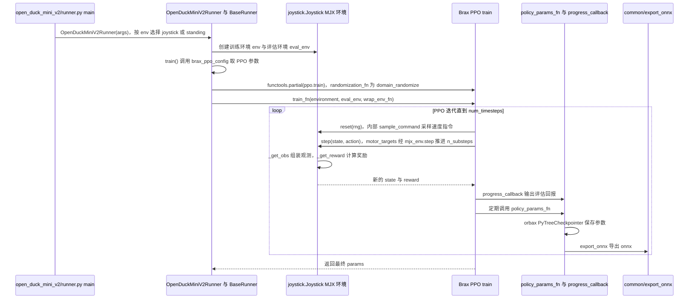

---

type: entity
tags: [rl, mujoco, mjx, locomotion, imitation, open-source, jax, disney, open-duck]
status: complete
updated: 2026-09-07
related:
  - ./open-duck-mini.md
  - ./open-duck-reference-motion-generator.md
  - ./open-duck-mini-runtime.md
  - ./mujoco-playground.md
  - ./mjlab-playground.md
  - ./brax.md
  - ../concepts/sim2real.md
  - ../concepts/reward-design.md
  - ./pollen-microduck-rl.md
  - ./open-duck-mini-viewer.md
sources:
  - ../../sources/repos/open_duck_playground.md
summary: "Open Duck Playground 在 MuJoCo Playground/MJX 上提供 open_duck_mini_v2 摇杆速度跟踪 RL 环境，支持 Disney BDX 风格模仿奖励、域随机化与 ONNX 导出，是 Open Duck 当前主训练栈。"
---

# Open Duck Playground

**Open Duck Playground** 是 Open Duck 项目的 **MuJoCo Playground 训练仓**：在 JAX/MJX 并行仿真里训练 `open_duck_mini_v2` 的 locomotion 策略，并导出 ONNX 供 [Open Duck Mini Runtime](./open-duck-mini-runtime.md) 使用。

## 英文缩写速查

| 缩写 | 英文全称 | 简要说明 |
|------|----------|----------|
| Sim2Real | Simulation to Real | 把仿真中学到的策略迁移落地真机的工程主线 |
| MuJoCo | Multi-Joint dynamics with Contact | 接触丰富的刚体物理仿真引擎 |
| MJX | MuJoCo JAX | MuJoCo 的 JAX/XLA 后端，支持可微与批量仿真 |
| RL | Reinforcement Learning | 通过与环境交互最大化长期回报来学习策略的范式 |
| ONNX | Open Neural Network Exchange | 跨框架神经网络模型交换格式 |
| JAX | JAX | 支持自动微分与 XLA 编译的数值计算库 |
| Isaac Gym | NVIDIA Isaac Gym | GPU 并行刚体仿真训练环境 |
| MJCF | MuJoCo XML Format | MuJoCo 的模型与场景描述格式 |
| Reward | Reward Function | 塑造强化学习策略行为的标量反馈 |

## 为什么重要

- 将 [MuJoCo Playground](./mujoco-playground.md) 范式落到 **廉价舵机双足** 上，与 Isaac Gym 时代的 AWD 训练形成代际切换。
- **模仿奖励**与 [Reference Motion Generator](./open-duck-reference-motion-generator.md) 解耦：多项式系数文件可独立迭代，不必重训整个 MJCF 管线。
- 提供 **flat_terrain_backlash** 等任务与 3e8 步量级训练示例，便于复现社区「当前最佳行走」配置。

## 核心结构/机制

| 模块 | 路径 / 作用 |
|------|-------------|
| 环境定义 | `playground/open_duck_mini_v2/joystick.py` — 奖励开关、噪声、模仿项 |
| 机器人 MJCF | `xmls/open_duck_mini_v2.xml`、`scene_mjx_*.xml` |
| 共享工具 | `playground/common/rewards.py`、`randomize.py`、`export_onnx.py` |
| 参考运动 | `data/polynomial_coefficients.pkl`（来自 motion generator） |
| 训练入口 | `runner.py`；推理 `mujoco_infer.py` |

**典型训练命令：**

```bash
uv run playground/open_duck_mini_v2/runner.py --task flat_terrain_backlash --num_timesteps 300000000
```

启用模仿奖励：在 `joystick.py` 设 `USE_IMITATION_REWARD=True`，并确保 `data/` 内系数文件与当前步态 sweep 一致。

## 常见误区或局限

- **硬编码与 WIP：** 新机器人需复制 `open_duck_mini_v2` 并改 geom/sensor 命名；部分常量仍待清理。
- **模仿奖励非万能：** 需与 BAM 标定后的 MJCF 联调；电机模型不准时模仿项无法单独救场。
- **与 Brax 自带 env 不同：** 新环境应在本 Playground 模式扩展，而非 Brax legacy physics env。

## 源码运行时序图

训练入口：`uv run playground/open_duck_mini_v2/runner.py --task flat_terrain_backlash --num_timesteps <N>`（README 所列；`runner.py` 的 `main()` 解析参数后调用 `runner.train()`）。另有评估入口 `uv run playground/open_duck_mini_v2/mujoco_infer.py -o <onnx>`，在 MuJoCo 内以 `policy.infer` 逐步驱动 `data.ctrl`。下图为训练主流程。



图依据：apirrone/Open_Duck_Playground@b9be205，`README.md`（训练与推理命令）、`playground/open_duck_mini_v2/runner.py`、`playground/common/runner.py`（train、policy_params_fn、progress_callback）、`playground/open_duck_mini_v2/joystick.py`（Joystick、reset、step 段）、`playground/open_duck_mini_v2/mujoco_infer.py`（run 循环片段）；`randomize.py`、`export_onnx.py` 仅据调用点推断，未读源码；未运行代码。

## 参考来源

- [sources/repos/open_duck_playground.md](../../sources/repos/open_duck_playground.md)
- [apirrone/Open_Duck_Playground](https://github.com/apirrone/Open_Duck_Playground)

- 源码核对（2026-11-02）：apirrone/Open_Duck_Playground@b9be205，读过 `README.md`（训练与推理段）、`playground/open_duck_mini_v2/runner.py`、`playground/common/runner.py`、`playground/open_duck_mini_v2/joystick.py`（部分）、`playground/open_duck_mini_v2/mujoco_infer.py`（部分）；时序图依据以上文件，未运行代码。

## 关联页面

- [Open Duck Mini](./open-duck-mini.md)
- [Open Duck Reference Motion Generator](./open-duck-reference-motion-generator.md)
- [Open Duck Mini Runtime](./open-duck-mini-runtime.md)
- [Open Duck Mini Viewer](./open-duck-mini-viewer.md) — 浏览器脚本步态预览，不加载本仓 ONNX
- [mjlab Playground 任务集](./mjlab-playground.md)
- [Reward Design](../concepts/reward-design.md)
- [Microduck RL](./pollen-microduck-rl.md) — Pollen 线 mjlab + BAM，对照本页 MJX / 模仿奖励

## 推荐继续阅读

- [MuJoCo Playground](https://playground.mujoco.org/)
- Disney BDX 论文 PDF（imitation reward 定义）：[BD_X_paper.pdf](https://la.disneyresearch.com/wp-content/uploads/BD_X_paper.pdf)
