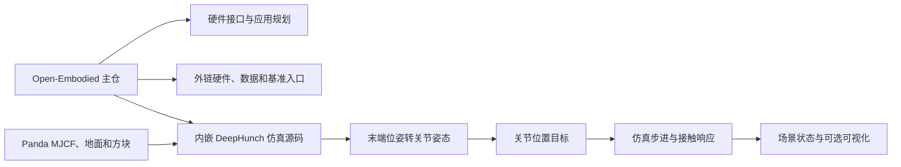
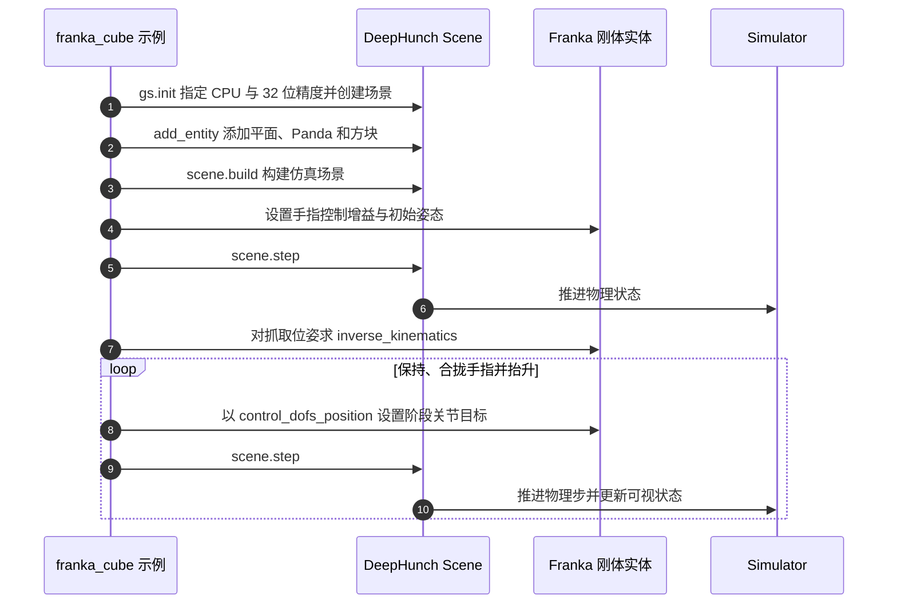

# Open-Embodied: A Robotics Stack and Simulator Repository · 具身机器人资源与仿真代码

## 一句话定义

Open-Embodied 是一个具身机器人开源项目入口。主仓可核验的工程资产是 DeepHunch 物理仿真包及示例；统一硬件接口、实时操作系统和应用部署是 README 的规划层，不是本次已验证的发布能力。

## 英文缩写速查

| 缩写 | 英文全称 | 简要说明 |
|---|---|---|
| HAL | Hardware Abstraction Layer | 项目规划中用于隔离设备差异的硬件抽象层 |
| RTOS | Real-Time Operating System | 规划中提供确定时限的操作系统类别，不能从仿真示例推断已经实现 |
| MJCF | MuJoCo Configuration Format | Franka 示例加载的机器人模型文件格式 |
| IK | Inverse Kinematics | 由期望手部位姿求关节目标，本示例在仿真内完成 |

## 核心信息

| 项目 | 内容 |
|---|---|
| 维护方 | GitHub 组织 open-embodied；README 列 DeepOpen 为支持方，未用页首机构罗列推断各方对固定提交的贡献 |
| 快照 | [源码归档](../../sources/repos/open-embodied.md)固定 2026-11-25 提交，包标注 `deephunch-world` 1.5.0 |
| 开放范围 | 主仓根许可证为 Apache-2.0；资源外链、模型资产和子模块单独核对 |
| 可读入口 | `examples/rigid/franka_cube.py`、`deephunch/engine/scene.py` 和 `pyproject.toml` |

## 为什么重要

选型时能直接把统一机器人接口的设计方向与已发布的仿真入口分开：前者可用于划分系统模块，后者适合检验抓取控制的代码和资产如何联动。

## 核心原理

- **把资源目录、规划和可运行代码分开。** README 的硬件/数据/基准等入口可用于继续查找，但不证明它们通过一个 API 相互兼容。硬件抽象、OS、中间件、应用是规划层。
- **公开源码有可追踪的物理回路。** 示例用 DeepHunch 建地面、Panda 机械臂和 4 cm 方块，构建场景后用 IK 求目标关节角，再通过位置控制与 `scene.step()` 推进。此路径不依赖语言模型发指令，也不是策略训练或真机执行。
- **检查资产和接口版本。** Python 包名是 `deephunch-world`，运行时导入名是 `deephunch`；文档中另指向独立 DeepHunch 仓。复现要明示使用了哪一份代码、依赖和模型资产。

## 流程总览

## 源码运行时序图

以[主仓固定提交的 Franka 方块示例](../../sources/repos/open-embodied.md)为例；它是手工编排的刚体仿真场景，不涉及真机驱动。

保持阶段沿用设置好的手臂目标；抬升前重新对更高的手部位置求 IK。示例的物理时间步是 0.01 秒，不能据此推断实测墙钟频率或控制周期。

## 工程实践与局限

- 建议先在隔离环境核对 Python 版本、PyTorch、Quadrants 和模型路径；从默认不开 GUI 的刚体示例开始，再启用 `--vis` 排查显示相关依赖。
- 示例没有成功率表或真机对照。若用于工程验证，应另行记录初始状态、资产修订、步长、指端摩擦和方块抬升后的保持时间，不拿一次轨迹替代重复评估。
- 根 LICENSE 只说明主仓代码边界。外链硬件、数据和仿真模型分别核查授权，README 的社区项目对照表也不是该仓基准测试数据。

## 与其他工作对比

- [Genesis](./genesis-sim.md) 单独讨论物理引擎能力、任务案例与数据生成；阅读 Open-Embodied 时，可按同一问题检查场景/求解器接口，但不能用 Genesis 的评测成绩给 DeepHunch 背书。
- [MuJoCo](./mujoco.md) 是独立物理引擎；示例使用 MJCF 资产，不能据此把主仓代码的状态推进等同于 MuJoCo 原生运行。
- [ros2_control](./ros2-control.md) 聚焦已落地的硬件和控制器接口；Open-Embodied 的统一系统接口在此核对范围内是计划，不可作为真实硬件驱动完备性的证据。

## 关联页面

- [仿真评测基础设施](../concepts/simulation-evaluation-infrastructure.md)：把演示变成可复核的测试。
- [Genesis](./genesis-sim.md)：对照仿真场景建模、控制和求解器边界。

- [机器人仿真集成](../methods/robot-simulation-integration.md)：核对资产、仿真驱动和上层控制接口。
- [工程仿真流程](../methods/engineering-simulation-workflow.md)：明确交付依赖与可重复的测试条件。

## 参考来源

- [Open-Embodied 主仓、包元数据与仿真代码归档](../../sources/repos/open-embodied.md)

## 推荐继续阅读

- [主仓 Franka 方块抓取示例](https://github.com/open-embodied/open-embodied/blob/da44b6600d78220a3f388a54f46aa1fbaefc0ef5/examples/rigid/franka_cube.py)
