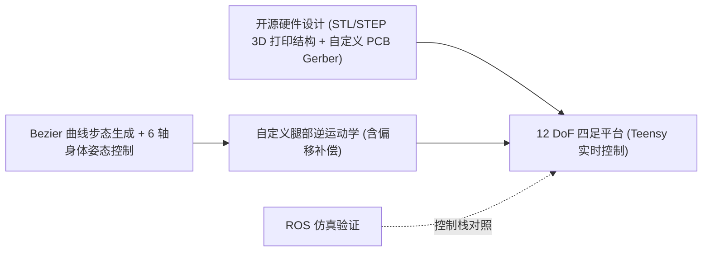
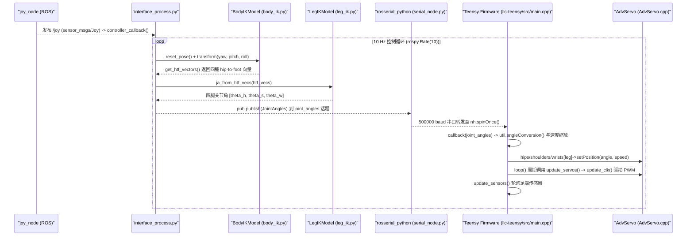

# OpenQuadruped

## 一句话定义

**OpenQuadruped** 是全 3D 打印的 12 自由度开源四足机器人，仓库 [adham-elarabawy/open-quadruped](https://github.com/adham-elarabawy/open-quadruped)。

## 英文缩写速查

| 缩写 | 英文全称 | 简要说明 |
|------|----------|----------|
| IK | Inverse Kinematics | 逆运动学 |
| PCB | Printed Circuit Board | 印制电路板 |
| STEP | STEP CAD format | 通用 CAD 交换格式 |
| ROS | Robot Operating System | 机器人中间件 |

## 为什么重要

- 软硬件（含 PCB）完整公开，是理解经典四足控制栈的好样本。
- 在微信文章《想进入机器人领域吗？学习这18个开源项目就够了》中排第 **10** 位。

## 核心要点（据文章）

- 使用 Teensy 实时控制，提供 Bezier 曲线步态、完整 6 轴身体姿态控制和考虑偏移的自定义腿部逆运动学。
- 仓库包含 STL/STEP、自定义 PCB Gerber、Teensy 固件和 ROS 仿真；MIT 许可。
- 设计经过多次迭代（缩短身体、髋部集中执行器等）。

## 工程实践

- 适合学习经典（非 RL）四足控制：逆运动学 + 步态生成 + 姿态控制。
- 以上规格与许可证均出自文章叙述，**未逐项核对官方仓库**；动手前请以官方 README/BOM 为准。

## 机制与架构图

## 源码运行时序图

以下时序图依据 `adham-elarabawy/open-quadruped` 仓库 `master` 分支源码核对绘制，核对路径：`ros-workspace/src/open_quadruped/launch/real.launch`、`ros-workspace/src/open_quadruped/nodes/interface_process.py`、`control_library/control_library/body_ik.py`、`control_library/control_library/leg_ik.py`、`llc-teensy/src/main.cpp`、`llc-teensy/lib/AdvServo/AdvServo.cpp`。注：`interface_process.py` 中 `gait_mode` 分支当前仅记录日志、尚未接入 `control_library/control_library/gait_planner.py`，实测闭环以 `body_mode` 6 轴姿态控制为主。

## 局限与风险

- 本页仅基于一篇第三方公众号文章，规格数字可能随版本变化。
- 仓库迁移、分叉和许可证以官方当前状态为准。

## 关联页面

- [腿足运动控制](../tasks/locomotion.md) — 把 Bezier 足端轨迹放到步态和机身稳定问题中理解。
- [平衡恢复](../tasks/balance-recovery.md) — 对照外部扰动下的平衡任务，区分按给定姿态调节机身与受扰后恢复支撑。
- [quadruped-robot](./quadruped-robot.md)
- [spotmicro](./spotmicro.md)
- [stanford-doggo-and-pupper](./stanford-doggo-and-pupper.md)
- [gait-generation](../concepts/gait-generation.md)
- [机器人开源项目 18 例（微信 GitHubStore）索引](../overview/robot-open-source-wechat-githubstore-18-projects.md)

## 推荐继续阅读

- [open-quadruped 仓库](https://github.com/adham-elarabawy/open-quadruped)

## 参考来源

- [wechat_githubstore_18_open_source_robot_projects.md](../../sources/blogs/wechat_githubstore_18_open_source_robot_projects.md)
