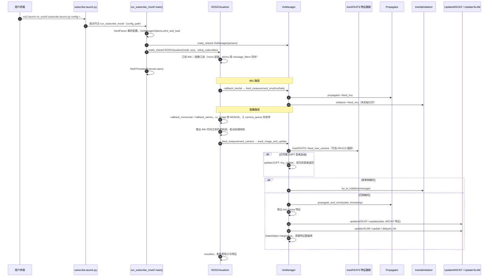

---

type: entity
tags: [repo, vio, msckf, research, ros, cmu]
status: complete
updated: 2026-09-15
related:
  - ../entities/vins-fusion.md
  - ../comparisons/lidar-slam-lio-vio-selection.md
sources:
  - ../../sources/repos/open_vins.md
summary: "OpenVINS 是开源视觉-惯性导航研究平台：MSCKF 类滤波、可配置特征与 ROS 集成，便于算法对比实验。"
---

# OpenVINS

**OpenVINS** 面向 **VIO 研究** 的可扩展滤波框架，强调可复现与模块配置。

## 英文缩写速查

| 缩写 | 英文全称 | 简要说明 |
|------|----------|----------|
| VIO | Visual-Inertial Odometry | 视觉-惯性里程计，融合相机与 IMU 估计位姿 |
| LiDAR | Light Detection and Ranging | 激光雷达，地形感知与建图主传感器 |
| LIO | LiDAR-Inertial Odometry | 激光-惯性里程计 |

## 为什么重要

- **学术基准**：便于与优化式 VIO（如 VINS）对照。
- **RPNG 实验室**：持续维护的 ROS 集成与数据集工具。

## 核心结构/机制

| 特性 | 说明 |
|------|------|
| **MSCKF** | 多状态约束卡尔曼 |
| **Features** | 可换检测/跟踪 |
| **Calibration** | 在线/离线标定工具链 |

## 常见误区或局限

- **工程部署**：大规模产品化常选 VINS-Fusion 或商用 VIO；OpenVINS 偏研究。
- **极端运动**：需仔细调过程噪声与特征管理。

## 源码运行时序图

入口：`ros2 launch ov_msckf subscribe.launch.py config:=euroc_mav`（launch 文件 `ov_msckf/launch/subscribe.launch.py` 启动可执行节点 `run_subscribe_msckf`；ROS1 对应 `ov_msckf/src/ros/ROS1Visualizer.cpp` 路径，图未覆盖）

图依据：rpng/open_vins@6948812，读过 `ov_msckf/launch/subscribe.launch.py`（节点与参数）、`ov_msckf/src/run_subscribe_msckf.cpp`（main）、`ov_msckf/src/ros/ROS2Visualizer.cpp`（订阅、回调、处理线程）、`ov_msckf/src/core/VioManager.cpp`（feed IMU、track_image_and_update、do_feature_propagate_update 片段）、`ov_msckf/src/core/VioManager.h`（feed_measurement_camera 转发）。

## 参考来源

- [sources/repos/open_vins.md](../../sources/repos/open_vins.md)
- [rpng/open_vins](https://github.com/rpng/open_vins)
- 源码核对（2026-11-02）：rpng/open_vins@6948812，读过 ov_msckf/launch/subscribe.launch.py、ov_msckf/src/run_subscribe_msckf.cpp、ov_msckf/src/ros/ROS2Visualizer.cpp、ov_msckf/src/core/VioManager.cpp、ov_msckf/src/core/VioManager.h；时序图依据以上文件，未运行代码。

## 关联页面

- [VINS-Fusion](../entities/vins-fusion.md)
- [LiDAR / LIO / VIO 选型](../comparisons/lidar-slam-lio-vio-selection.md)

## 推荐继续阅读

- https://docs.openvins.com/
