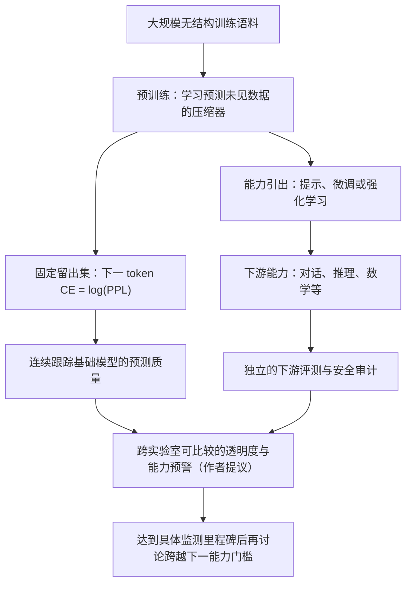

# Perplexity and Intelligence｜困惑度与智能

## 一句话定义

**Perplexity and Intelligence（困惑度与智能）** 是 OpenAI 首席科学家 Jakub Pachocki 于 2026-11-22 发表的研究观点：用**固定留出集上的预训练交叉熵（log-perplexity）**长期追踪模型的基础预测能力，配合能力与安全评估，讨论是否建立跨实验室的透明度和阶段性发展限制；它不是一种新的机器人模型，也不是公开基准论文。

## 英文缩写速查

| 缩写 | 英文全称 | 简要说明 |
|---|---|---|
| PPL | Perplexity | 预测未见 token 的困惑度；原文公布其对数 |
| CE | Cross-Entropy | 下一 token 预测的平均交叉熵，按自然对数定义时等于 log-PPL |
| CoT | Chain of Thought | 推理链；其引出能力的作用不能仅用预训练 PPL 表示 |
| RL | Reinforcement Learning | 预训练之后引出/塑造模型能力的技术之一 |
| VLA | Vision-Language-Action | 具身迁移讨论的模型类；不是本文测量对象 |

## 为什么重要

- **把能力进展和宣传性 benchmark 拆开：** 基础预测损失在多代模型上有连续定义，很多下游 benchmark 却可能逐渐饱和或改变。
- **关注安全监测的提前量：** 作者担心模型改进与评价/对齐能力不再同步，提出把共同指标和可操作的监测里程碑绑定。
- **给机器人基础模型的启发是评测方法，不是损失阈值：** VLA/WAM 也应分开记录 held-out 训练目标、下游闭环成功率和部署风险。

## 原文身份与证据范围

| 字段 | 已核对的信息 |
|---|---|
| 原标题 / 中文名 | Perplexity and Intelligence / 困惑度与智能 |
| 作者 | Jakub Pachocki，OpenAI 首席科学家 |
| 发布日期 | 2026-11-22 |
| 类型 | OpenAI 官方观点文章（非同行评审论文） |
| 主要度量 | OpenAI 内部代码库**固定留出快照**上的 log-PPL / CE |
| 公共复现入口 | 官方网页没有列出相应可复现的预训练代码、原始模型损失曲线数据或公开留出集 |
| 一手资料 | [官方完整原文及脚注](https://openai.com/index/perplexity-and-intelligence/) |

## 流程总览

图的模块来自文章第 2–5、26–46 段的逻辑：**预训练预测质量**和**后训练引出能力**应分别观测，安全门槛属于作者的治理建议，而非 OpenAI 已发布的行业规则。

## 核心原理与数值解读

按自然对数定义，平均下一 token 交叉熵为：

`H = -(1/N) * Σ_t log p(x_t | x_<t)`，因此 `PPL = exp(H)`，`log(PPL) = H`。

原文的「log-perplexity 0.99」不是「困惑度小于 1」；若换算为 PPL，其值约为 `exp(0.99)`。指标越低，表示该固定留出数据上的 token 预测越好。

| 叙述对象 | log-PPL / CE | 证据性质与读法 |
|---|---:|---|
| GPT-3.5 | 约 **0.99** | 作者公开的内部留出代码评估；与早期 ChatGPT 语用能力并列叙述 |
| GPT-4 | 约 **0.91** | 同一内部评测口径；作者联系其可有效利用 CoT 的能力 |
| 较近模型 | **低于 0.8** | 作者观察到数学和网络安全等方面的变革性能力；不意味着严格因果阈值 |
| 数学能力案例模型 | 约 **0.76** | 作者观察到模型在其开放数学问题上的突破性表现 |
| 下一可能阶段 | 约 **0.68–0.70** | **作者外推预测**，不是已达到的实测值或经过验证的普遍阈值 |

**不能跨模型体系套用数字：** 该内部固定快照来自代码数据；训练语料、tokenizer、评测分布及不同实验室数据配比会改变损失读法。原文也强调，即便 CoT 能提升能力，并不意味着预训练 PPL 因此降低。

## 评测与安全建议

1. **预训练指标：** 在固定留出分布上连续报告 CE / PPL、评测数据与 tokenization 口径；保留不同代模型的可比性。
2. **下游测评：** 将推理、数学、网络安全等能力作为独立任务评估，避免把损失值当作任务成绩。
3. **监测能力：** 对更强模型额外观察对评测/训练的意识及现有 CoT 监控可能弱化的风险，安排红队与行为审计。
4. **限制提议：** 作者建议在理解和监测达到可验证里程碑前，不跨过业界商定的下一个能力指标门槛；属于建议，并非现行强制标准。

## 与其他工作对比

| 问题 | 本文（Pachocki 2026） | [Kaplan 2020](./paper-scaling-laws-neural-language-models.md) | 具身策略 |
|---|---|---|---|
| 核心用途 | 用内部留出 PPL 观察潜在能力与安全治理风险 | 通过 N/D/C 扫描拟合语言模型 CE 缩放规律 | 同时观察预训练目标、迁移与控制效果 |
| 证据形式 | 官方纵向模型观察与作者推断 | 可读方法/实验/附录的技术论文 | VLA/WAM 各自不同任务与数据协议 |
| 不能直接推出 | 具体能力涌现的必要充分阈值 | 任意模型/数据下的通用幂律指数 | 真机可靠性、接触稳定性和安全性 |

## 工程实践（面向机器人模型研究）

- 若训练离散 action token 模型，可分别报告 action-token CE 与文本 CE；对连续动作的 flow/diffusion/回归损失，**先明确概率密度与评价定义，不能直接等同语言 PPL**。
- 在同一机器人本体、观测协议和留出任务下，分开画训练/验证损失、离线轨迹误差、真机成功率与最坏端到端延迟曲线。
- 对能力跃迁主张保留实际任务样例、种子与对照组，避免把相关性阈值当作跨模型的定量能力预测；在真机额外记录失效接管与安全约束违反率。
- **源码运行时序图：不适用。** 本文是官方研究观点文章，未发布对应实验的可执行训练或评估入口；流程图仅描述作者论证，不伪装为代码运行链。

## 局限与风险

1. **跨实验室不可直接对齐：** 留出集、tokenizer 与训练分布不同；作者承认行业共同可比方法尚待建立。
2. **PPL 不是任务成绩：** 好预测不必然等于更优机器人闭环成功率、实际推理能力或更安全行为。
3. **看不全后训练与推理计算：** 提示、微调、RL 和 CoT 的能力提升不能由预训练 PPL 单独表示。
4. **熵下界未知：** 语料的不可约随机性会改变接近下限时「同样大小的损失下降」的解释。
5. **未来表述不是事实：** 0.68–0.70 区间与 2027 年 AI 促进预训练研究的加速均是作者推测；没有公开第三方复现和统一标准。

## 关联页面

- [具身规模法则](../concepts/embodied-scaling-laws.md) — 将验证损失与真机指标分离的具身迁移参照
- [Scaling Laws for Neural Language Models](./paper-scaling-laws-neural-language-models.md) — 语言模型 N/D/C 与 CE 的实证基础
- [The Bitter Lesson](../concepts/bitter-lesson.md) — 通用计算和学习方法的历史视角
- [VLA](../methods/vla.md) — 模型预测质量如何与机器人动作成功率分开验证
- [强化学习（Reinforcement Learning）](../methods/reinforcement-learning.md) — 原文将其列为后训练能力引出手段之一；不把 RL 收益等同于预训练 PPL 的改善
- [模型架构纵深路线 Stage 5](../../roadmap/depth-model-architecture.md) — 规模与部署的指标边界

## 参考来源

- [OpenAI 官方文章归档（正文、数值及脚注 1–5）](../../sources/blogs/openai-perplexity-and-intelligence-2026.md)
- [Pachocki：Perplexity and Intelligence（2026-11-22）](https://openai.com/index/perplexity-and-intelligence/)

## 推荐继续阅读

- [Kaplan et al.: Scaling Laws for Neural Language Models](https://arxiv.org/abs/2001.08361)
- [OpenAI：Perplexity and Intelligence 原文](https://openai.com/index/perplexity-and-intelligence/)
