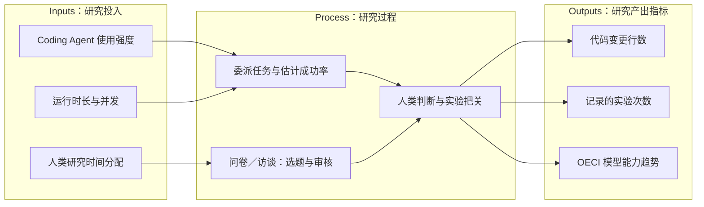

# OpenAI 科研加速：参差不齐的能力前沿（Research acceleration: The jagged frontier）

**身份：** OpenAI 官方研究报告（2026-11-18；[原文](https://openai.com/index/research-acceleration-jagged-frontier/)）。这是一份**内部观察性研究**，不是可执行的算法项目，也不是机器人科研 Agent 的公开基准。

## 一句话定义

用 **Inputs → Process → Outputs** 三层指标追踪编码 Agent 进入 AI 研发后，研究任务完成率、研究人员工作组织与能力进展如何变化，同时解释为什么**局部高自动化不等于全流程无人科研**。

## 英文缩写速查

| 缩写 | 英文全称 | 简要说明 |
|------|----------|----------|
| RSI | Recursive Self-Improvement | AI 加速下一代 AI 开发的研究议题；本文追踪指标而非宣称实现完全 RSI |
| ECI | Epoch Capabilities Index | Epoch 维护的能力趋势指标；OpenAI 自定义变体 OECI 采用内部+公开基准 |
| OECI | OpenAI Epoch Capabilities Index | 报告测量的模型能力前沿代理指标 |
| API | Application Programming Interface | 报告用 API 标价换算内部 Agent 使用等值，而非真实账单 |
| O*NET | Occupational Information Network | 用于归类 AI 研发任务类型的分类体系 |

## 为什么重要

- **分清执行成功率与研究加速**：机器人训练脚本 / 仿真环境 / benchmark 评测属于不同难度的研究工作；不能根据 Agent 写代码多就推出实验质量提高。
- **重新定位瓶颈**：监控运行已较容易委派，搭建训练与评测环境以及研究选题仍是明显短板，适合从高可验证任务逐步推进。
- **与 RSI 保持概念边界**：[AI Auto-Research](../concepts/ai-auto-research.md) 是工具辅助研发；[递归自改进](../concepts/recursive-self-improvement.md) 的完全形态要求系统自主开发后继者。原文给的是观测指标，不是 ignition 证据。

## 核心原理：研究投入—过程—产出测量框架

**读图边界：** 这是原文的**测量叙事结构**，而非一条经实验证实的因果管线。特别是 P3→OECI 不能视为“Agent 导致能力增长”的证明。

### 任务层级与成功率

| 维度 | OpenAI 报告数据 | 工程读法 |
|------|----------------|----------|
| 预计人类 2–4 小时的任务 | 2026-03 23% → 2026-10 46% | **零人工介入估计成功率**，并非节省 46% 的研发人力 |
| 预计人类 4–8 小时的任务 | 13% → 35% | 任务组合随时间改变，不能作为严格同题能力曲线 |
| 沟通 / 分析 / 构建 | 69% / 58% / 43% | 不同类别高度不均衡 |
| 监控训练 / 启动训练 / 推理与服务栈编码 | 79% / 35% / 25% | 能观测运行 ≠ 能可靠部署训练 / 推理系统 |
| 建立评测、RL 与 Agent 环境 | 29% | 环境与可靠评估仍是研究瓶颈 |

类别成功率统计窗口是 **2026-08-01 至 2026-10-18**，使用 O*NET AI R&D 分类；以上均为报告内部估计，并非独立机器人实验。

### 输入强度与产出读法

- **Agent 使用：** 截至 2026-10，研究人员每日 Agent API **标价等值**中位约 **$2,400**，P90 约 **$23,000**，相较 9 月增 62% / 105%。这些数值**不是实际付款或净节省**。
- **运行量：** “Agent workday”定义为累计 8 小时 Agent 使用，平均每研究员每日约 **0.5 → 5.7 workdays**；口径累计并发运行时长，不等于人类日历时间或产能倍数。
- **与人力支出比：** 2026-09 Agent API 等值约为研究人员**非股权薪酬**的 2 倍，但报告称股权占目标薪酬约 70–80%，比较并不完整；内部 Agent 部署占研究算力约 2%。
- **人员工作配置：** 2026-01 至 09，安全与对齐领域文档化工作周贡献增加 **77%**；这不是模型更安全 77% 的度量。
- **活动与能力：** 截至 2026-10-18 四周，活跃实验人员均值实验次数为 2025 基线 **1.68 倍**。OECI 前沿自 2025-08 约 **16.4 分/年**，其基准混合与外部 ECI 不同，不宜直接排名比较。

## 工程实践

建议把原文测量框架移植为**机器人研究工具链的指标模板**，而不是照搬其成功率：

| 层次 | 可落地记录 | 验收注意 |
|------|------------|----------|
| Inputs | Agent 会话/并发、调用成本、仿真机时、研究员审查耗时 | 把推理消耗与机器人机时拆开 |
| Process | 自动起实验成功率、日志异常诊断准确性、PR 回滚次数、人工干预点 | 建立同题集与明确人工介入定义 |
| Outputs | **有效且可复现**的实验数、held-out 成绩、真机成功率/安全停机次数 | 代码行数/实验次数只能作活动代理 |
| Ownership | 人类负责选题、硬件安全门、评测协议和采用权 | 记录 Agent 提案与人类签字，便于追责 |

以上是**本知识库对机器人场景的工程推论**，非 OpenAI 实验验证过的机器人结果。

### 源码开放与运行时序

- 本项是**研究报告而非可运行算法项目**；原文未附可公开运行的专用代码、任务原始记录及复现仓库。因此 **源码运行时序图不适用**，不能凭空描画论文/报告未公开的内部执行函数。
- 原文网页的部分方法细节通过 “View methods” 交互提供；本次未逐项导出交互图表的原始数据点。所列数据仅使用正文明确数值。

## 局限与风险

1. **相关不等于因果**：Agent 更常使用、实验更多，与能力前沿更快上升三者不能直接连成因果关系。
2. **内部样本与自报**：任务成功估计、工作量分类、研究者主观问卷难以外部复现；100+ 研究人员的调查回答不能解释为已实测替代比例。
3. **科研品味依赖人工**：对少量关键想法的访谈归因，多数由研究人员提出；在预训练的部分案例中出现 Agent 参与修改想法，不宜推成全面自主选题。
4. **具身场景转移缺证据**：物理 reset、Sim2Real、接触安全、真机部署不在本研究测量范围内，必须另外验证。

## 关联页面

- [AI Auto-Research：研究生命周期](../concepts/ai-auto-research.md) — 研究全链路自动化与分层验证。
- [递归自改进（RSI）](../concepts/recursive-self-improvement.md) — 辨别研究提速、研究自治和自举改进。
- [Agentic Coding 工程基础](../concepts/agentic-coding-software-fundamentals.md) — Agent 代码产出如何变成可维护的工程收益。
- [Coding Agent 验证闭环](../methods/coding-agent-verification-loops.md) — 用可执行测试与独立审查把任务成功估计转为可复核的交付证据。
- [Claude Code 动态多 Agent 工作流](../methods/claude-code-dynamic-workflows.md) — 研究员如何拆解、并行委派和验证任务的工程方法对照；不将其当作 OpenAI 内部 Agent 的同一实现。
- [具身大模型评测基准选型闭环](../queries/embodied-eval-benchmark-selection-loop.md) — 机器人测评有物理任务与 Sim2Real 约束，不能用本报告的软件 Agent 科研成功率替代。
- [RSI 纵深路线](../../roadmap/depth-rsi.md) — Stage 5 研究过程和 ignition 测量边界。

## 参考来源

- [OpenAI 原始报告逐节归档](../../sources/sites/openai-research-acceleration-jagged-frontier-2026.md)

## 推荐继续阅读

- [Research acceleration: The jagged frontier — OpenAI 官方原文（2026-11-18）](https://openai.com/index/research-acceleration-jagged-frontier/)
- [OpenAI 先前的 Research Acceleration 报告（2026-09）](https://openai.com/index/research-acceleration-view-inside-openai/)
