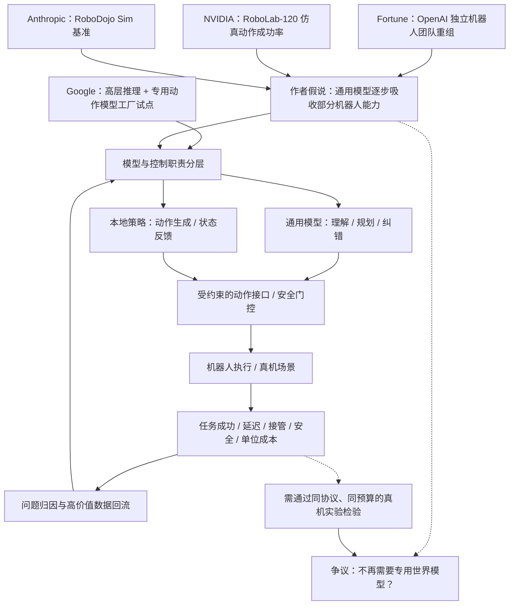

# Why Did OpenAI Disband Its Robotics Team? / OpenAI 机器人团队调整：通用模型、世界模型与「第二个奇迹」争论

## 一句话定义

这是一篇 **AiWang 撰写、36氪于 2026-11-21 转载的产业观点文章**：借 OpenAI 撤销**独立**机器人团队的组织调整，提出「机器人应以通用模型应用和稳定部署为中心，而不是等待又一次文明级模型涌现」；本页将**可核验事实、作者推论与本库的工程建议分层记录**，不把评论作为 OpenAI 官方技术路线或学术定论。

## 英文缩写速查

| 缩写 | 英文全称 | 简要说明 |
|---|---|---|
| LLM | Large Language Model | 文章所说的通用模型与认知能力外化基础 |
| VLA | Vision-Language-Action | 视觉语言到动作的专用机器人策略范式 |
| WAM | World Action Model | 联合预测世界状态与动作的一类物理智能模型 |
| SR | Success Rate | RoboLab 和 RoboDojo 基准中的任务成功率；须带协议解读 |
| ROI | Return on Investment | 数据闭环、产业部署所要求的收益/成本核算 |
| API | Application Programming Interface | 通用模型与机器人控制系统之间的服务接口 |
| Sim2Real | Simulation to Reality | 仿真结果能否预测并迁移到真实机器人的问题 |

## 为什么重要

- [Fortune 2026-11-13 原始采访](https://fortune.com/2026/11/13/openai-disbands-robotics-team-as-its-general-models-start-running-robots/)确认了团队重组，却同时记录 OpenAI **仍把机器人视为长期方向**；组织结构变化不能推导成「不再做机器人」。
- [NVIDIA Astranomy](./astranomy.md) 显示通用推理模型在部分仿真抓放任务中能直接给动作，但评测**暂停仿真等待推理**、延迟是秒级；不能从仿真成功率跳到真机高频控制已解决。
- 文章提出了有用的**工程化分层、数据闭环 ROI、可审计责任**问题，但把世界模型划成「第二个奇迹」并预测其衰退，是可争论的投资论断，不是机器人学定理。

## 核心事实与观点审计

### 1. OpenAI 的组织动作是可核实事实，战略解释不是唯一答案

Fortune 于 **2026-11-13** 报道并引述 OpenAI 确认：撤销 stand-alone robotics team；机器人研究人员纳入主研究团队（Mark Chen），应用机器人与硬件相关团队纳入 Applied（Greg Brockman）。其声明将整合解释为让通用模型直接应用于部分机器人任务、推动机器人进展，**而不是退出机器人研究**。

- **事实：** 独立组织撤销、人员重组及公司公开给出的理由。
- **作者解释：** 「通用模型已经足够大，专用机器人模型将被一般化吸收」。
- **尚无法得出的结论：** OpenAI 已证实所有专用策略无价值、世界模型研究没有新增技术空间、具身研发不会再出现重大架构突破。

### 2. 用同一张表把性能、协议和代价放在一起

| 公开一手材料 | 文章提及的结果 | 条件 / 不能直接外推的边界 |
|---|---|---|
| [NVIDIA Astranomy](https://research.nvidia.com/labs/srl/projects/astranomy/) | RoboLab-120：GPT-6 Astra **Direct 66.3%**、**Agentic 74.8%**、**Orchestrated 66.5%**；报告图中的 Lakeside **51.0%** | 仿真 DROID 形态、120 任务、每任务 5 次；模型推理期间**物理暂停**；Direct 平均 **18.56 秒/调用**，Agentic 平均 **$36.40/episode**（报告估算），非实时真机指标 |
| [RoboLab 实时榜](https://research.nvidia.com/labs/srl/projects/robolab/leaderboard.html) | 本次核对显示 AMP1（Agentic LM）**86.0%**（2579/3000），Lakeside 51.0% | 报告「最强显示对照 51%」**不能当实时全榜最高值**；策略类型、运行次数和训练条件不同，不能跨列概括 |
| [Anthropic Fable 5.2](https://www.anthropic.com/claude-fable-and-mythos-5-2) | **RoboDojo Sim 64.9%**，同 harness 的 Fable 5.1 为 **27.6%**、GPT-6 Astra 为 **29.8%** | Anthropic 内部运行；和 RoboLab 是**不同任务/平台/评测协议**，不能把 64.9 与 74.8 直接比较 |
| [Google DeepMind Gemini Robotics 2.5](https://deepmind.google/blog/gemini-robotics-2-5-accelerates-real-world-physical-intelligence/) | Apptronik Apollo 2 在 Mercedes-Benz 产线零件装盘概念验证中报 **96%**；Gemini Robotics ER 管工作流、2.5 action model 管手臂 | 厂商发布的**特定试点**结果，不代表跨工位零样本或产业标准化认证；这恰好体现通用推理与**专用动作模型并存** |

这些材料分别支持「通用模型进入机器人」「不同模块的协作有效」，**并未同时证明「通用模型完全覆盖物理世界模型和低层策略」**。

### 3. 文章关键论点的证据分级

| 命题 | 证据层级 | 读法 |
|---|---|---|
| OpenAI 调整独立机器人团队 | **新闻采访已核实** | 与退出机器人研发严格区分 |
| 通用模型能处理部分仿真操作任务 | **公开实验支持** | 仅限对应的观测、动作接口、环境和时延协议 |
| 语义规划与反射/安全控制分层 | **合理工程架构建议** | Google 的高层/动作模型分工与 NVIDIA 的监督型配置可作具体例子 |
| 文字与 Transformer 是同一等级的认知外化革命 | **作者理论类比** | 类比可帮助讨论社会扩散，但无法证实历史唯一性或未来概率 |
| 机器人专用模型只会「再撑几年」 | **作者投资预测** | 未建立可复现时间模型，不能写成客观规律 |
| 物理世界模型研究是「押注第二个奇迹」 | **有争议的路线判断** | WAM、视频世界模型、物理动力学学习的任务、监督信号及在线价值各不相同 |
| AI 必然让人放弃判断 | **风险提醒而非因果定论** | 文章自己也承认短期调查与脑电研究不足以证明长期认知退化 |

## 核心原理：把文章主张重构成可检验的工程问题

作者从一个组织调整延伸到四层关系：**通用模型能力 → 机器人动作接口 → 实时与安全控制 → 真实部署和责任**。以下 Mermaid 为原文**论证结构的概念图**，不是来自某个公开软件系统的运行图。

该图中的「数据回流」是文章建议的工程闭环，**不是** Fortune、NVIDIA 或 Google 已公开部署同一套可运行系统的证明。

## 工程实践：如何验证「通用模型能否替代专用策略」

建议比较 **Generalist-only / VLA-only / Hybrid 通用模型+VLA / WAM+Planner** 四组，在明确本体与任务域下使用同一观测、动作限幅、机器人控制器与成功判据。

| 验收维度 | 最小可审计内容 | 不能接受的代理 |
|---|---|---|
| 成功与恢复 | 按刚性抓放、插装、柔性接触、长程任务分组的 SR、失败原因、恢复率、接管率 | 只挑最佳成功视频或把不同基准总分混比 |
| 时间约束 | 感知→推理→发令→执行的 P50/P99/最坏时延，物理时间持续运行，不暂停环境 | 把暂停仿真的 74.8% 视为 50 Hz 实时能力 |
| 安全与控制 | 端侧控制频率、动作限幅、力矩/接触上限、超时安全态、人工急停 | 仅依靠高层模型「知道危险」 |
| 数据飞轮 ROI | 有效同步轨迹、边际成功率增益、单位数据成本、跨场景退化 | 用拍摄时长和训练 token 数替代有效数据 |
| 交付与责任 | 合格件/小时、维护和人工接管成本、版本/日志/责任链 | 用模型榜单或 Demo 成绩推断可盈利部署 |

可以把 [控制–推理频率解耦](../concepts/control-inference-frequency-decoupling.md) 作为低层实现入口：模型给有界目标，本地策略/伺服负责持续闭环，超时切安全状态。**这是一条待现场验证的工程建议，不声称文章已经展示完整控制器实现。**

## 源码运行时序图

**不适用。** 原资料为行业观点文章，未提供可运行的研究代码、部署入口或模型实现；上述流程图仅表示经外部资料校验的论证与建议，不应伪造源码调用顺序。涉及的 [RoboLab](./robolab.md) 仿真框架与其他开源策略应分别到对应实体页查看真实入口。

## 结论

**总判：通用大模型已经展示部分机器人的规划与动作能力；但 OpenAI 一次团队重组和两项不同的仿真基准，无法证明 VLA/WAM 或具身专用模型必然失去研究与商业价值。**

1. **看性能同时看约束。** 将任务成功率与连续墙钟时延、单位调用成本、人工接管和硬件安全一起汇报。
2. **承认混合架构。** Google 的工厂案例是「通用推理 + 动作模型」的证据，不是「取消动作模型」的证据。
3. **统计口径不可混搭。** NVIDIA 66.3/74.8 与 Anthropic 64.9 属于不同 benchmark；RoboLab 51.0 是报告历史参照而非恒定最高线。
4. **路线判断保持可证伪。** 若新 WAM 在接触成功率、推理时延、数据效率或恢复成本上取得可复现优势，就不能预设其「不可能再有突破」。
5. **交付第一优先级。** 同一任务上先测可靠性、恢复率、节拍、单位成本与责任追踪，再谈「大模型吞并专用策略」。

## 局限与风险

- **材料边界：** 本页依据用户提供的完整 36氪/AiWang 文本通读编译；微信网页本次无法正常读取，因此未与线上文本逐字校对。组织调整与核心数字另用 Fortune/NVIDIA/Anthropic/Google 核验。
- **媒体与论文边界：** Fortune 是采访报道；NVIDIA 和 Anthropic 分别是研究方/模型提供方结果；Google 是厂商工业 PoC 自述；它们的证据等级不相同。
- **哲学与投资预测：** 文字起源、认知外化、独立世界模型衰退和「第二次奇迹不可能」属于作者解释/推测，本页不将其转换为已证实因果或行业共识。
- **未核查细节：** 文中商汤八平台双臂插花、若干历史书籍与人脑认知论文、PearsEVO 个案，未获得完整一手实验或财务资料，不作量化证明。
- **开源状态：** 本文不提供独立可运行源码；关联基准及其可复现资产见各自技术实体页，不能以本评论冒充可复现实验。

## 关联页面

- [Astranomy：Astra 原生机器人策略](./astranomy.md) — 66.3%、74.8%、推理延迟和仿真暂停的证据来源。
- [RoboLab-120](./robolab.md) — 基准定义、协议与动态榜单读法。
- [VLA](../methods/vla.md) — 专用动作策略并未因为通用模型做规划而在定义上消失。
- [机器人操作任务](../tasks/manipulation.md) — 将语义推理效果落实到抓放、接触与任务执行的成功判据。
- [世界–动作模型（WAM）](../concepts/world-action-models.md) — 不应将全部物理世界预测方案当成一个待被取代的产品类别。
- [控制–推理频率解耦](../concepts/control-inference-frequency-decoupling.md) 和 [LLM 机器人控制接口](../concepts/llm-robotics-control-interfaces.md) — 分层执行的具体工程入口。
- [Physical AI 总览](../overview/physical-ai.md) — 对接数据、仿真、模型和真实执行。
- [具身评测纵深路线](../../roadmap/depth-embodied-eval.md) — 如何做同协议、同任务、同代价的横评。

## 参考来源

- [AiWang/36氪 2026-11-21 评论归档](../../sources/blogs/36kr-aiwang-openai-robotics-reorganization-20261121.md) — 本页唯一观点文章原文、阅读范围和误差说明。
- [Fortune：OpenAI 机器人团队重组（2026-11-13）](https://fortune.com/2026/11/13/openai-disbands-robotics-team-as-its-general-models-start-running-robots/) — 组织事实与公司解释。
- [NVIDIA Astranomy](https://research.nvidia.com/labs/srl/projects/astranomy/) — 模型策略比较、实验设计及限制。
- [NVIDIA RoboLab 官方榜单](https://research.nvidia.com/labs/srl/projects/robolab/leaderboard.html) — 动态榜单与各行不同样本数。
- [Anthropic Claude Fable 5.2](https://www.anthropic.com/claude-fable-and-mythos-5-2) — RoboDojo Sim 官方成绩及内部 harness 注解。
- [Google DeepMind Gemini Robotics 2.5](https://deepmind.google/blog/gemini-robotics-2-5-accelerates-real-world-physical-intelligence/) — 具身推理与动作模型分工的工业试点。

## 推荐继续阅读

- [NVIDIA Astranomy 全部结果与局限](https://research.nvidia.com/labs/srl/projects/astranomy/) — 先看 15 Hz、仿真暂停、每任务 5 次、18.56 秒调用，再解释得分。
- [OpenAI 重组的 Fortune 原始报道](https://fortune.com/2026/11/13/openai-disbands-robotics-team-as-its-general-models-start-running-robots/) — 区分「取消独立编制」与「退出机器人业务」。
