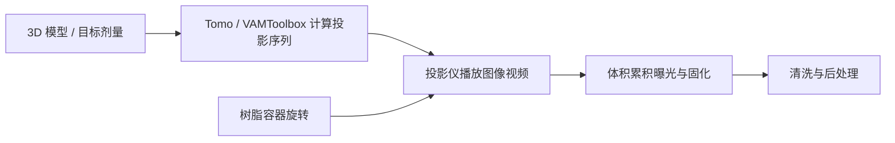

# OpenCAL：计算轴向光刻打印机

**OpenCAL** 是一套开源 CAL（Computed Axial Lithography）体积打印机与后处理平台。打印时旋转装有光敏树脂的容器，并从多个角度投射计算出的二维光图案；当目标区域累积足够光剂量后，零件在体积内形成，而不是逐层堆叠。OpenCAL 以低成本商用光学组件和可快速制造的零件为基础，面向研究、教育与创客空间复现。

## 英文缩写速查

| 缩写 | 英文全称 | 简要说明 |
|---|---|---|
| CAL | Computed Axial Lithography | 通过多角度光投影在树脂体积中形成目标形状的打印方法 |
| VAM | Volumetric Additive Manufacturing | 体积增材制造；CAL 所属的制造路线 |
| OST | Optical Scattering Tomography | 光学散射层析；论文提及的 VAM 技术进展 |
| DLP | Digital Light Processing | 投影图案的数字光处理投影技术 |

## 核心结构 / 机制

1. **模型与剂量目标：** 将三维目标转换为体素/剂量分布。
2. **投影优化：** [VAMToolbox](../../sources/repos/vamtoolbox.md) 从目标体计算不同角度所需的投影序列，并考虑光学与树脂模型。
3. **旋转曝光：** 旋转树脂容器，同步播放投影序列；目标位置累计剂量并固化。
4. **后处理：** 清洗未固化树脂并回收材料。OpenCAL 论文记录了溶剂清洗与离心清洗模块的设计。

### 流程总览

## 核心组件

| 组件 | 作用 |
|---|---|
| OpenCAL 控制软件 | 在 Raspberry Pi 5 上运行，管理打印机操作与人机界面 |
| CAL-hardware | 提供光学、机械与结构件的硬件设计资料 |
| Tomo | 提供投影生成的图形化操作界面 |
| VAMToolbox | 提供投影序列计算与优化算法 |

## 工程实践与开放状态

- OpenCAL 控制软件、硬件设计、Tomo 与 VAMToolbox 均有公开代码或设计资料；各仓库的许可不完全相同。
- OpenCAL 面向研究用途。实际复现需自行核对光学组件、树脂化学、投影标定和硬件安全要求。
- VAMToolbox README 表明该库不是 OSI-approved open source；不要将其许可与 OpenCAL 主仓库混为一谈。
- CAL 的体积曝光速度来自多角度同时构造目标，而具体打印精度、树脂兼容性与成功率取决于光学、剂量优化和材料参数，不能仅凭“无层打印”推断。

## 关联页面

- [Blender](./blender.md) — 可作为网格模型的上游编辑与格式转换工具；打印前仍需按 OpenCAL 流程计算投影序列。
- [FreeCAD](./freecad.md) — 参数化机械设计工具，可用于制作打印机结构件；与 CAL 打印工艺本身不同。

## 参考来源

- [OpenCAL 项目文档](../../sources/sites/opencal-org.md)
- [OpenCAL 主仓库归档](../../sources/repos/opencal.md)
- [VAMToolbox 归档](../../sources/repos/vamtoolbox.md)
- [OpenCAL 论文](../../sources/papers/opencal_arxiv_2509_02865.md)
- [CAL 奠基论文](../../sources/papers/cal_original_science_2019.md)

## 推荐继续阅读

- [OpenCAL 官方文档](https://opencal-org.readthedocs.io/en/stable/)
- [OpenCAL GitHub](https://github.com/computed-axial-lithography/OpenCAL)
- [Tomo](https://github.com/computed-axial-lithography/tomo)
- [VAMToolbox](https://github.com/computed-axial-lithography/VAMToolbox)
- [OpenCAL 论文：arXiv:2509.02865](https://arxiv.org/abs/2509.02865)
- [CAL 原始论文（Science, 2019）](https://doi.org/10.1126/science.aau7114)
