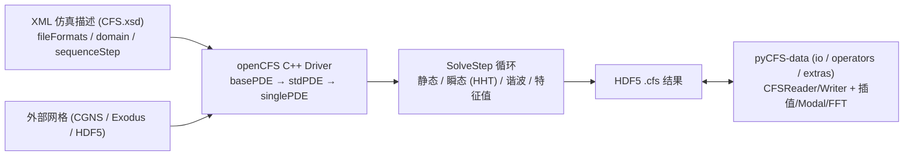
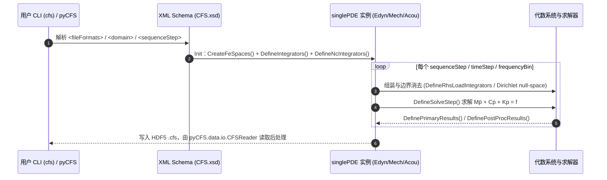

# openCFS：有限元多物理场仿真

## 一句话定义

**openCFS（Coupled Field Simulation）** 是面向物理场及其耦合的开源有限元建模与仿真工具，可作为执行器、传感器和振动声学问题的分析候选。

## 英文缩写速查

| 缩写 | 英文全称 | 简要说明 |
|------|----------|----------|
| CFS | Coupled Field Simulation | 耦合场仿真 |
| FEM | Finite Element Method | 有限元法 |
| PDE | Partial Differential Equation | 描述物理场的偏微分方程 |
| XML | Extensible Markup Language | 仿真配置所用的标记语言 |

## 为什么重要

机器人部件分析可能同时涉及电磁力、结构振动与温升。openCFS 提供多场和耦合求解入口，值得在需要场级仿真时评估；是否适合某一关节或传感器仍需用实际模型验证。

## 核心原理

| 核心信息 | 说明 |
|------|------|
| 维护组织 | openCFS 软件促进协会（奥地利维也纳）；官网列出的社区包含埃尔朗根-纽伦堡大学（FAU Erlangen-Nürnberg）、TU Wien、TU Graz 等高校研究人员，非单一高校独占项目 |

输入包括网格、材料、边界条件与 XML 问题配置；以有限元离散物理 PDE，并按指定分析类型求解，输出场量与后处理结果。

| 层次 | 官方资料列出的能力 |
|------|--------------------|
| 物理场 | 声学、力学、静电、磁场、热场、压电 |
| 场间耦合 | 振动声学、热力学、磁力学、压电声学等 |
| 分析方式 | 静态、瞬态、谐波、多谐波与特征频率 |
| 扩展能力 | 非共形网格、模型降阶、结构优化 |

声学论文（`arXiv:2207.04443v3`）进一步给出类层次 `basePDE` → `stdPDE` → `singlePDE`（如 `acousticPDE`、电磁模块 `openCFS-Edyn`）及 Mortar 非共形旋转网格接口；`pyCFS-data`（`arXiv:2405.03437v3`）则提供 `pyCFS.data.io.CFSReader/CFSWriter`（读写 HDF5 `.cfs`）、RBF/投影插值与 SNGR 源项前后处理。配套资料统一保存在本实体，不将每篇说明论文拆成独立项目。

## 源码运行时序图

图依据：`arXiv:2207.04443v3` §3–§4（PDE 基类接口与 C++ 执行周期）、`arXiv:2405.03437v3` §2–§4（`pyCFS.data.io` / `operators`）与 GitLab `openCFS/cfs` 源码树（`source/`、`Testsuite/`、`CMakeLists.txt`）。

## 工程实践

1. 从[官方安装文档](https://opencfs.gitlab.io/userdocu/Installation/CFS/)选择 Linux、macOS 或 Windows 发行包。
2. 按官方教程复现一个单场案例，记录网格、材料参数、边界与求解类型，再增加耦合。
3. 通过网格收敛与解析解或实测量校核结果；用于机器人部件时，可从温度、位移、磁场或频响中选一个明确目标量。这是工程使用建议，本次未实测。
4. 用用户文档的 ParaView/Python 后处理说明组织输出；配套数据论文的具体接口以其实现文档为准。

### 开源核查

**2026-10-18：已开源。** 官网直接链接[官方 GitLab](https://gitlab.com/openCFS/cfs)、发行包与用户文档，主体软件采用 MIT 许可。第三方求解器、依赖与可选优化功能需单独核对许可和安装要求。本次未安装或编译。

## 局限与风险

- 面向连续物理场数值求解；本次资料不能证明它适合实时全身控制或大规模强化学习训练。
- 耦合结果依赖材料、边界和网格质量；功能列表不能代替目标工况的精度、收敛与计算成本验证。
- 官方提供代码与教程，但本次未逐项复现功能，也未验证各平台发行包的兼容性。
- 2026 年综述保留官网给出的出版信息；相关论文主要据作者摘要提炼，不填写未经核验的性能数字。

## 关联页面

- [FEMM](./femm.md)：已有磁场、静电、热流等有限元工具入口，可对照分析需求与建模方式。
- [PYLEECAN](./pyleecan.md)：电机设计自动化框架；若目标为电机参数化设计，可结合其工作流评估工具选型。
- [Engineering Simulation and Verification Workflow · 工程仿真建模与验证流程](../methods/engineering-simulation-workflow.md)：对应从网格、材料与 PDE 边界条件出发建立并核验多物理场有限元仿真的标准工程流程。
- [Parametric CAD Workflow · 参数化 CAD 建模流程](../methods/parametric-cad-workflow.md)：承接上游执行器与传感器参数化几何模型输入，为有限元网格划分与耦合场分析提供几何基础。

## 参考来源

- [官方站点与文档核查](../../sources/sites/opencfs.md)
- [官方源码归档](../../sources/repos/opencfs.md)
- [综述、声学及数据处理论文](../../sources/papers/opencfs.md)

## 推荐继续阅读

- 用户文档：https://opencfs.gitlab.io/userdocu/
- 开发文档：https://opencfs.gitlab.io/cfs/
- 2026 年综述：https://doi.org/10.1016/j.softx.2026.103102
