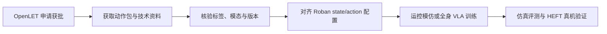

# OpenLET LET-HumanMotion-Roban2

**LET-HumanMotion-Roban2** 是乐聚与青瞳视觉联合打造、面向鲁班人形运控训练和评测的全身动作数据集。官方公开说明给出五类动作、Roban 机型重定向与 120 fps 重采样；数据通过 OpenLET 平台申请获取。

## 一句话定义

**申请制的 Roban 全身动作参考数据，可支持运控模仿学习和技能覆盖评测；公开文档未列精确条数。**

## 英文缩写速查

| 缩写 | 英文全称 | 简要说明 |
|------|----------|----------|
| BFM | Behavior Foundation Model | 此处指 LejuBFM 文档中的通用运控基模部署环境 |
| VLA | Vision-Language-Action | LeTools 教程展示的全身视觉-语言-动作策略训练路线 |
| IL | Imitation Learning | 从参考动作或演示轨迹学习机器人策略 |
| HEFT | — | 教程中用于 Roban 真机控制的控制器 |
| fps | frames per second | 官方说明重采样到每秒 120 帧 |

## 数据集概况

| 项目 | 官方公开内容 |
|------|--------------|
| 制作方 | 乐聚机器人与青瞳视觉 |
| 动作类别 | 非交互动作、环境交互、物体交互、武术、舞蹈 |
| 机型适配 | 动作全部重定向至鲁班机型 |
| 采样 | 120 fps 重采样 |
| 用途 | 运控能力训练与评测 |
| 申请 | 通过 [OpenLET 数据平台](https://openlet.openatom.tech/data/let-humanmotion-roban2) 提交；条款和权限以平台及审批结果为准 |
| 代码 | 已有访问权限时查看 [LET-HumanMotion-Roban2 技术仓](https://atomgit.com/OpenLET/LET-HumanMotion-Roban2.git)；代码可访问不代表数据已获批 |
| 精确规模 | 当前公开文档未列条数；“近四万条”需在数据平台或获批包内核验 |

## 能用在哪

- **全身运控模仿训练：** 把经过机器人机型重定向的参考动作作为轨迹跟踪监督，训练策略复现非交互、环境交互、物体交互以及高动态动作。
- **动作跟踪基准：** 按动作类别建立留出评测，比较策略在跟踪误差、完成率、稳定性和接触事件上的差异；应在获得数据后依据实际标签定义指标。
- **训练数据扩展：** 与自采真机演示或其它技能数据组合，考察动作先验对 VLA 操作/移动任务的帮助。官方公开页未说明语言标签、图像模态或文件 schema，因此不应把它直接当作完整 VLA episode 数据。
- **真机复现：** [LejuBFM 环境与部署说明](../../sources/sites/lejubfm-openlet-docs.md)覆盖 Roban 2.2 的 sonic/heft 编译环境；[LeTools Roban 教程](../../sources/sites/letools-roban-wholebody-vla.md)展示全身 VLA 训练和 HEFT 推理链路。二者提供复现方向，不构成对数据包字段兼容性的保证。

## 数据到策略的复现路径

关键工程门槛不是单纯把动作帧送入策略，而是核验获批数据的状态/动作字段、相机或语言观测、切分协议与 Roban 控制配置是否一致。

## 工程实践与限制

1. 先从平台申请数据，阅读审批返回的许可和使用条款；不要从代码仓可见性推断数据权限。
2. 审核包内文件清单、标注、时间戳、采样频率和训练/测试划分。公开网页只明确 120 fps 与机型重定向，没有公布字段级 schema 或精确样本量。
3. 若采用 LeTools 全身 VLA 教程，注意其示例转换脚本以 rosbag 为输入，导出 23D state / 32D action，并按 50 Hz 训练/控制。需要做数据适配和重采样检查，不能默认等价于 OpenLET 发布格式。
4. LejuBFM setup 文档限定 Roban 2.2、`ROBOT_VERSION=17`；部署到其他本体需单独适配，不可照搬真机编译与控制配置。

## 关联页面

- [OpenLET 社区](./openlet.md) — LET 系列数据与社区资源总览
- [LeTools](./letools.md) — 数据转换、VLA 训练与真机推理工具链
- [乐聚机器人](./leju-robotics.md) — 机型与运营方
- [LET-Base-Dataset](./let-base-dataset.md) — Kuavo 轮臂操作数据集（与本数据集机型/用途不同）
- [LejuLab-Deploy](./cn-os-lejulab-deploy.md) — 乐聚控制部署源码索引
- [模仿学习](../methods/imitation-learning.md)

## 推荐继续阅读

- [OpenLET 数据申请页](https://openlet.openatom.tech/data/let-humanmotion-roban2)
- [LejuBFM OpenLET 说明](https://www.lejubfm.lejurobot.com/docs/datasets/openlet)
- [LeTools Roban 全身 VLA 教程](https://www.letools.lejurobot.com/docs.html#tutorials/roban_wholebody_vla.md)

## 参考来源

- [OpenLET 数据集与申请归档](../../sources/datasets/openlet-humanmotion-roban2.md)
- [LejuBFM 官方文档归档](../../sources/sites/lejubfm-openlet-docs.md)
- [Lejulab_ARM 代码仓归档](../../sources/repos/lejulab-arm.md)
- [LeTools Roban 全身 VLA 教程归档](../../sources/sites/letools-roban-wholebody-vla.md)
