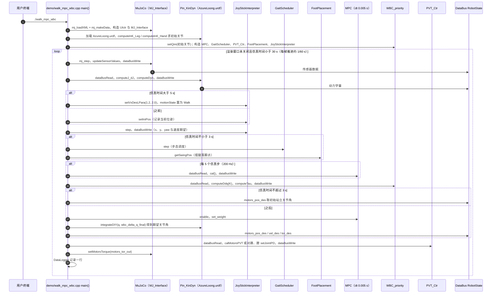

# OpenLoong-Dyn-Control

**OpenLoong-Dyn-Control** 提供青龙人形在 **MuJoCo** 上的 **MPC + 全身控制** 研究与仿真 demo。

## 英文缩写速查

| 缩写 | 英文全称 | 简要说明 |
|------|----------|----------|
| MuJoCo | Multi-Joint dynamics with Contact | 接触丰富的刚体物理仿真引擎 |
| MPC | Model Predictive Control | 滚动时域内优化控制序列的预测控制 |
| WBC | Whole-Body Control | 协调全身关节满足多任务/约束的控制基础设施 |
| SLAM | Simultaneous Localization and Mapping | 同步定位与建图 |
| EtherCAT | Ethernet for Control Automation Technology | 高实时性工业以太网总线 |

## 为什么重要

- **与导航栈区分**：本仓属 **腿式人形运控**，非 Nav2/SLAM。
- **与 Framework 分工**：Framework 偏实机 C++ 全链；Dyn-Control 偏算法复现与论文级 demo。

## 核心结构/机制

| 能力 | 说明 |
|------|------|
| **MPC** | 质心/足端规划 |
| **WBC** | 关节力矩分配 |
| **MuJoCo** | 仿真验证与盲踩障碍 |

## 常见误区或局限

- **勿与 Autoware/Nav2 混栈** — 输出为关节/力矩级控制，非 `cmd_vel`。
- **硬件**：实机需配合 [OpenLoong](./openloong.md) Framework 与 EtherCAT 驱动。

## 源码运行时序图

入口：`./walk_mpc_wbc`（在 `build/` 目录运行；MuJoCo 仿真，`mj_loadXML("../models/scene.xml")`；其余示例 `walk_wbc`、`jump_mpc` 未读，未画）

图依据：loongOpen/OpenLoong-Dyn-Control@4dd7a7e，读过 `README.md`（构建与运行命令）、`demo/walk_mpc_wbc.cpp`（main 全文）。算法类（MPC、WBC、GaitScheduler 等）的内部实现未读，图只标出 main 中可见的调用。

## 参考来源

- [OpenLoong-Dyn-Control 源码归档](../../sources/repos/openloong-dyn-control.md)（<https://github.com/loongOpen/OpenLoong-Dyn-Control>）

- [sources/repos/openloong_dyn_control.md](../../sources/repos/openloong_dyn_control.md)
- [loongOpen/OpenLoong-Dyn-Control](https://github.com/loongOpen/OpenLoong-Dyn-Control)
- 源码核对（2026-11-02）：loongOpen/OpenLoong-Dyn-Control@4dd7a7e，读过 README.md、demo/walk_mpc_wbc.cpp；时序图依据以上文件，未运行代码。

## 关联页面

- [OpenLoong](./openloong.md)
- [MPC 与 WBC 集成](../concepts/mpc-wbc-integration.md)
- [导航·SLAM·自动驾驶栈总览](../overview/navigation-slam-autonomy-stack.md)

## 推荐继续阅读

- https://www.openloong.org.cn/pages/api/html/index.html
