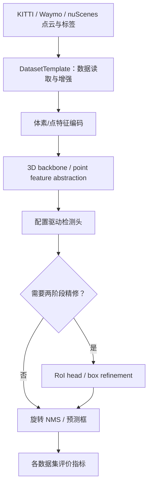
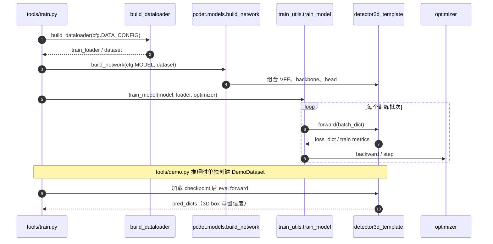

# OpenPCDet — 官方源码与原始技术文档深读

## 一句话定义

OpenPCDet 是 PyTorch 的点云 3D 检测工具箱，统一 DatasetTemplate、网络 build_network 和训练/推理入口，PointRCNN 与 PV-RCNN 是它支持的不同研究方法。

## 英文缩写速查

| 缩写 | 英文全称 | 简要说明 |
|---|---|---|
| LiDAR | Light Detection and Ranging | 点云的测距源 |
| BEV | Bird's-Eye View | 鸟瞰图上的二维卷积表征 |
| VFE | Voxel Feature Encoder | 把体素内原始点编码成稀疏体素特征 |
| RoI | Region of Interest | 二阶段模型的候选区域 |
| NMS | Non-Maximum Suppression | 旋转3D框后处理去重 |
| mAP | mean Average Precision | 检测精度指标 |

## 为什么重要

真实机器人系统需要复现不同 3D 检测模型，但每篇论文独立实现的数据预处理、训练脚本、3D box 坐标约定通常不一致。OpenPCDet 把点云数据集、增强、特征编码、骨干、预测头和评估分离，使 KITTI、Waymo、nuScenes 等实验可复用公共组件。**它是框架，不是一篇新的 PointRCNN/PV-RCNN 论文**。

## 核心原理与方法

1. 数据集抽象：`pcdet/datasets/dataset.py::DatasetTemplate` 管理 POINT_CLOUD_RANGE、POINT_FEATURE_ENCODING、DATA_AUGMENTOR、DATA_PROCESSOR 和 batch collate；独立的数据集类提供原始点/标注。
2. 检测网络：`pcdet/models/detectors/detector3d_template.py` 的 `build_networks()` 装配 VFE、3D backbone、BEV 映射/2D backbone、PFE、dense head、point head 或 RoI head，不同配置使用不同模块子集。
3. 训练与推理：`tools/train.py` 从 YAML 构造 loader、model、optimizer/scheduler，再调用 `train_utils.train_utils.train_model`；`tools/demo.py` 构造 DemoDataset 后推理并 Open3D 可视化。
4. 统一几何参数：README 定义 3D box 为 `(x,y,z,dx,dy,dz,heading)`；并提供旋转 IoU/NMS、proposal 细化及多卡训练。
5. **独立算法身份**：PointRCNN（原始点前景分割→3D proposal→二阶段精修）与 PV-RCNN（稀疏体素 backbone+体素到关键点聚合+RoI-grid pooling）不能因共用框架而合并为一个论文节点。

## 流程总览（作者技术文档/官方模块）

## 源码运行时序图

参照官方库 https://github.com/open-mmlab/OpenPCDet、README 与实际可执行模块（源码快照 `233f849`）。这是**关键调用路径**，并非已运行单步 profiler。

## 实验与评测

官方 README 的 KITTI val 中等难度 Car@R11：PointPillar 77.28、SECOND 78.62、PointRCNN 78.70、PV-RCNN 83.61（官方给定训练环境）。这些数值来自**不同模型配置**，是参考复现结果而不是 OpenPCDet 跨所有数据集的单一性能；Waymo 还区分 20%/100% 训练样本，nuScenes 使用不同的 NDS/mAP。

## 结论

OpenPCDet 值得作为 3D 检测的工程**统一复现层**；真正比较 PointRCNN、PV-RCNN、PointPillars 时要以同数据集、难度分组和配置的实验为依据，不能将源码合集误当单篇论文结果。

## 工程实践

官方流程以 `docs/GETTING_STARTED.md` 为准：整理 KITTI/Waymo 数据→生成 dataset info 和 gt database→选择 `tools/cfgs/kitti_models/*.yaml`→执行 `python tools/train.py --cfg_file tools/cfgs/kitti_models/pv_rcnn.yaml`，再使用 `python tools/test.py` 或 `python tools/demo.py` 核对预测。安装依赖要按官方 `docs/INSTALL.md`；GPU、spconv、PyTorch 和自定义 CUDA 算子需匹配。**没有在本环境运行训练**。

## 局限与风险

多模型工具箱并不保证所有数据集或所有训练配置可直接互换；不同传感器 LiDAR ring/坐标、类别映射、label 约定与类别范围必须重配。部分历史 README 的 PyTorch/SpConv 版本只是当时支持范围，不应据此宣称 2026 环境开箱即用。Waymo 许可限制权重再分发。常见失败源是 custom dataset 的标定、box yaw、点云预处理和 checkpoint 与 config 不匹配。

## 关联页面

- [PointNet++（点集分层特征学习）](./paper-pointnet2.md)
- [PointRCNN（原始点云二阶段检测）](./paper-pointrcnn.md)
- [PV-RCNN（点体素特征融合检测）](./paper-pv-rcnn.md)

- [LIO-SAM](./lio-sam.md)
- [LVI-SAM](./paper-lvi-sam.md)

## 参考来源

- [OpenPCDet 官方技术资料归档](../../sources/repos/vision3d_openpcdet_20261108.md)
- [OpenPCDet 原作者仓库及文档](https://github.com/open-mmlab/OpenPCDet)（233f849，主要执行入口及 README 对照）

## 推荐继续阅读

- [官方 README 与代码入口](https://github.com/open-mmlab/OpenPCDet)
