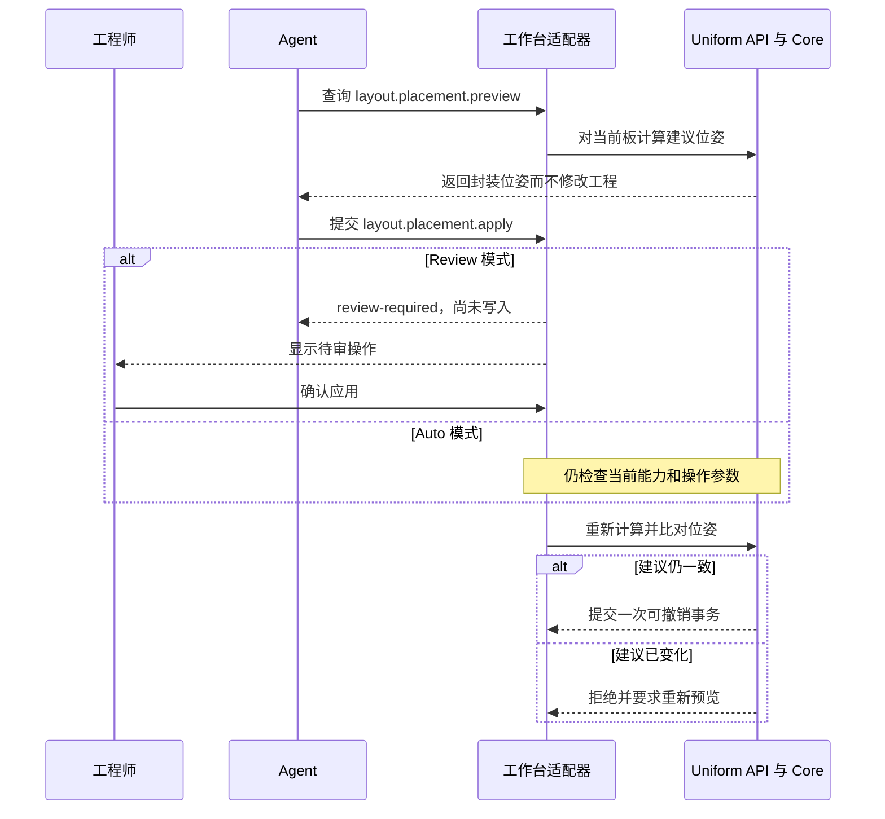

# OpenPE: AI-Native Power Electronics Workbench · 智能体协作电力电子设计工作台

## 一句话定义

OpenPE 将 Agent 会话、原理图、PCB 布局、3D 模型与原生 KiCad 源文件放到同一个桌面项目里。人可以手改并运行受支持的仿真，不需要先连接 Agent。

## 英文缩写速查

| 缩写 | 英文全称 | 简要说明 |
|---|---|---|
| EDA | Electronic Design Automation | 原理图、PCB 布局和电气规则检查工具 |
| PCB | Printed Circuit Board | 承载电路、连线和器件的板卡 |
| SPICE | Simulation Program with Integrated Circuit Emphasis | 用模型与网表计算电路响应；这里主要运行受支持的瞬态 |
| EMC | Electromagnetic Compatibility | 电磁兼容；内置插件筛查几何风险，不做合规认证 |
| STEP | Standard for the Exchange of Product model data | 外壳实体的三维交换格式，不是 PCB 制造数据 |

## 核心信息

| 项目 | 内容 |
|---|---|
| 发布 | 2026-11-23，v0.1.0 Beta |
| 机构 | 西湖大学、加州大学伯克利分校、加州大学洛杉矶分校、麻省理工学院、埃因霍温理工大学、格拉斯哥大学（官网署名所列关联机构） |
| 源码 | Apache-2.0；第三方资源另见 NOTICE，EMC Flyback 原始设计为 CC BY 4.0 |
| 运行 | Electron 桌面应用；Windows x64 和 macOS arm64 提供未签名安装包，macOS 未公证；Linux x64 需源码运行和本地构建求解器 |

## 为什么重要

对机器人电源、配电板、传感器转接板原型，Agent 的输出可以从一段建议变成明确的工程对象变更，工程师能看选中对象、审核操作、撤销，并在 KiCad 中复检。相对 [KiCad](./kicad.md)，OpenPE 的附加价值是会话和工程上下文、统一的受限编辑和插件链；KiCad 仍适合作为更完整的规则检查与制造交接入口。[Qucs-S](./qucs-s.md)则是专用电路仿真前端，不替代板级设计。

## 核心原理

- **同一工程，两个入口。** 操作面板和 Agent 通过 Uniform API 访问当前项目。Core 维护接受后的设计、版本和整工程撤销；插件与本地主机提供受限的分析和导出。会话切换不会要求另建一份板卡。
- **能力层级与权限分开。** 对象级是改某个元件或几何对象，操作级是组合变换，任务级是架构分类但 Beta 没有注册任务级自动设计。Codex、Claude Code 与 Cursor 的接入能调用工作台工具；DeepSeek Harness 和 Pi 只有受限上下文与提案，由人复核后应用。Review 模式返回待审项，Auto 也只能执行当前公开且通过校验的能力。
- **布局应用不等于自动布线。** 框选适合的板外封装可先显示建议位姿；画布有焦点且建议可见时按 Tab 应用。提交时会重新计算建议，若位姿不符就要求重新预览。区域批注给 Agent 提供对象和位置上下文，但不等于该区域已改好。

### 运行时序：布局建议与复核

## 工程实践

| 功能 | 可用于 | 不能推出 |
|---|---|---|
| SPICE Simulation | 运行受支持的 ngspice 瞬态；官网以 EMC Flyback 的 12 V 目标和 ±1% 容差演示 R15 调整，官方例程为 10 ms / 最大步长 5 ns | 不是所有拓扑都可编译；该演示不证明在实板、不同负载或公差组合下稳压 |
| Layout Thermal | Gmsh 建网格、Elmer 求稳态板温；可导入受支持的 SPICE 损耗 | 不覆盖全装配热交换；焊盘温度不是结温，外壳 CAD 不参与当前求解 |
| Layout Parasitics | 提取两端焊盘间的直流电阻和最短路径的部分电感 | 不等于闭合回路总电感或电磁场求解 |
| EMC Analysis / PE Layout Skill | 几何风险审查、工程指导与人工复查记录 | 不等于 EMC 合规测试，也不是自动布局布线 |
| Model CAD / JavaScript 扩展 | 改有限类型的外壳几何并导出实体 STEP；用 QuickJS 增加受限定能力的插件 | STEP 不含板和封装体；不是通用 CAD 导入或任意本机脚本执行 |

## 局限与风险

- 原生 KiCad 文件保存在本机，但你选择的 Agent 提供方会接收发出的提示和上下文；连接前先确认设计资料可分享。Beta 不内置各 Agent 运行时。
- 官方示例和源码能确认被支持的操作，不能把演示里的单次走线修改写成通用的「缩短近一半」效果；未获得可按同一口径复算的对照测量。
- Beta 仅覆盖部分 KiCad 10 能力，不宣称完整 ERC/DRC 对等、通用导入、自动布线或生产合格。实板应另审网络、封装、制造规则、保护、热与 EMC，并核对真实负载和波形。

## 关联页面

- [智能体工具调用接口](../methods/agent-tool-use-interface.md) — 核对参数合法、写入授权、待审状态和实际提交的区别。
- [工程仿真建模与验证流程](../methods/engineering-simulation-workflow.md) — 用载荷、边界条件、网格与工件身份解释结果，不只看是否出图。
- [人形机器人硬件设计纵深 · Stage 4](../../roadmap/depth-humanoid-hardware-design.md) — 将电源板设计预审放回板级落地和实测链路。

## 参考来源

- [官网、演示与团队归档](../../sources/sites/openpe.md)
- [v0.1.0 Beta 发布与固定源码归档](../../sources/repos/openpe.md)

## 推荐继续阅读

- [原生格式与制造导出](https://github.com/Open-Power-Electronics/OpenPE/blob/v0.1.0/docs/FORMAT.md#manufacturing-export) — 区分设计源文件、CAD 交换文件和制造交付件。
- [布局寄生参数的输出与限制](https://github.com/Open-Power-Electronics/OpenPE/blob/v0.1.0/docs/LAYOUT.md#layout-parasitics) — 核对两端电阻和路径部分电感的定义。
