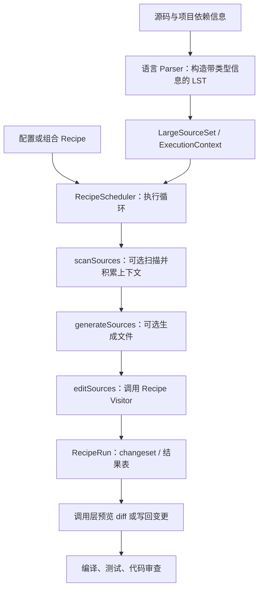
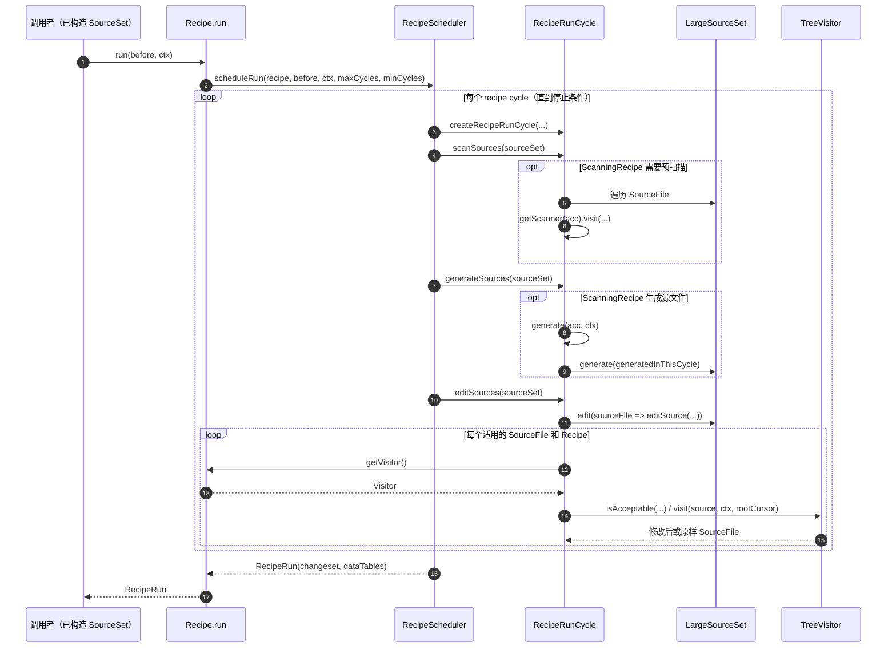

# OpenRewrite｜基于 LST 的自动化源码重构框架

## 一句话定义

**OpenRewrite** 是由 Moderne 维护的源码重构生态：解析源码为具有类型信息、保留原始格式的 **Lossless Semantic Tree（LST）**，再用可配置的 **Recipe** 与 **Visitor** 对源码执行可重复的迁移、修复和整理。

## 英文缩写速查

| 缩写 | 英文全称 | 简要说明 |
|------|----------|----------|
| LST | Lossless Semantic Tree | OpenRewrite 的类型感知、格式保留源码树 |
| AST | Abstract Syntax Tree | 常规抽象语法树；与 LST 比较时须注意信息保留范围 |
| CLI | Command-Line Interface | 命令行运行 Recipe 的入口形式，具体工具依所属发行组件 |
| API | Application Programming Interface | Recipe、TreeVisitor、Parser 等公开编程接口 |
| RPC | Remote Procedure Call | 引擎调度器存在远程 visitor 批处理路径，非所有使用均涉及 |

## 为什么重要

- **技术债可以编码成可审查变更：** 框架迁移、API 重命名和规范统一可以通过可组合 Recipe 实施，区别于盲目正则替换；结果仍须代码评审与测试。
- **从“符号匹配”到“语义匹配”：** Java LST 的类型归属帮助区分同名不同类型的引用，并尽量保留原文件格式。
- **与机器人软件工程的关系：** 适合评估在 Java/Gradle/Maven 配套工具、配置文件、管理后台中升级依赖或消除旧 API；这是工程映射，不代表官方提供 ROS 2、C++ 实时控制或运动策略学习的现成 Recipe。

## 核心信息

| 字段 | 内容 |
|------|------|
| 维护者 | Moderne / OpenRewrite 开源社区 |
| 源码 | [openrewrite/rewrite](https://github.com/openrewrite/rewrite) |
| 官方文档 | [docs.openrewrite.org](https://docs.openrewrite.org/) |
| 核心语言与生态 | 以 Java 生态为起点；支持的解析器和 Recipe 随模块变化，许可按模块核实 |
| 许可证 | `rewrite-core` 与多数原有语言模块 Apache-2.0；部分新增语言模块/Recipe 采用 Moderne Source Available License，另有商用模块 |
| 源码核对快照 | [08560af（2026-11-07）](https://github.com/openrewrite/rewrite/tree/08560af3c93b7a87d1cd798a97c1b212e303b16e) |

## 核心原理

1. **解析与类型归属：** 解析器把源文件构造成 LST，保留空白/布局以及可用的语义类型信息；与纯文本替换相比，可进行更精确的代码匹配。
2. **Recipe 编排：** 命令式 `Recipe` 可组合其他 Recipes；也能通过 YAML 声明式配置复合迁移。
3. **Visitor 执行：** `Recipe.getVisitor()` 返回访问器，逐层遍历 LST；语言专用 JavaVisitor/JavaIsoVisitor 负责匹配和替换节点，Cursor 维护访问路径。
4. **扫描—生成—编辑：** 源码调度器 `RecipeScheduler` 每轮调用 `RecipeRunCycle.scanSources`、`generateSources`、`editSources`；其中跨文件扫描/生成主要为 `ScanningRecipe` 服务，普通 Recipe 不必实际使用扫描或生成能力。
5. **交付与验证：** 调度返回变更集，调用层的 Maven/Gradle 插件可以先 dry-run 检查 diff，再应用重构并执行原项目测试；引擎返回 changeset 不等于程序逻辑已验证。

## 流程总览

下图依据官方 LST/Recipes 文档及 `RecipeScheduler` 源码，方括号明确可选分支：

扫描/生成在调度框架中按顺序调用，但没有 ScanningRecipe 时可以不产生对应工作；上图的项目依赖信息是否足够影响类型归属质量。`RecipeRun` 是引擎结果，磁盘写回属于调用工具链。

## 源码运行时序图

**入口：** `Recipe.run(LargeSourceSet, ExecutionContext)`，此时调用者已经构造好 LST/SourceSet；图对应官方 `rewrite-core` 的普通非 RPC 编辑分支，并非臆测 Maven/Gradle 插件内部实现。

**源码依据：** [Recipe.java](https://github.com/openrewrite/rewrite/blob/08560af3c93b7a87d1cd798a97c1b212e303b16e/rewrite-core/src/main/java/org/openrewrite/Recipe.java)、[RecipeScheduler.java](https://github.com/openrewrite/rewrite/blob/08560af3c93b7a87d1cd798a97c1b212e303b16e/rewrite-core/src/main/java/org/openrewrite/RecipeScheduler.java)、[RecipeRunCycle.java](https://github.com/openrewrite/rewrite/blob/08560af3c93b7a87d1cd798a97c1b212e303b16e/rewrite-core/src/main/java/org/openrewrite/scheduling/RecipeRunCycle.java)。`RecipeRunCycle` 同时有 RPC 批处理分支，此图限定在普通 Visitor 路径，未覆盖其细节。

## 工程实践

1. **先选 Recipe，再选插件入口：** Java 工程优先按官方 [Quickstart](https://docs.openrewrite.org/running-recipes/getting-started) 配置 Maven 或 Gradle 插件，在构建配置中激活具体 Recipe；`org.openrewrite.java.ChangeType` 是类型改名的一个示例，不代表所有迁移只需替换类名。
2. **先预览：** Maven 可使用 `mvn rewrite:dryRun`，Gradle 使用 `rewriteDryRun`，检查差异、依赖变更和作用范围后再执行 `mvn rewrite:run` / `rewriteRun`。具体任务名与参数以插件版本文档为准。
3. **确认制品仓库权限：** 官方 Quickstart 提及 Code Genome Project 仓库认证、按 Recipe 许可分级的下载资格；Gradle/Maven 凭证放用户配置或 CI secrets，不写入仓库。
4. **按原项目 CI 验收：** 即使 LST 变换成功，仍需跑编译、单测、集成测试和人工审阅，尤其是 API 语义变更、机器人相关工具链的硬实时或安全关键模块。

**与替代方案的区别：** OpenRewrite 侧重可复用、带语义信息的规则化源码改写；它不是一个自动规划机器人动作的 VLA/强化学习算法，也不能保证改动后系统行为无回归。

## 局限与风险

- **本地内存边界：** 官方文档明确本地 LST 要能放入内存；Moderne 跨仓库缓存与规模化能力不能等同于 `rewrite` 核心库默认能力。
- **许可分层：** 核心框架和大量经典模块是 Apache-2.0，部分较新语言模块是 Moderne Source Available License，部分 Recipes 另有商业许可；不能据仓库根 LICENSE 推断所有 Recipe 均可自由再分发或商用托管。
- **规则范围：** Recipe 的正确性、类型解析依赖、适用项目版本、构建环境仍需逐项验证，不能用“语义级”一词替代测试。
- **复现状态：** 本页通读官方核心文档与定向源码，但未本地执行构建、迁移或对任何机器人项目做成功率基准。

## 关联页面

- [Agentic Coding 软件工程基础](../concepts/agentic-coding-software-fundamentals.md) — 将可重复重构接入评审、CI 与工程取舍。
- [软件安全基础](../concepts/software-security-basics.md) — 依赖漏洞修复仍须供应链核验与回归测试。
- [CodeGraph](./codegraph.md) — 符号关系索引面向代码理解；OpenRewrite 面向可确定执行的源码变换。

## 参考来源

- [OpenRewrite 官方源码归档](../../sources/repos/openrewrite-rewrite.md)
- [OpenRewrite 官方文档归档](../../sources/sites/openrewrite-docs.md)
- [官方源码](https://github.com/openrewrite/rewrite)
- [官方许可证说明](https://docs.openrewrite.org/licensing/openrewrite-licensing)

## 推荐继续阅读

- [OpenRewrite Quickstart](https://docs.openrewrite.org/running-recipes/getting-started) — 插件安装、配置 Recipe 与 dry-run。
- [Recipe 编写指南](https://docs.openrewrite.org/concepts-and-explanations/recipes) — 如何组合命令式和声明式 Recipe。
- [LST 生命周期](https://docs.openrewrite.org/concepts-and-explanations/lossless-semantic-trees) — 解释类型归属和保留格式的必要性。
