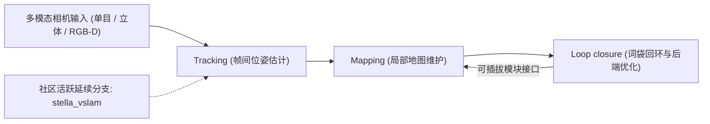

---

type: entity
tags: [repo, vslam, modular, research, eth]
status: complete
updated: 2026-11-18
related:
  - ../entities/orb-slam3.md
  - ../comparisons/lidar-slam-lio-vio-selection.md
sources:
  - ../../sources/repos/openvslam.md
summary: "OpenVSLAM 是模块化视觉 SLAM 框架；社区维护多迁移至 stella_vslam，支持单目/立体/RGB-D。"
---

# OpenVSLAM

**OpenVSLAM** 强调 **模块可替换** 的视觉 SLAM 框架（特征、回环、优化器可插拔）。

## 英文缩写速查

| 缩写 | 英文全称 | 简要说明 |
|------|----------|----------|
| SLAM | Simultaneous Localization and Mapping | 同步定位与建图 |
| RGB | Red-Green-Blue | 彩色图像通道，常与深度 (RGB-D) 配合 |
| LiDAR | Light Detection and Ranging | 激光雷达，地形感知与建图主传感器 |
| LIO | LiDAR-Inertial Odometry | 激光-惯性里程计 |
| VIO | Visual-Inertial Odometry | 视觉-惯性里程计，融合相机与 IMU 估计位姿 |

## 为什么重要

- **教学与实验**：便于替换前端/后端做算法对比。
- **延续项目**：活跃维护请同时关注 stella_vslam 分支。

## 核心结构/机制

| 模块 | 说明 |
|------|------|
| **Tracking** | 帧间位姿估计 |
| **Mapping** | 局部地图维护 |
| **Loop closure** | 词袋回环 |

## 源码运行时序图

**不适用**。经核查官方仓库 `xdspacelab/openvslam`（`master` 分支，GitHub 仓库状态为 `archived: true`，最后提交 `0fcb161` 于 `2021-02-24`），当前仓库树仅包含 `README.md` 一份文件，正文仅指向 *Termination of the release* 停更公告，已移除全部 C++/CMake 源码与可运行示例入口，因此无法基于该仓真实源码核对运行时调用链。若需源码级时序分析，应核对社区延续仓库 [stella-cv/stella_vslam](https://github.com/stella-cv/stella_vslam)。

## 常见误区或局限

- **维护状态**：原仓库 README 提示后续开发重心转移，选型前确认分支活跃度。

## 参考来源

- [sources/repos/openvslam.md](../../sources/repos/openvslam.md)
- [xdspacelab/openvslam](https://github.com/xdspacelab/openvslam)

## 关联页面

- [Gauss-Newton（高斯-牛顿法）](../methods/gauss-newton.md) — 局部建图和后端优化可沿残差线性化理解，具体求解器仍需按所用分支核对。
- [机器人自主探索](../tasks/autonomous-exploration.md) — 视觉地图可作为探索的定位输入，探索目标选择与执行需由下游另行实现。

- [ORB-SLAM3](../entities/orb-slam3.md)
- [LiDAR / LIO / VIO 选型](../comparisons/lidar-slam-lio-vio-selection.md)

## 推荐继续阅读

- https://github.com/stella-cv/stella_vslam
