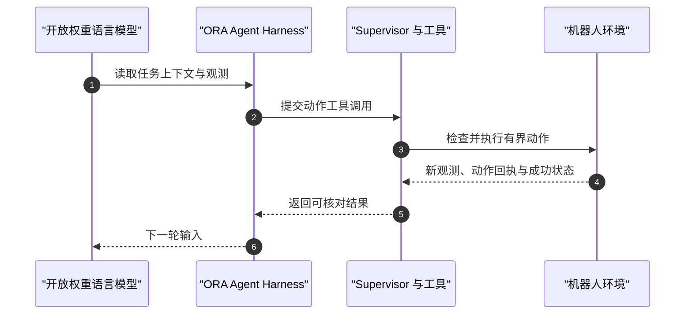

# ORA: Open Robot-Use Agents

## 一句话定义

ORA（Open Robot-Use Agents）是将开放权重语言模型接入机器人环境的开源 harness：模型逐轮选择感知、测量或动作工具；环境 supervisor 执行有界动作并返回回执，模型根据新证据决定下一步。它不训练 VLA、不需机器人示范或任务专属记忆，主要贡献是针对机器人任务设计的上下文、工具和执行边界。

## 英文缩写速查

| 缩写 | 英文全称 | 简要说明 |
|------|----------|----------|
| ORA | Open Robot-Use Agents | 开源机器人使用 agent harness |
| LLM | Large Language Model | 逐轮读取观测并选择工具的语言模型 |
| VLA | Vision-Language-Action | 以视觉和指令为条件输出动作的策略模型 |
| RGB-D | Red-Green-Blue-Depth | RGB 彩色图与深度观测 |
| ReAct | Reasoning and Acting | 推理与工具动作交替进行的 agent 模式 |

## 为什么重要

- **把 agent 控制引入操作闭环：** 与先生成完整脚本再开环运行不同，ORA 在动作后读取实际结果，可据此调整后续动作。
- **把机器人上下文显式化：** 坐标系、夹爪尺寸、控制点和相机标定经 robot card 与 benchmark boundary 传给同一套 agent loop。
- **动作监督可回放：** 保存工具调用、执行结果和回执，便于核对动作与观察之间的因果关系。
- **与现有路线互补：** 可对照 [LLM 机器人控制接口](../concepts/llm-robotics-control-interfaces.md) 的抽象层级，以及 [ASPIRE](../methods/aspire.md) 的代码生成和技能积累路线。

## 核心机制

### 逐工具调用闭环

每轮模型接收当前观测与任务上下文，再发出工具调用。只读感知和测量工具可独立组合；改变环境的动作单独执行。环境返回相机图像、机器人状态、动作回执和剩余预算，作为下一轮证据。

### Prompt bundle、工具集与上下文

- **Prompt bundle：** 系统策略、证据规则、benchmark 边界、robot card、任务指令、工具 schema 和当前轮事实。适配新机器人主要更新其卡片与环境边界。
- **工具集：** 对象查找、分割、像素到世界坐标标记、几何测量、抓取规划、末端位姿移动、夹爪动作、观察与任务结果检查。
- **上下文管理：** 每轮提供当前证据；较早的文本、图像和结果可以引用或概述，需要时再取回。
- **信任边界：** 成功判定实现、仿真 ground truth、物体真值与接触信息不提供给模型；评测器只返回允许的结果。

## 评测与结果

官方博客报告 DeepSeek-V4.1-Flash + ORA 的仿真成功率：

| 基准 | 任务规模 | 成功数 | 成功率 |
|------|----------|-------:|-------:|
| RoboTwin C2R | 50 tasks × 5 seeds = 250 cases | 173 / 250 | 69.2% |
| LIBERO-Pro Task and Swap | 8 suites = 800 cases | 651 / 800 | 81.4% |

- 这是项目方报告的 benchmark 结果，使用各 benchmark 官方成功检查；无有效结局的 case 按失败计。
- RPent 等公开基线的测试协议、样本数和记忆/策略设置不完全一致，不能只按百分比严格排名。
- RoboDojo 也提供首轮扫描结果；当前公开量化证据主体仍来自仿真。

## 工程实践

1. 从官方 Getting Started 选择具体环境和任务，先跑安装与 launch check；synthetic doctor 路径不是 benchmark 成绩。
2. 核对硬件和依赖。单 GPU 完整仿真指引建议 Linux、NVIDIA GPU、32 GB 显存或以上、uv 和模型 API key；不同 benchmark 依赖隔离。
3. 估算调用成本：每个动作步骤都需要模型决策；报告 token 成本不含 GPU 和仿真成本。
4. 保存请求、工具调用、监督结果、观测和 episode 状态，便于按证据链复现失败。
5. 真机使用要单独验证坐标系、相机、碰撞和动作精度；小规模演示不能替代安全性与泛化评估。

## 局限与风险

- 每次工具调用都等待模型决策，闭环灵活性以延迟和 API 成本为代价。
- 感知和动作受预定义工具及标定质量限制，几何误差会影响执行。
- 核心量化结果来自仿真，真机材料为 preliminary demonstration。
- 开放权重不代表评测已经验证本地自托管；核算时需计入模型服务、GPU 和仿真成本。
- 跨工作基线的任务数和设置可能不对齐，解读比较须回到各自协议。

## 关联页面

- [LLM 机器人控制接口](../concepts/llm-robotics-control-interfaces.md) — 对比逐轮 agent、程序控制与策略接口。
- [ASPIRE](../methods/aspire.md) — coding agent 调试并积累机器人技能程序。
- [LIBERO benchmark](../entities/libero-benchmark.md) — ORA 使用的操作评测环境之一。
- [HoloAgent](../entities/holoagent.md) — 语言任务、记忆和工具驱动的机器人 agent 系统。
- [具身大模型评测基准选型闭环](../queries/embodied-eval-benchmark-selection-loop.md) — ORA 的 RoboTwin / LIBERO-Pro 成功率属其 ③ 策略任务成功率层；跨工作协议不齐时不可直接比榜，仿真结论外推真机需过 ④ 层校准。

## 参考来源

- [ORA 官方博客](../../sources/blogs/ora-open-robot-use-agents.md)
- [ORA 项目说明页](../../sources/sites/ora-open-robot-use-agents.md)
- [ORA 官方代码仓库](../../sources/repos/ora-open-robot-use-agents.md)

## 推荐继续阅读

- [ORA 官方博客](https://haoailab.com/blogs/ora/)
- [ORA 官方代码仓库](https://github.com/hao-ai-lab/ORA)
