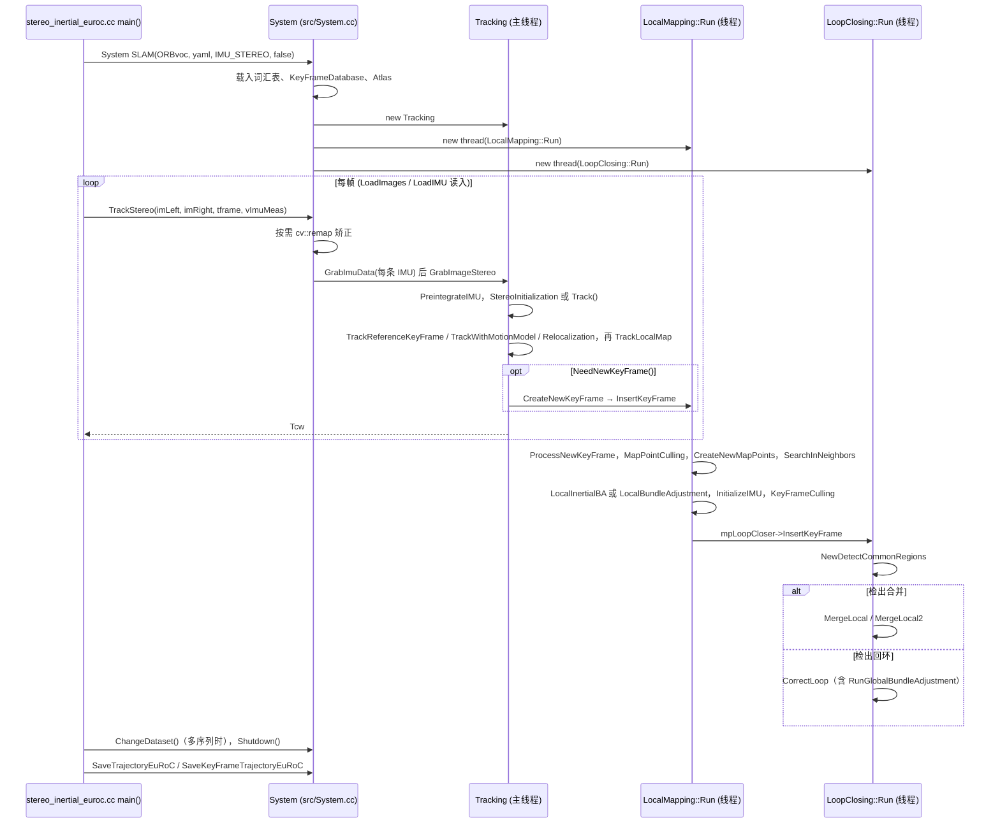

---

type: entity
tags: [repo, vslam, vio, visual-slam, research, eth]
status: complete
updated: 2026-11-21
related:
  - ../comparisons/lidar-slam-lio-vio-selection.md
  - ../entities/vins-fusion.md
  - ../entities/paper-vs-graphs-visual-slam-scene-graph.md
  - ../overview/navigation-slam-autonomy-stack.md
original:
  - ../../sources/papers/orb_slam3_arxiv_2007_11898.md
sources:
  - ../../sources/papers/orb_slam3_arxiv_2007_11898.md
  - ../../sources/repos/orb_slam3.md
summary: "ORB-SLAM3 支持单目/双目/RGB-D 与 IMU 的视觉/视觉-惯性 SLAM，包含快速 MAP 惯性初始化、Atlas 多地图与四尺度数据关联。"
---

# ORB-SLAM3

**ORB-SLAM3**（Campos et al., T-RO 2021，[arXiv:2007.11898](https://arxiv.org/abs/2007.11898)）是学术与工程界广泛引用的 **视觉 / 视觉-惯性 / 多地图 SLAM** 开源库。

## 一句话定义

**首个覆盖针孔/鱼眼相机与单目/双目/RGB-D/IMU 紧耦合的多地图 SLAM 开源库**：通过短程共视、中程局部地图复用、长程高召回三帧重投影地点识别与 Atlas Welding BA 跨会话融合，结合数秒收敛的 MAP 惯性初始化，将室内 VIO 推至厘米/亚厘米级精度。

## 英文缩写速查

| 缩写 | 英文全称 | 简要说明 |
|------|----------|----------|
| RGB | Red-Green-Blue | 彩色图像通道，常与深度 (RGB-D) 配合 |
| IMU | Inertial Measurement Unit | 惯性测量单元，提供加速度与角速度 |
| SLAM | Simultaneous Localization and Mapping | 同步定位与建图 |
| ROS 2 | Robot Operating System 2 | 机器人系统集成与通信的常用中间件 |
| LiDAR | Light Detection and Ranging | 激光雷达，地形感知与建图主传感器 |
| LIO | LiDAR-Inertial Odometry | 激光-惯性里程计 |
| VIO | Visual-Inertial Odometry | 视觉-惯性里程计，融合相机与 IMU 估计位姿 |

## 为什么重要

- **多传感器模式**：单目、双目、RGB-D、IMU 紧耦合。
- **多地图 Atlas**：适合长时间运行与跟踪丢失恢复。

## 核心机制与系统结构

| 特性 | 说明 |
|------|------|
| **ORB 特征** | 快速特征提取与匹配 |
| **IMU 融合** | 视觉-惯性紧耦合 |
| **回环/重定位** | DBoW2 + 位姿图 |

## 工程实践与实验基准（T-RO 2021 全文核对）

| 维度 | 论文结果与部署要点（Table II–VII） |
|------|------------------------------------|
| **EuRoC 全序列** | **Stereo-Inertial** 全 11 序列平均 RMS ATE **0.035 m**（尺度误差 **0.6%**）；**V202** 上 Stereo-Inertial RMS ATE **0.014 m**（Tracking 平均 **33.05±9.29 ms**，Mapping 平均 **196.61±54.52 ms**） |
| **TUM-VI Room（AR/VR）** | Mono **0.039 m**、Stereo **0.068 m**、Mono-Inertial **0.011 m**、Stereo-Inertial **0.009 m**（亚厘米级，鱼眼 Kannala-Brandt 模型） |
| **多会话 Atlas** | EuRoC MH01–05：Mono-Inertial **0.065 m**（vs VINS 0.210 m）、Stereo-Inertial **0.047 m**；V103/V203 高动态丢失可通过新 Active Map + Welding BA 自动合并恢复 |
| **实机传感器边界** | 纯旋转探索不可估单目深度；平坦平面匀速无滚转/俯仰运动难激励 IMU 可观性（论文建议改用 Stereo）；户外鱼眼远点（>20 m 天空点）需剔除防漂移；强曝光变化可加 CLAHE 均衡化 |

## 常见误区或局限

- **误区：自带 Nav2 插件** — 官方只提供单机 C++ 示例与旧版 ROS1 包装，上 ROS 2 导航栈需自行完成传感器同步、TF 广播与 `odom -> base_link` 桥接。
- **局限**：重依赖 ORB 角点与描述子匹配，低纹理隧道/白墙环境弱于直接法/光流法（如 BASALT）；GPL-3.0 协议制约闭源商业集成。

## 源码运行时序图

入口：`./Examples/Stereo-Inertial/stereo_inertial_euroc Vocabulary/ORBvoc.txt <EuRoC.yaml> <数据集路径> <时间戳文件>`（README 通过 `euroc_examples.sh` 调用 EuRoC 示例；`build.sh` 编译）。其他传感器示例（`Examples/Monocular/mono_euroc.cc`、`Examples/RGB-D/rgbd_tum.cc` 等）同样是创建 `ORB_SLAM3::System` 后逐帧调用 `TrackMonocular` / `TrackRGBD` / `TrackStereo`。

图依据：ORB_SLAM3@4452a3c，`README.md`、`Examples/Stereo-Inertial/stereo_inertial_euroc.cc`、`src/System.cc`（构造函数、TrackStereo）、`src/Tracking.cc`（GrabImageStereo、Track 内的函数调用）、`src/LocalMapping.cc`（Run）、`src/LoopClosing.cc`（Run）。各函数内部算法未读；LocalMapping/LoopClosing 的分支条件仅按调用名概括；Viewer 线程（可视化开启时）未画。

## 参考来源

- [orb_slam3_arxiv_2007_11898.md](../../sources/papers/orb_slam3_arxiv_2007_11898.md) — 原文（T-RO 2021 / arXiv:2007.11898）全文摘录与实验基准核对
- [sources/repos/orb_slam3.md](../../sources/repos/orb_slam3.md)
- [UZ-SLAMLab/ORB_SLAM3](https://github.com/UZ-SLAMLab/ORB_SLAM3)
- 源码核对（2026-11-02）：UZ-SLAMLab/ORB_SLAM3@4452a3c，读过 README.md、Examples/Stereo-Inertial/stereo_inertial_euroc.cc、src/System.cc、src/Tracking.cc、src/LocalMapping.cc、src/LoopClosing.cc（主流程与调用关系，非逐行）；时序图依据以上文件，未运行代码。

## 关联页面

- [Gauss-Newton（高斯-牛顿法）](../methods/gauss-newton.md) — 局部 BA、惯性 BA 与位姿图承担不同校正职责，可结合非线性最小二乘背景分开阅读。
- [机器人自主探索](../tasks/autonomous-exploration.md) — Atlas 与重定位可服务长程探索，仍需自行对齐 ROS 2、TF、规划和避障接口。

- [RigVis：双目惯性 SLAM 与稠密点云](rigvis.md) — 轻量实验系统，对照 ORB-SLAM3 的视觉惯性闭环与地图优化；源码和指标尚待独立核验。
- [LiDAR / LIO / VIO 选型](../comparisons/lidar-slam-lio-vio-selection.md)
- [VINS-Fusion](../entities/vins-fusion.md)
- [导航·SLAM·自动驾驶栈总览](../overview/navigation-slam-autonomy-stack.md)

## 推荐继续阅读

- [机器人论文阅读笔记：ORB-SLAM3](https://imchong.github.io/Robot_Learning_Paper_Notebooks/papers/09_State_Estimation/ORB-SLAM3__Visual_Visual-Inertial_and_Multi-Map_SLAM/ORB-SLAM3__Visual_Visual-Inertial_and_Multi-Map_SLAM.html)
- https://arxiv.org/abs/2007.11898
