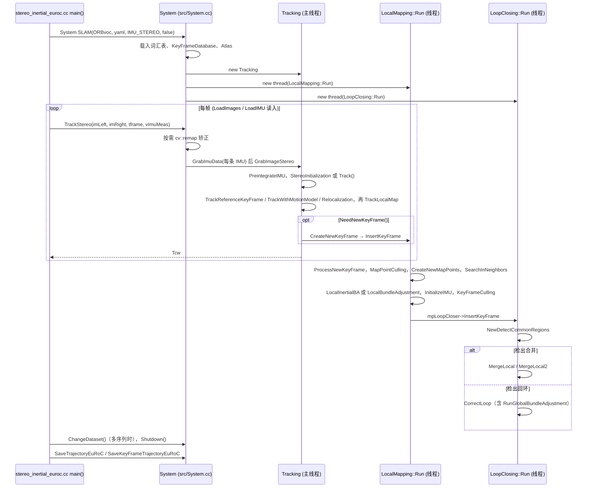

---

type: entity
tags: [repo, vslam, vio, visual-slam, research, eth]
status: complete
updated: 2026-09-15
related:
  - ../comparisons/lidar-slam-lio-vio-selection.md
  - ../entities/vins-fusion.md
  - ../entities/paper-vs-graphs-visual-slam-scene-graph.md
  - ../overview/navigation-slam-autonomy-stack.md
sources:
  - ../../sources/repos/orb_slam3.md
summary: "ORB-SLAM3 支持单目/双目/RGB-D 与 IMU 的视觉/视觉-惯性 SLAM，多地图管理与高精度重定位。"
---

# ORB-SLAM3

**ORB-SLAM3** 是学术与工程界广泛引用的 **视觉/视觉-惯性 SLAM** 开源库。

## 英文缩写速查

| 缩写 | 英文全称 | 简要说明 |
|------|----------|----------|
| RGB | Red-Green-Blue | 彩色图像通道，常与深度 (RGB-D) 配合 |
| IMU | Inertial Measurement Unit | 惯性测量单元，提供加速度与角速度 |
| SLAM | Simultaneous Localization and Mapping | 同步定位与建图 |
| ROS 2 | Robot Operating System 2 | 机器人系统集成与通信的常用中间件 |
| LiDAR | Light Detection and Ranging | 激光雷达，地形感知与建图主传感器 |
| LIO | LiDAR-Inertial Odometry | 激光-惯性里程计 |
| VIO | Visual-Inertial Odometry | 视觉-惯性里程计，融合相机与 IMU 估计位姿 |

## 为什么重要

- **多传感器模式**：单目、双目、RGB-D、IMU 紧耦合。
- **多地图 Atlas**：适合长时间运行与跟踪丢失恢复。

## 核心结构/机制

| 特性 | 说明 |
|------|------|
| **ORB 特征** | 快速特征提取与匹配 |
| **IMU 融合** | 视觉-惯性紧耦合 |
| **回环/重定位** | DBoW2 + 位姿图 |

## 常见误区或局限

- **误区：自带 Nav2 插件** — 需自行 ROS 2 桥接与 TF 发布。
- **局限**：动态场景、弱纹理环境性能下降。

## 源码运行时序图

入口：`./Examples/Stereo-Inertial/stereo_inertial_euroc Vocabulary/ORBvoc.txt <EuRoC.yaml> <数据集路径> <时间戳文件>`（README 通过 `euroc_examples.sh` 调用 EuRoC 示例；`build.sh` 编译）。其他传感器示例（`Examples/Monocular/mono_euroc.cc`、`Examples/RGB-D/rgbd_tum.cc` 等）同样是创建 `ORB_SLAM3::System` 后逐帧调用 `TrackMonocular` / `TrackRGBD` / `TrackStereo`。

图依据：ORB_SLAM3@4452a3c，`README.md`、`Examples/Stereo-Inertial/stereo_inertial_euroc.cc`、`src/System.cc`（构造函数、TrackStereo）、`src/Tracking.cc`（GrabImageStereo、Track 内的函数调用）、`src/LocalMapping.cc`（Run）、`src/LoopClosing.cc`（Run）。各函数内部算法未读；LocalMapping/LoopClosing 的分支条件仅按调用名概括；Viewer 线程（可视化开启时）未画。

## 参考来源

- [sources/repos/orb_slam3.md](../../sources/repos/orb_slam3.md)
- [UZ-SLAMLab/ORB_SLAM3](https://github.com/UZ-SLAMLab/ORB_SLAM3)
- 源码核对（2026-11-02）：UZ-SLAMLab/ORB_SLAM3@4452a3c，读过 README.md、Examples/Stereo-Inertial/stereo_inertial_euroc.cc、src/System.cc、src/Tracking.cc、src/LocalMapping.cc、src/LoopClosing.cc（主流程与调用关系，非逐行）；时序图依据以上文件，未运行代码。

## 关联页面

- [LiDAR / LIO / VIO 选型](../comparisons/lidar-slam-lio-vio-selection.md)
- [VINS-Fusion](../entities/vins-fusion.md)
- [导航·SLAM·自动驾驶栈总览](../overview/navigation-slam-autonomy-stack.md)

## 推荐继续阅读

- https://arxiv.org/abs/2007.11898
