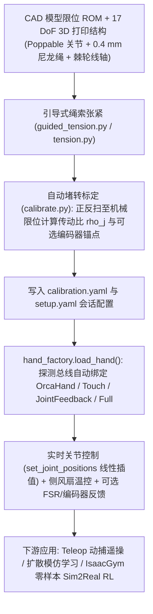
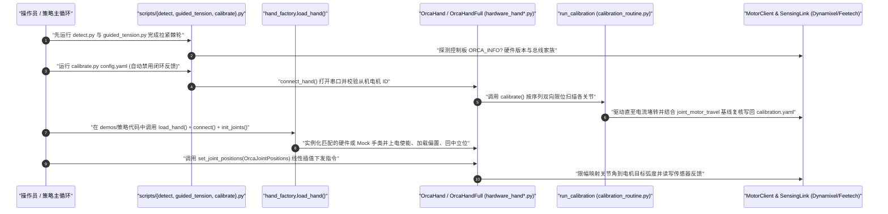

# ORCA Hand（虎鲸开源拟人灵巧手）

## 一句话定义

**英文全称 / 原始题目**：*ORCA: An Open-Source, Reliable, Cost-Effective, Anthropomorphic Robotic Hand for Uninterrupted Dexterous Task Learning*（ETH Zurich Soft Robotics Lab, `arXiv:2504.04259v2`）。

**ORCA Hand** 是由苏黎世联邦理工学院（ETH Zurich）软体机器人实验室开源的 **17 自由度（17 DoF）** 拟人化绳驱五指灵巧手及软硬件生态体系，物料成本低于 **2,000 CHF**、单人无经验 **8 小时内可装配完毕**，通过可弹出防断销轴关节、过旋转中心肌腱走线无传感器自标定、棘轮线轴快速再张紧以及标准化 SDK [`orcahand/orca_core`](https://github.com/orcahand/orca_core)（MIT License），兼顾人手级低指尖惯量与数十小时级不间断策略学习可靠性。

## 英文缩写速查

| 缩写 | 英文全称 | 简要说明 |
|---|---|---|
| **ORCA** | Open-source, Reliable, Cost-effective, Anthropomorphic | 本文开源 17 DoF 拟人灵巧手平台全称 |
| **DoF** | Degree of Freedom | 自由度；ORCA 含食/中/无名/小指各 3 + 拇指 4 + 腕部 1 = 17 DoF |
| **CoR** | Center of Rotation | 关节旋转中心；肌腱穿经 CoR 实现多关节运动学近似解耦 |
| **FSR** | Force Sensing Resistor | 指尖薄膜压阻触觉传感器（RP-C7.6-ST），二值触发低至 0.05 N |
| **ROM** | Range of Motion | 关节机械运动范围，由 CAD 名义限位或实测编码器跨度确定 |

## 为什么重要

1. **打破“拟人绳驱脆弱难维护”与“直驱低价笨重”之间的硬件三角悖论**：商业级高自由度绳驱手（如 Shadow Hand）售价超 **100,000 CHF** 且运维极其昂贵；开源直驱手（如 LEAP Hand）虽低成本可靠，但手指内置电机显著增大转动惯量与体积。ORCA Hand 把电机全部外置到底座手塔并保留真人体型比例与人手级柔顺皮肤，将成本压缩到 **2,000 CHF** 以下同时依然实现了四指 **10.5 kg（103 N）** 负重与 **7 小时 17 分钟（约 2,000 次抓取）** 零硬件介入的连续模仿学习运行。
2. **面向机器人学习的“机械防错 + 可维护性”工程范式**：可弹出销轴在碰撞过载时先脱位再徒手按回，极大保护 3D 打印连杆；单向棘轮线轴几秒即可拉紧松弛钓线而免拆螺丝；基于阻塞电流的自动标定算法消除了装配松紧差异对跨会话一致性的破坏。
3. **持续进化的工业级开源软件底座（`orca_core` v0.13.0+）**：与早期仅面向单版实验的高校脚本不同，`orcahand/orca_core` 已发展出覆盖 **Dynamixel** 与 **Feetech** 双总线家族、v1/v2.0/v2.1.x 多硬件板卡自动侦测（`detect.py`）、引导张紧（`guided_tension.py`）、行程校验防过紧及可选装关节绝对编码器闭环反馈（`OrcaHandFull`）的完整生产级架构。

## 核心原理

### 核心机械与电控设计

- **17 DoF 仿生自由度分配（总重 ~1.2 kg）**：
  - **第 2–5 指（食/中/无名/小指）**：各 **3 个**主动驱动关节（PIP、MCP 屈伸、ABD 侧摆），**刻意固定远端 DIP 关节**，理由是人类 DIP 高度耦合于 PIP 且很少独立做功，固定后既省掉一套极易产生绳索松弛的远端走线，又为指尖触觉传感腾出宝贵封装空间；
  - **拇指**：**4 个**独立关节（IP、MCP、ABD 与 CMC），并以 **15° 手掌旋前对掌倾角**安装以覆盖对掌灵巧操纵；
  - **腕部 1 DoF**：考虑高载荷与低松弛要求，放弃绳驱改用玻璃纤维增强 **GT2 同步带**传动俯仰屈伸（±60°）。
- **低摩擦走线与可弹出关节（Poppable Pin Joints）**：选用 `0.4 mm` 编织尼龙钓鱼线作屈/伸拮抗肌腱，所有转向经光滑金属销轴与 PTFE 铁氟龙套管规避 PLA 直接磨损；轴承座开圆弧形缺口，平时维持标准销轴同等的轴向刚度，遇突发强冲击则“弹出”泄荷保护打印件不崩裂。
- **内置指尖触觉方案**：5 枚 **FSR（RP-C7.6-ST）** 贴装于刚性 PLA 背板与浇注硅胶表皮之间，串联 `10 kΩ` 分压电阻接入 **Arduino Nano Every**，经穿行指腹内 PTFE 管的 `0.2 mm` 铜线汇出手塔（详见物理设计与算法笔记 [paper-notebook-orca](./paper-notebook-orca-open-source-reliable-cost-effective-anthrop.md)）。

### 自动标定与 `orca_core` 闭环架构

- **无外置关节编码器的开环自标定（Algorithm 1）**：因肌腱经由各关节 **旋转中心（CoR）** 路由，相邻关节耦合极弱，电机位置与关节角度可用线性关系近似。`calibration_routine.py` 按配置的 `calibration_sequence` 依次以电流控制将各关节推抵机械屈曲极限与伸展极限直至堵转，测出电机行程 `Δm_j = m_j^max - m_j^min`，结合 CAD 限位行程 `Δθ_j = θ_j^max - θ_j^min` 自动解算单关节传动比 `ρ_j = Δm_j / Δθ_j` 并持久化为 `calibration.yaml`。
- **v0.13.0+ 工程扩展**：最新 `orca_core` 在原有纯开环 `OrcaHand` 基础上，通过 `hand_factory.py` 无缝按硬件能力扩展出 **`OrcaHandTouch`**（指尖传感帧解析）、**`OrcaHandJointFeedback`**（基于关节绝对编码器消除纯绳驱长时漂移）与全功能 **`OrcaHandFull`**，并在标定阶段核对实测行程与 `joint_motor_travel` 基线，一旦因肌腱过紧导致提前虚假堵转即自动升流复测。

### 流程总览

## 实验与评测

### 硬件寿命、负载与追踪精度

- **连续耐久性测试（2.5 h + 扩展耐久）**：每隔 4 秒全指抓握掌心毛绒玩具（**2,250 次**抓握循环），同步每 16 秒腕部往复 `40°` 摆动（**550+ 次**）；在底座双侧散热风扇辅助下，中指与腕部电机峰值电流与平均温升（约 **38–39°C**）全程保持平稳无过热关断、无断绳（主动结束测试而非失效）；论文摘要亦报告了跨越 **>10,000 次**连续循环（约 **20 小时**）无硬件故障的持续运转能力。
- **负载能力（600 mA 限流位置模式）**：四指协同抓取静态拉力/握持达 **10.5 kg（103 N）**，单食指钩提达 **2 kg（19.6 N）**。
- **运动学精度与延迟对比（对标 LEAP Hand）**：在食指 MCP/PIP 安装 3 枚 `tag36h11` AprilTag 并以 60 fps RealSense D435i（测量误差 `σ = 0.08°`）验证 `0.2 Hz` / `0.5 Hz` 正弦跟踪，经过自动标定后的 ORCA 获得了与直驱 **LEAP Hand** 相当的追踪精度与软件主导总线延迟（`< 0.2 s`），同时因指端没有内置舵机质量，关节速度变化更加平滑、较少出现顿挫冲击。

### 策略学习与触觉实测

- **Zero-Shot Sim-to-Real RL（手内网球单轴连续转球）**：在 `IsaacGymEnvs`（未启用触觉传感器）中并行 **4,096** 个 ORCA 模型结合域随机化以 **A2C** 算法训练仅约 **1 小时**，即实现直接零样本迁移到物理 ORCA Hand 连续稳定旋转网球。
- **长时程模仿学习（Franka Panda + ORCA 拾放立方体）**：借助 **ROKOKO** 动捕手套 + 能量最小化运动学重定向在约 2.5 小时内录制 **214 条**演示，在单张 RTX 4090 上训练机器人扩散 Transformer（500 epochs，约 4 小时）。在 60 次测试区域评估中，引入 **CIELAB 色彩掩膜**高光突显目标物块的策略准确率达到 **`86.6%`**（纯 RGB 原始输入 `50.0%`，混合训练 `70.0%`）；在带斜坡自动滑落回位的长时程自治测试中，整套系统**持续无故障运行 7 小时 17 分钟（约 2,000 次抓放循环）**未对机械手本体进行人工调整。
- **指尖 FSR 实测与寿命衰退拐点**：出厂静置测试可稳定感知低至 **`0.05 N`**（优于标称 `0.29 N` 阈值，10 次循环 100% 检出），但经过数千次实抓磨损后暴露了硅胶磨损与导线弯折两大薄弱点（详见局限节）。

### 与其他开源/商业灵巧手对比

| 平台 | 驱动方式与自由度 | 材料/参考成本 | 装配门槛与可维护性 | 集成感知与闭环支持 |
|---|---|---|---|---|
| **ORCA Hand（本文）** | **17 DoF 绳驱（外置电机塔）** + 腕 GT2 带 | **< 2,000 CHF** | **< 8 h** 装配；可弹出防断关节 + 秒级棘轮张紧 + 自动堵转标定 | 支持内置 FSR 与后期可选绝对编码器/矩阵触觉扩展 |
| **Shadow Hand** | 20–24 DoF 气动/肌腱精密集成 | > 100,000 CHF | 专有黑盒架构，损坏维修周期极长、成本高 | 高密度集成专有传感 |
| **LEAP Hand** | 16 DoF 全直驱舵机外骨骼 | < 2,000 CHF | ~3 h 装配，极高机械耐用度 | 指节含舵机，手型偏大且手指转动惯量高于绳驱 |
| **[RUKA v2](./ruka-v2-hand.md) / DexHand** | 开源绳驱灵巧手家族 | 低成本 DIY | ORCA 在弹出关节与软件全流程自校准方面工程化更完备 | 视具体社区版本而定 |

### 核心结论

ORCA Hand 在保持高度拟人外观、指端低惯量与低成本的同时，通过机械保护结构（可弹出关节）、棘轮快捷维护与 `orca_core` 自动标定把开源绳驱灵巧手推向了可跑数千次自主策略实验的工程可用台阶。

## 源码运行时序图

[`orcahand/orca_core`](https://github.com/orcahand/orca_core)（MIT License）封装了从硬件自动探测、张紧标定到多类后端控制（含纯串口 Mock 验证）的完整执行序列：

## 工程实践

1. **严格遵循“先探测 → 再张紧 → 后标定”维护顺序**：官方明确强调每次重绷钓线后必须**先跑 `scripts/guided_tension.py`（v2.1 硬件；v2.0 用 `scripts/tension.py`）拉紧棘轮，再运行 `scripts/calibrate.py`**。同一配置目录下会持久化 `setup.yaml` 与 `calibration.yaml`；若桌面同时接入多只同款机械手，务必各自拷贝独立 `config.yaml` 目录防止互写覆盖。
2. **多代硬件与无硬件仿真开发**：`orca_core` 原生自动识别 Dynamixel（v1 通常 3M bps、v2 1M bps）及 Feetech 舵机以及 `v2.0.0 / v2.1.0 / v2.1.1` 控制器；在没有真机的 CI 或算法调试阶段，在脚本与 CLI 后传入 **`--mock`** 即可无痛启用 `MockOrcaHand*` 内存后端验证接口兼容。
3. **利用 `measure_travel.py` 及时排查过紧故障**：在刚装完新绳或怀疑指节运动卡滞时，先跑 `scripts/measure_travel.py` 生成真实的电机旋转行程基线；后续再触发自动标定时，系统一旦检测到单关节因过紧提前堵转就会报警并自动加流重试，防止标定比例尺失真。
4. **软件通信延迟优化**：尽管硬件跟踪与 LEAP 相当，整套闭环仍有近 `0.2 s` 级链路时延（其中很大一部分来自串口轮询与驱动参数）；高频控制部署前应查阅官方 `docs/pages/orca-core-docs/latency-optimization.md` 调低 USB-串口 `latency_timer` 并采用单次合并交易 `get_motor_state()` 减少总线往返。

## 常见误区与局限

- **硅胶指套磨损导致 FSR 触发失效**：论文明确报告在小指等高频摩擦部位经历 **2,000–4,000 次**抓握后，硅胶外皮疲劳移位会产生内部空腔间隙，导致 FSR 触发阈值从初始 `0.05 N` 急剧恶化至 **`6.38 N`**。
- **穿指细铜导线弯折疲劳断裂**：受限于早期设计穿线空间，经由 PTFE 管穿行的 **`0.2 mm` 直径细铜线**在经历约 **4,500–7,000 次**连续屈伸后，在拇/食/中指的 **MCP 与 ABD** 高曲率关节弯折区集中出现金属疲劳折断（论文提示工程迭代方向之一就是改进柔性走线与新一代传感接插件）。
- **绳驱松弛的周期性再张紧依赖**：虽然棘轮线轴把每次调紧时间降到数秒内且 7.3 小时 IL 任务无需手工干预，但论文仍明言多天高强度长跑后不可避免会有微弱蠕变，目前尚未实现全自动在线电机/机械自收紧（需定期运行 `run_slack_test` 或人工拨紧棘轮再复标）。
- **标准 Feetech 硬件适配注记**：虽然 `orca_core` 代码层新接入了 Feetech 驱动分支与维护指令，但 README 明示目前 Feetech 下的自动电流阈值尚属实验性且松弛测试容易漏检轻微打滑。

## 关联页面

- [paper-notebook-orca-open-source-reliable-cost-effective-anthrop.md](./paper-notebook-orca-open-source-reliable-cost-effective-anthrop.md) — 同一作者论文的原理深读与 Algorithm 1 专项拆解（与本系统实体页互补）
- [ruka-v2-hand.md](./ruka-v2-hand.md) — 同类开源绳驱仿生手对照
- [allegro-hand.md](./allegro-hand.md) — 商业直驱灵巧手平台对照
- [shadow-hand.md](./shadow-hand.md) — 商业高自由度绳驱手基准
- [robot-open-source-wechat-issue01-curator.md](../overview/robot-open-source-wechat-issue01-curator.md) — 开源机器人硬件第一期策展收录页
- [manipulation.md](../tasks/manipulation.md) — 灵巧手抓取与操纵任务层
- [sim2real.md](../concepts/sim2real.md) — IsaacGym 到真机零样本迁移与时延建模
- [tactile-sensing.md](../concepts/tactile-sensing.md) — 灵巧手指尖压阻传感与磨损分析
- [imitation-learning.md](../methods/imitation-learning.md) — ROKOKO 遥操与扩散模型模仿学习方法

## 参考来源

- [orcahand_reading_arxiv_2504_04259.md](../../sources/papers/orcahand_reading_arxiv_2504_04259.md) — `arXiv:2504.04259v2` 论文全文精读与定量测试核对档案
- [orca_core.md](../../sources/repos/orca_core.md) — `orcahand/orca_core`（v0.13.0+）仓库架构、入口脚本与开源协议核对档案
- [wechat_jixie_robot_open_source_treasury_issue01_10_robots.md](../../sources/blogs/wechat_jixie_robot_open_source_treasury_issue01_10_robots.md) — 中文社区开源收录原始线索
- [allhandsup-org.md](../../sources/sites/allhandsup-org.md) — 开源机械手聚合站点线索
- [ORCA 项目页 (ETH SRL)](https://srl.ethz.ch/orcahand) · [GitHub: orcahand/orca_core](https://github.com/orcahand/orca_core) · [arXiv:2504.04259](https://arxiv.org/abs/2504.04259)

## 推荐继续阅读

- 如果你刚上手实体手组装或软件调试，先按 `orca_core` 仓库下的 `docs/pages/getting-started-docs/initial-tensioning-and-calibration.md` 完成首次张紧，再运行 `examples/main_demo.py --mock` 或真机演示；
- 若需深入理解 ORCA 论文里的数学误差消除推导与早版实验设定，配合阅读 [paper-notebook-orca](./paper-notebook-orca-open-source-reliable-cost-effective-anthrop.md) 与 [sim2real.md](../concepts/sim2real.md)。
