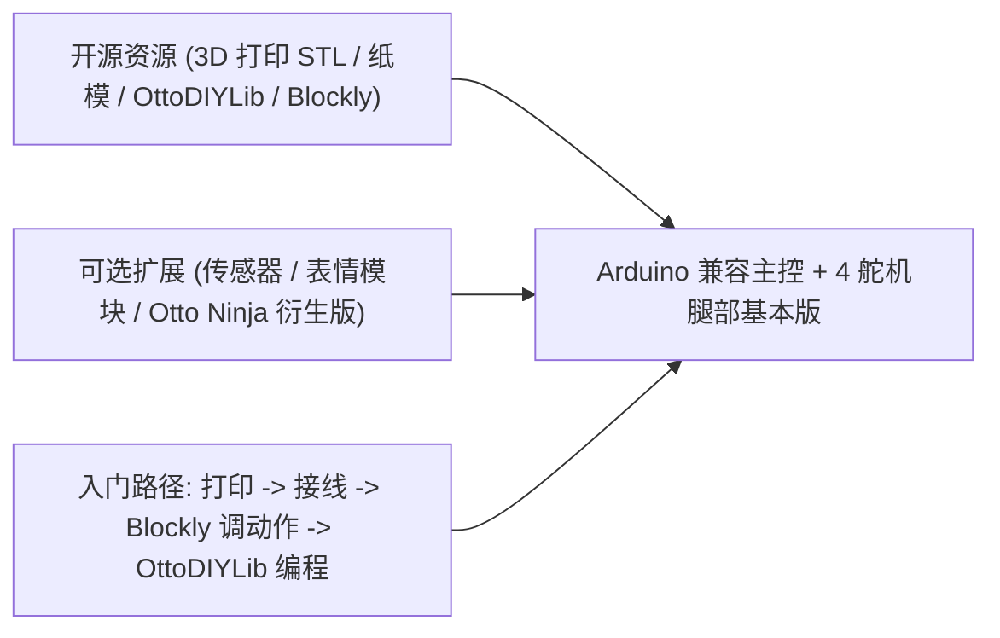
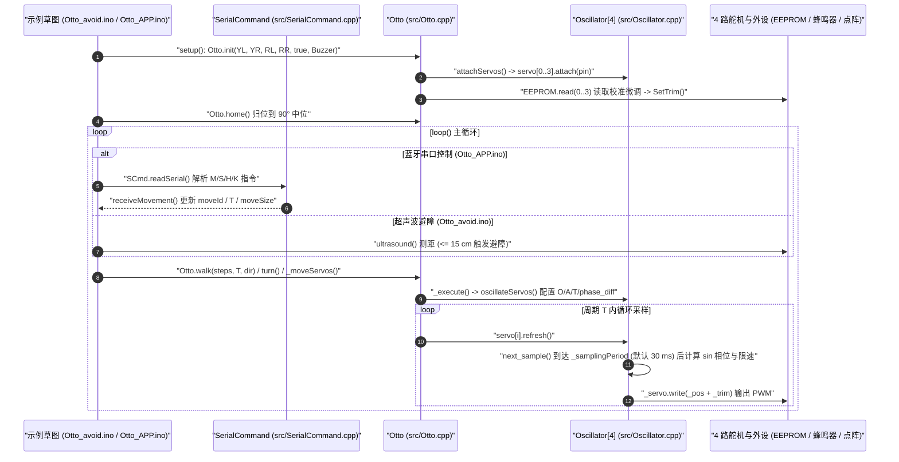

# Otto DIY

## 一句话定义

**Otto DIY** 是面向教育的低成本开源双足机器人，官方站点 ottodiy.com，库仓库 [OttoDIY/OttoDIYLib](https://github.com/OttoDIY/OttoDIYLib)，组织入口 [OttoDIY](https://github.com/OttoDIY)。

## 英文缩写速查

| 缩写 | 英文全称 | 简要说明 |
|------|----------|----------|
| Blockly | Blockly visual programming | 积木式图形化编程 |
| STL | Stereolithography file | 3D 打印模型格式 |
| MIT | MIT License | 宽松开源许可证 |
| GPL | GNU General Public License | 著佐权开源许可证 |

## 为什么重要

- 入门门槛最低的双足平台，作为本批 18 项中「第一台机器人」的起点。
- 在微信文章《想进入机器人领域吗？学习这18个开源项目就够了》中排第 **4** 位。

## 核心要点（据文章）

- Arduino 兼容，结构件全 3D 打印；基本版使用 4 个舵机控制腿部，可扩展传感器和表情模块。
- 提供完整 3D 文件、Arduino 库（OttoDIYLib）、Blockly 图形化编程、教程和纸模；衍生版本 Otto Ninja 支持行走+滚动。
- GitHub 上有多个活跃仓库（OttoDIYLib、OttoDIY 组织、Open-Hardware-Leaders/OttoDIY），许可证以 MIT/GPL 为主。

## 工程实践

- 适合第一次做机器人的人：打印 → Arduino 接线 → Blockly 调动作 → 再换 OttoDIYLib 写代码。
- 以上规格与许可证均出自文章叙述，**未逐项核对官方仓库**；动手前请以官方 README/BOM 为准。

## 机制与架构图

## 源码运行时序图

以上调用链依据 `OttoDIY/OttoDIYLib`（`main` 分支）中的 `src/Otto.cpp`、`src/Oscillator.cpp`、`src/SerialCommand.cpp` 及 `examples/Otto_avoid/Otto_avoid.ino`、`examples/Otto_APP/Otto_APP.ino` 整理。

## 局限与风险

- 本页仅基于一篇第三方公众号文章，规格数字可能随版本变化。
- 仓库迁移、分叉和许可证以官方当前状态为准。

## 关联页面

- [humanoid-robot](./humanoid-robot.md)
- [open-source-humanoid-hardware](./open-source-humanoid-hardware.md)
- [机器人开源项目 18 例（微信 GitHubStore）索引](../overview/robot-open-source-wechat-githubstore-18-projects.md)
- [Locomotion](../tasks/locomotion.md)：以 4 舵机低成本双足结构为入门载体，实践基础步态生成与双足移动控制概念。
- [Parametric CAD Workflow · 参数化 CAD 建模流程](../methods/parametric-cad-workflow.md)：结合全 3D 打印结构件设计，用于定制和修改教育双足机器人的外壳与舵机支架模型。

## 推荐继续阅读

- [OttoDIY 组织](https://github.com/OttoDIY)

## 参考来源

- [wechat_githubstore_18_open_source_robot_projects.md](../../sources/blogs/wechat_githubstore_18_open_source_robot_projects.md)
