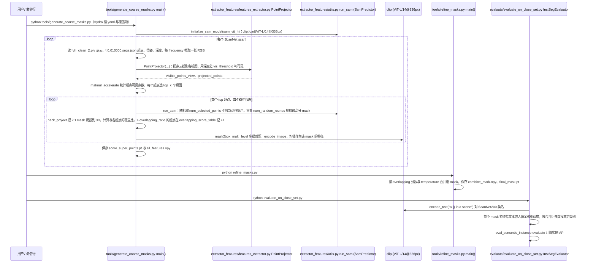

# OV-SAM3D

**OV-SAM3D**（[HanchenTai/OV-SAM3D](https://github.com/HanchenTai/OV-SAM3D)）是 **无需针对场景训练** 的开放词汇三维场景理解框架。

## 一句话定义

先从超点得到粗 3D mask，用多视角 **SAM** 反投影修正，再结合 **RAM** 开放标签与重叠分数合并实例——适合 **离线** 点云理解与伪标注，而不是 GO2 机载实时主路径。

## 英文缩写速查

| 缩写 | 英文全称 | 简要说明 |
|------|----------|----------|
| SAM | Segment Anything Model | 多视角二维 mask 来源；见 [paper-segment-anything](./paper-segment-anything.md) |
| RAM | Recognize Anything Model | 开放世界图像标签 |
| OV | Open-Vocabulary | 不依赖闭集 3D 训练集的标签空间 |
| 3D | Three-Dimensional | 输出为三维实例 mask / 特征 |
| ScanNet | ScanNet Dataset | 常用室内评测集之一 |

## 为什么重要

- 把「多视角 SAM → 修正 3D 实例 → 开放标签」做成可跑通的离线流水线。
- 适合 GO2 语义落地的 **第二步**：几何锐利后，对保存的多视角图像 + 点云做离线着色/实例检查。
- 与 [DualMap](./dualmap.md) / [OVO](./ovo-semantic-mapping.md) 的在线路径形成互补。

## 核心信息

| 字段 | 内容 |
|------|------|
| 机构 | 浙江大学（Zhejiang University）；腾讯优图（Tencent Youtu Lab） |
| 代码 | <https://github.com/HanchenTai/OV-SAM3D> |
| 开源 | **已开源** |
| 论文 | arXiv:2405.15580 |
## 核心原理

| 阶段 | 脚本/机制（对齐上游 README） |
|------|------------------------------|
| 粗 mask | `generate_coarse_masks.py`：superpoints + SAM |
| 细化 | `refine_masks.py`：开放标签 + 重叠分数 |
| 评测 | 对齐 OpenMask3D 风格评测脚本 |

## 工程实践

1. 准备 ScanNet 类扫描数据路径与 SAM checkpoint。
2. 先跑粗 mask，再 refine；确认输出 mask / feature 目录。
3. 用于 GO2：先用 Point-LIO 录包导出同步 PCD + 图像 + 位姿，再离线跑本流水线验证投影质量。

## 局限与风险

- **非实时 / 非 ROS 导航产品**：机载关键帧请选 DualMap 或自建轻量投影。
- 依赖多视角图像质量与标定；单雷达无相机无法单独发挥 SAM 优势。
- 开放标签噪声需后处理；勿直接写死进静态占据地图。

## 源码运行时序图

入口（README Usage / Evaluation，均为 Hydra 配置 `ovsam3d/configs/ovsam3d_scannet200.yaml`）：
`python tools/generate_coarse_masks.py data.scans_path=... external.sam_checkpoint=...` → `python refine_masks.py ...` → `python evaluate/evaluate_on_close_set.py --gt_dir ... --mask_pred_dir ... --mask_features_dir ...`

另有独立脚本 `tools/generate_open_tags.py`（RAM++ 对多帧出标签，再经 OpenAI `gpt-4` 过滤，写入 `<scan>_text.txt`），用于「开放标签」；本次读到的 `refine_masks.py` 与评测脚本里没有读取这些 txt 的代码，故未画入主链。

图依据：HanchenTai/OV-SAM3D@80a86a6，读过 README.md、ovsam3d/configs/ovsam3d_scannet200.yaml、ovsam3d/tools/generate_coarse_masks.py、ovsam3d/tools/refine_masks.py、ovsam3d/tools/generate_open_tags.py、ovsam3d/tools/utils.py、ovsam3d/extractor_features/features_extractor.py、ovsam3d/extractor_features/utils.py、ovsam3d/evaluate/evaluate_on_close_set.py。

## 关联页面

- [GO2 三维语义建图与 SAM 流水线](../queries/go2-3d-semantic-mapping-sam-pipeline.md)
- [DualMap](./dualmap.md)
- [OVO](./ovo-semantic-mapping.md)
- [point_lio_unilidar](./point-lio-unilidar.md)
- [LEGO](./paper-lego-leveled-language-gaussian-splatting.md) — 按场景优化的 3DGS 层级开放词汇；本页是训练无关点云路线

## 参考来源

- [sources/repos/ov-sam3d.md](../../sources/repos/ov-sam3d.md)
- 项目页：<https://hithqd.github.io/projects/OV-SAM3D/>
- arXiv：<https://arxiv.org/abs/2405.15580>
- 源码核对（2026-11-02）：HanchenTai/OV-SAM3D@80a86a6，读过 README.md、ovsam3d/configs/ovsam3d_scannet200.yaml、ovsam3d/tools/（generate_coarse_masks.py、refine_masks.py、generate_open_tags.py、utils.py）、ovsam3d/extractor_features/（features_extractor.py、utils.py）、ovsam3d/evaluate/evaluate_on_close_set.py；时序图依据以上文件，未运行代码。

## 推荐继续阅读

- 上游仓：<https://github.com/HanchenTai/OV-SAM3D>
