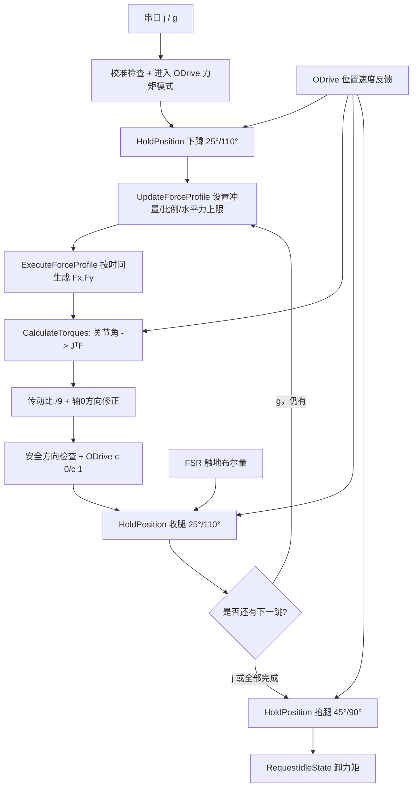
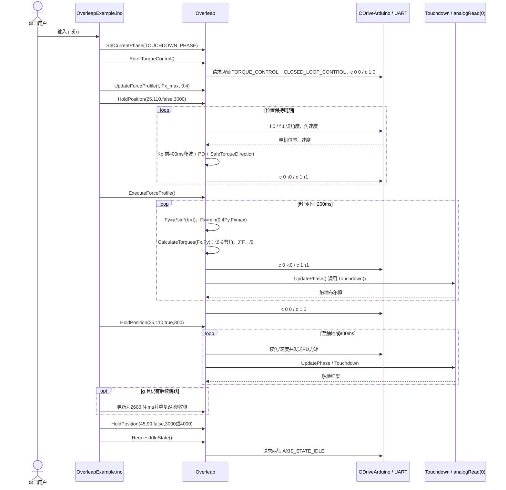

# Overleap：双自由度弹跳腿的分阶段力矩控制 / Phase-based Jumping Control for a 2-DOF Robotic Leg

## 一句话定义

**Overleap** 是 Aaron de los Santos 的开源双自由度机械腿：使用两台 9:1 准直驱电机，在 Arduino 上切换**关节位置 PD**与**预设足端力曲线 + 雅可比转置**，通过 UART 向 ODrive 下发**电机力矩指令**，实现竖直单跳和绕圈连续跳。

## 英文缩写速查

| 缩写 | 英文全称 | 简要说明 |
|---|---|---|
| DOF | Degree of Freedom | 机械腿具有髋和膝两个主动自由度 |
| PD | Proportional-Derivative | 下蹲、收腿、抬腿时单片机内部的位置误差力矩控制 |
| QDD | Quasi-Direct Drive | 9:1 低传动比、兼顾背驱与输出力矩的执行结构 |
| UART | Universal Asynchronous Receiver/Transmitter | Arduino 与 ODrive 之间传输 ASCII 力矩命令 |
| FSR | Force Sensitive Resistor | 脚底接触检测元件；不提供足端力幅值反馈 |
| GRF | Ground Reaction Force | 实际地面反作用力；本代码未直接测量其连续曲线 |

## 为什么重要

- **可复查的经典控制小样机**：不依赖强化学习，完整展示“接触相目标足端力 → 关节力矩 → 电机侧命令”的计算链。
- **区分控制空间**：支撑/收腿阶段追踪关节角，蹬地阶段以时间生成足端力，但执行器始终运行在 ODrive torque control，而不是切换 ODrive 内部位置控制。
- **区分目标力与实测力**：这是基于预设时间曲线的力矩前馈，不是脚底力传感器闭环调力。

## 核心原理

### 硬件、几何与控制接口

- 双关节串联腿：髋轴 0、膝轴 1；上、下连杆长度 **L₀=0.19 m、L₁=0.22 m**；两轴传动比 **9:1**。
- 由二维转台提供竖直与圆周运动自由度，足底使用 FSR 判断是否触地。
- 髋角 θ₀ 从水平线起算；膝角 θ₁ 相对大腿延长线。按官方坐标，+X 向右、+Y 向下。
- Arduino 读取 ODrive 关节位置/速度反馈并算出力矩；发送 ASCII 的 **c 0 / c 1** 给 ODrive 两轴。

### 一次跳跃的四个阶段

| 阶段 | 目标、最大时间 | 控制模式与结束条件 |
|---|---|---|
| 下蹲（prepare） | θ₀=25°，θ₁=110°；3 s | 关节 PD；按时间结束 |
| 蹬地（push-off） | 预设足端力，200 ms | 力曲线 → 雅可比转置 → 电机力矩 |
| 收腿（tuck） | θ₀=25°，θ₁=110°；0.8 s | 关节 PD；检测触地则提前结束 |
| 抬腿（raised） | θ₀=45°，θ₁=90°；3 s 或 4 s | 关节 PD；结束后请求 ODrive idle |

**动作入口**：串口 **j** 是竖直单跳，四阶段各一次；**g** 开头只下蹲一次，之后进行 **10 次**“蹬地 → 收腿”，最后抬腿。官方例程中 g 首次冲量 2200 N·ms，后续 9 次 2600 N·ms。

### 流程总览

### 关节位置 PD：在 MCU 内直接计算力矩

对输出轴角度 θ（**单位：度**），位置保持的原始计算为：

\[
\tau_0=-K_{p0}(t)(\theta_0-\theta_{d0})-K_{d0}\dot{\theta}_0,\quad
\tau_1=+K_{p1}(t)(\theta_1-\theta_{d1})-K_{d1}\dot{\theta}_1
\]

不同符号来自两轴的安装/编码器方向约定。前 **400 ms**，比例增益按 Kp(t)=Kp·min(t/400 ms,1) 爬坡，**Kd 不爬坡**。

| 增益 | 下蹲、抬腿（不以触地退出） | 收腿（触地退出） |
|---|---:|---:|
| Kp₀ | 0.009 | 0.005 |
| Kp₁ | 0.004 | 0.006 |
| Kd₀、Kd₁ | 0.0001 | 0.0001 |

注意**收腿不是两轴都更软**：膝的 Kp 从 0.004 增到 0.006。增益按输出轴**度**实现，不可不换单位地当成标准 rad 制增益。

### 蹬地力曲线：时间前馈，不是力传感器闭环

预设 **T=200 ms**、b=0.005，设定冲量 I（N·ms）：

\[
F_y(t)=\frac{I}{100}\sin^2(0.005\pi t),\qquad
F_x(t)=\min(0.4F_y(t),F_{x,\max}),\quad t\in[0,200]\text{ ms}
\]

因为 \(\int_0^{200}\sin^2(0.005\pi t)\,dt=100\ \mathrm{ms}\)，冲量参数除以 100 后给出峰值牛顿数：

| 命令 | I | Fy 峰值 | Fx 上限及峰值 |
|---|---:|---:|---|
| j：单跳 | 2500 N·ms | 25 N | 上限 0 N，始终为 0 |
| g：第一次 | 2200 N·ms | 22 N | 上限 10 N，峰值 8.8 N |
| g：第 2–10 次 | 2600 N·ms | 26 N | 上限 10 N，峰值被裁剪为 10 N |

这些是**命令曲线**，不能视为实际足底测量或实测离地冲量。FSR 只参与着地/相位判断。

### 雅可比转置：足端期望力转关节力矩

官方坐标约定下：

\[
x=-L_0\cos\theta_0-L_1\cos(\theta_0+\theta_1),\quad
y=-L_0\sin\theta_0-L_1\sin(\theta_0+\theta_1)
\]

\[
J=\begin{bmatrix}
L_0\sin\theta_0+L_1\sin(\theta_0+\theta_1) & L_1\sin(\theta_0+\theta_1)\\
-L_0\cos\theta_0-L_1\cos(\theta_0+\theta_1) & -L_1\cos(\theta_0+\theta_1)
\end{bmatrix},\quad
\boldsymbol\tau_{\rm joint}=J^\top \begin{bmatrix} F_x\\F_y\end{bmatrix}
\]

上述角度在三角函数中用**弧度**，计算的关节侧力矩单位是 N·m。源码将两轴各除以 **9** 得电机侧指令，再对轴 0 反号以匹配其正力矩方向。该换算未包含摩擦、减速器效率与执行器饱和的补偿。

## 源码运行时序图

这是依据 [OverleapExample.ino](https://github.com/aarondls/overleap/blob/main/Overleap/examples/OverleapExample/OverleapExample.ino)、[Overleap.cpp](https://github.com/aarondls/overleap/blob/main/Overleap/Overleap.cpp) 的**静态函数调用时序**，不是实机抓取的运行 trace。

## 工程实践

1. 阅读官方 [README](https://github.com/aarondls/overleap#readme)、装配图及 ODrive 配置说明；检查 9:1 减速、电机方向、AS5047 编码器 ABI/index、FSR 与电源。
2. 烧录官方示例并执行编码器搜索和零位标定；用串口 **y** 确认轴 0 正力矩顺时针、轴 1 逆时针，再尝试 **j/g**。
3. 依照 **I=2200/2500/2600 N·ms**、**Fxmax=0/10 N**、**0.4 比例**对照代码记录期望力曲线，比较下蹲 PD 与蹬地阶段电机指令。
4. 为真机增加实际接触力/电流/角速度与落地时刻日志，确认“期望冲量 ≠ 实际冲量”；先低能量、空载验证角度限位、机械固定和急停，再考虑完整弹跳。

**与模型方法的边界**：这里直接使用当前关节角进行静力矩映射，并不提供闭环地面反力跟踪、全身动力学优化或自动落脚规划；可与 [SLIP + VMC](../methods/slip-vmc.md) 和 [雅可比矩阵](../formalizations/robot-jacobian.md) 对照理解。

## 局限与风险

- **没有足端力反馈闭环**：FSR 的 analogRead(0)>1 是二值接触判断；力曲线不依据实测 GRF 修正。
- **提前离地退出条件与时长不匹配**：ExecuteForceProfile 的离地退出判断需要 current_duration > 400 ms，但 PrepareForceProfile 固定 duration=200 ms；当前示例并不会因此提前结束蹬地，仍可能因安全角方向检查中止。
- **理想传动与实际负载有差距**：JᵀF/9 不计传动损耗、摩擦、时延和电机限流；串口频率、阻尼和触地误判影响真机稳定性。
- **PD 参数不完全同向变化**：髋的 Kp 在收腿下降，膝的 Kp 反而上升；不能简单归类为整体“软/硬”。
- **有限的安全边界**：SafeTorqueDirection 在髋约 -10°～75°、膝约 0°～135°附近检查向外力矩方向，不等价于独立的硬件急停或全功能安全控制器。
- **验证范围**：官方展示单跳与绕圈跳；本次仅审阅官方 README 与控制源码，**未编译、未烧录、未在实机测量跳高/速度/力冲量**。

## 关联页面

- [SLIP + VMC：弹簧腿与足端力映射](../methods/slip-vmc.md)
- [PID/PD 关节控制](../methods/pid-control.md)
- [机器人雅可比矩阵](../formalizations/robot-jacobian.md)
- [Locomotion 任务](../tasks/locomotion.md)
- [经典模型控制纵深路线 Stage 1](../../roadmap/depth-classical-control.md)

## 参考来源

- [Overleap 官方源码核读归档](../../sources/repos/overleap.md)
- [比特Z 公众号文章摘录归档](../../sources/blogs/wechat_bitz_overleap_jumping_algorithm_2026-10-11.md)
- [Overleap 官方 GitHub README](https://github.com/aarondls/overleap)
- [Overleap.cpp — CalculateTorques、HoldPosition、ExecuteForceProfile](https://github.com/aarondls/overleap/blob/main/Overleap/Overleap.cpp)
- [OverleapExample.ino — j/g 命令调用链](https://github.com/aarondls/overleap/blob/main/Overleap/examples/OverleapExample/OverleapExample.ino)

## 推荐继续阅读

- [Overleap 官方 Arduino 库接口说明](https://github.com/aarondls/overleap/blob/main/Overleap/README.md)
- [ODrive 官方控制模式文档](https://docs.odriverobotics.com/)
