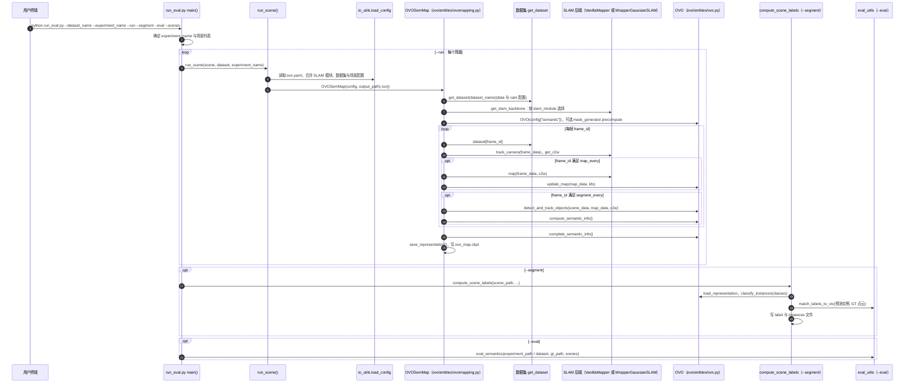

# OVO（Open-Vocabulary Online Semantic Mapping）

**OVO**（[tberriel/OVO](https://github.com/tberriel/OVO)，MIT）把 **开放词汇在线 3D 语义映射** 接到视觉 SLAM 骨干上。

## 一句话定义

给定带位姿的 RGB-D 关键帧，用 SAM 2 初始化二维 mask 并跟踪三维实例，为每个实例聚合 CLIP 描述子，实现可查询、可回环的在线开放词汇语义地图。

## 英文缩写速查

| 缩写 | 英文全称 | 简要说明 |
|------|----------|----------|
| OVO | Open-Vocabulary Online | 本系统缩写：在线开放词汇语义映射 |
| SAM2 | Segment Anything Model 2 | 默认二维 mask 初始化（亦兼容 SAM1）；见 [paper-sam2](./paper-sam2.md) |
| CLIP | Contrastive Language–Image Pretraining | 实例级开放词汇描述 |
| RGB-D | RGB + Depth | 主输入模态 |
| SLAM | Simultaneous Localization and Mapping | 可对接 ORB- / Gaussian-SLAM |
| MIT | Massachusetts Institute of Technology License | 本仓许可 |

## 为什么重要

- 强调 **在线 + 低内存 footprint**，并演示与完整 SLAM（含回环）端到端，而不只依赖真值位姿。
- 官方直接支持 **[SAM 2](./paper-sam2.md)**，与「先 mask 再投到 3D」叙事一致。
- 相对 [DualMap](./dualmap.md) 更偏 RGB-D SLAM 研究栈；相对 [OV-SAM3D](./ov-sam3d.md) 更偏在线而非离线超点流水线。

## 核心信息

| 字段 | 内容 |
|------|------|
| 机构 | 萨拉戈萨大学（University of Zaragoza） |
| 代码 | <https://github.com/tberriel/OVO>（MIT） |
| 开源 | **已开源** |
| 论文 | arXiv:2411.15043 |
## 核心原理

| 步骤 | 说明 |
|------|------|
| 关键帧 | SLAM 选关键帧并估计位姿 / 点云 |
| Mask | SAM2 生成 2D 分割并反投影为 3D segment |
| 跟踪 | 将 3D 段投影回图像，与新 mask 匹配 |
| CLIP | 按可见性选最佳视角描述子；含学习式 CLIP merge |

## 工程实践

1. 按 README 安装 PyTorch、SAM2 submodule、Perception Encoder 等。
2. 配置 `ovo.yaml`；可用 `run_eval.py` 跑评测管线。
3. 接到 GO2：需 RGB-D（或可靠深度）+ 位姿；L1 点云路径要另做深度/投影桥，不能假设开箱即用。

## 局限与风险

- 主线假设 **RGB-D**，不是纯 L1 几何栈。
- 依赖 SLAM 位姿质量；几何未锐利时语义关联会漂。
- 与 DualMap 的 ROS 导航产品化程度不同，集成工作量需自评估。

## 源码运行时序图

入口：`python run_eval.py --dataset_name Replica --experiment_name ovo_mapping --run --segment --eval --scenes office0`（`--run` 跑建图，`--segment` 把预测投到 GT 点云，`--eval` 算指标；对应 `run_eval.py` 的 `main`）

图依据：tberriel/OVO@e0d16f7，读过 `ReadMe.md`（运行说明与参数）、`run_eval.py`（main、run_scene、compute_scene_labels 全文）、`ovo/entities/ovomapping.py`（__init__、run 主循环与保存）。`OVO` 类内部（`detect_and_track_objects`、`classify_instances` 等）与 `ovo/slam/*` 未读，图只标出调用点。

## 关联页面

- [GO2 三维语义建图与 SAM 流水线](../queries/go2-3d-semantic-mapping-sam-pipeline.md)
- [SAM 2](./paper-sam2.md) / [SAM](./paper-segment-anything.md) — 2D mask 前端基础模型
- [DualMap](./dualmap.md)
- [OV-SAM3D](./ov-sam3d.md)
- [ORB-SLAM3](./orb-slam3.md)
- [导航·SLAM 栈](../overview/navigation-slam-autonomy-stack.md)

## 参考来源

- [sources/repos/ovo-semantic-mapping.md](../../sources/repos/ovo-semantic-mapping.md)
- [sam2_arxiv_2408_00714.md](../../sources/papers/sam2_arxiv_2408_00714.md) — SAM 2 基础模型归档
- 项目页：<https://tberriel.github.io/ovo/>
- arXiv：<https://arxiv.org/abs/2411.15043>
- 源码核对（2026-11-02）：tberriel/OVO@e0d16f7，读过 ReadMe.md、run_eval.py、ovo/entities/ovomapping.py；时序图依据以上文件，未运行代码。

## 推荐继续阅读

- 上游仓：<https://github.com/tberriel/OVO>
- [SAM 2 官方仓](https://github.com/facebookresearch/sam2)
