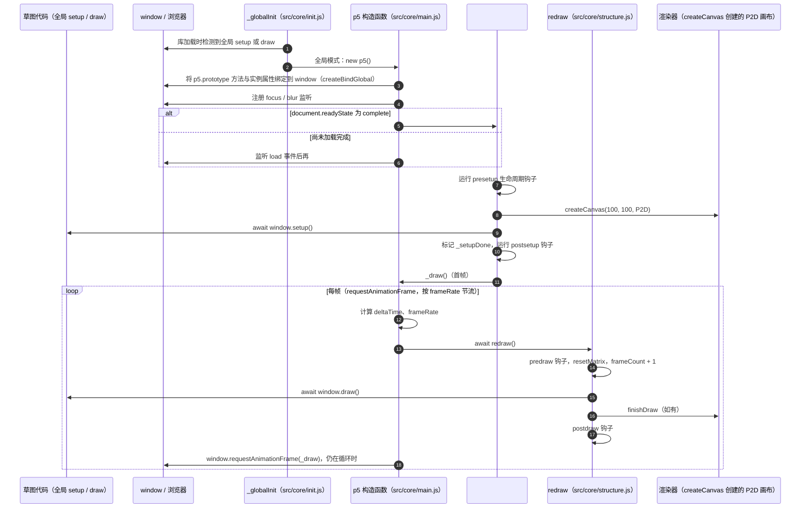

# p5.js

**p5.js** 是 Processing 生态中的浏览器端创意编程库，让 JavaScript 草图通过逐帧绘制、输入事件和图形 API 构成交互式网页作品。

## 英文缩写速查

| 缩写 | 英文全称 | 简要说明 |
|------|----------|----------|
| JS | JavaScript | p5.js 草图与网页交互的宿主语言 |
| DOM | Document Object Model | 浏览器网页控件和页面元素的对象模型 |
| WebGL | Web Graphics Library | p5.js 在浏览器中支持的 3D 图形接口 |

## 为什么重要

- **快速形成闭环：** setup() 初始化画布与资源，draw() 持续更新可视状态；鼠标、键盘、触摸等事件可直接改变草图。
- **表达传感器与运动数据：** 图形、颜色、向量和轨迹容易映射到 IMU、关节状态或策略输出，适合先检查数据和交互假设。
- **降低网页原型成本：** 在线 Editor、参考手册、示例和社区库支持从教学草图到交互原型的快速迭代。
- **可与 ML demo 组合：** [ml5.js](./ml5js.md) 处理浏览器端模型调用，p5.js 负责摄像头画面上的关键点绘制、交互和可视反馈。

## 核心原理

p5.js 将浏览器 Canvas、DOM 与输入事件包装成以 sketch 为中心的 API。常见程序分为一次性 setup() 和循环 draw()：前者创建画布、加载资源并设定状态，后者根据当前输入重绘图像。2D 绘图与 WebGL 模式都运行在网页环境中；第三方库可扩展能力，但须与使用的 p5.js 版本兼容。

## 工程实践

| 机器人相关任务 | p5.js 原型做法 | 进入正式系统前的工作 |
|------|----------|--------------------|
| 状态监控 | 订阅机器人遥测并画关节曲线、姿态或接触状态 | 时间戳、单位、丢包与数据有效性 |
| 遥操作 UI | 用画布或 DOM 控件编辑目标、显示 deadman 状态 | 身份验证、限幅、速率限制、断连安全与急停 |
| 算法教学 | 可视化坐标变换、路径规划或简单动力学 | 与目标仿真器的物理、碰撞和控制周期对齐 |

从浏览器与机器人之间应通过边界明确的 API / WebSocket 服务传输受校验消息；p5.js 草图不应直接承担关节闭环或安全保护。

## 局限与风险

- p5.js 面向创意表达和网页交互，浏览器事件循环和绘制帧率不提供硬实时保证。
- 视觉流畅不等于机器人控制安全；真机控制仍需独立的实时控制器、限幅、状态估计和急停链路。
- 官方项目当前有持续演进的版本与文档；依赖需锁定版本，核对对应 Reference 与兼容库。

## 源码运行时序图

入口：草图页面加载 p5.js 后，在全局模式下定义 `function setup()` 与 `function draw()`，库侧自动执行 `new p5()`（无 sketch 参数即全局模式）；实例模式为 `new p5(sketch)`。下图只覆盖启动与帧循环，不含 DOM/鼠标/键盘事件回调与渲染器内部。

图依据：processing/p5.js@3dd0886，读过 `package.json`（版本与构建脚本）、`src/app.js`（模块装配与导出）、`src/core/main.js`（构造函数、`#_start`、`#_setup`、`_draw`）、`src/core/structure.js`（`redraw` 实现）。渲染器与事件回调未读，图未画。

## 关联页面

- [The Coding Train](./the-coding-train.md) — 官方教学 Track 与大量 p5.js 示例。
- [ml5.js](./ml5js.md) — 为网页草图提供浏览器端机器学习 API。
- [计算机视觉骨干网络](../concepts/vision-backbones.md) — 机器人视觉模型与浏览器演示模型的任务边界不同。

## 参考来源

- [p5.js 官方项目站归档](../../sources/sites/p5js.md)
- [processing/p5.js 官方代码仓归档](../../sources/repos/p5js.md)
- [p5.js About](https://p5js.org/about/)
- [p5.js Reference](https://p5js.org/reference/)

## 推荐继续阅读

- [p5.js Get Started](https://p5js.org/tutorials/get-started/)
- [p5.js Web Editor](https://editor.p5js.org/)
