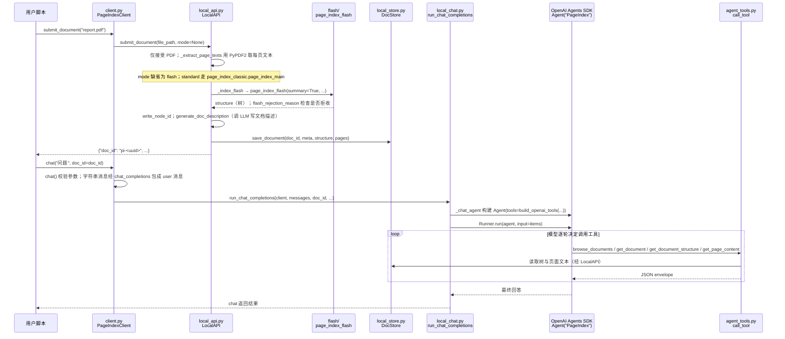

# PageIndex（VectifyAI）

**PageIndex** 是 VectifyAI 开源的无向量 RAG 引擎。它把长文档组织成分层树索引，再让 LLM 基于问题在树上推理检索，返回可追溯到原文位置的答案。官方 Python SDK 支持本地模型 API 调用，也可接入 PageIndex Cloud。

## 英文缩写速查

| 缩写 | 英文全称 | 简要说明 |
|------|----------|----------|
| RAG | Retrieval-Augmented Generation | 检索增强生成；先检索资料再生成回答 |
| LLM | Large Language Model | 大语言模型；用于树结构整理与检索推理 |
| SDK | Software Development Kit | 软件开发工具包；PageIndex 提供的 Python 客户端 |
| MIT | Massachusetts Institute of Technology License | PageIndex 仓库采用的宽松开源许可证 |

## 为什么重要

长篇专业文档常依赖章节关系、定义范围和跨节证据。PageIndex 的树结构保留这些文档脉络，并让检索过程沿目录与节点逐步推进，因此结果可以定位到具体原文。它适合财报、合同、监管文件、技术手册、医学文献与学术教材等需要上下文判断的资料。

PageIndex 属于文档检索基础设施，可作为机器人研究者处理论文、规范和技术手册的候选工具；它不承担机器人感知、规划或控制。

## 核心机制

1. **构建索引树：** 对文档解析并生成层级目录与节点信息。
2. **沿树检索：** 检索 agent 根据问题判断相关分支，逐层查看节点并调用 LLM 推理。
3. **生成带出处回答：** 将找到的内容汇总为答案，并保留原文引用，便于核查。

这种方式将传统 RAG 的向量相似度召回换成结构化导航和模型推理。官方 README 将其描述为无需向量数据库与文本切块；实际效果仍取决于文档解析质量、树构建质量、模型能力和检索成本。

## 工程实践

| 项目 | 说明 |
|------|------|
| 安装 | `pip install -U pageindex` |
| 本地调用 | 配置模型 API key，使用 Python 的 `PageIndexClient` 索引 PDF 并提问 |
| 云端 | SDK 可连接 PageIndex Cloud |
| 许可证 | MIT；官方 GitHub 仓库公开可用 |
| 适用资料 | 长篇专业文档，尤其需要沿章节结构检索和核验出处的场景 |

树上多步推理可能增加单次查询的模型调用与延迟；使用前宜用自身文档和问题集评估召回质量、引用准确性、成本和响应时间。无需向量库不等于无需 LLM API 或无需索引预处理。

## 与其他知识页的关系

- [DeepTutor](deeptutor.md) 的 Knowledge Center 将 PageIndex 列为可选 RAG 引擎；PageIndex 本身则聚焦文档树索引与检索。
- [LLM Wiki（Karpathy 模式）](../references/llm-wiki-karpathy.md) 强调把多来源知识编译成可维护页面；PageIndex 解决的是对原始长文档按需检索的问题。两者处于不同的知识处理阶段。

## 源码运行时序图

入口：`pip install -U pageindex` 后，Python 中 `PageIndexClient(index=..., chat=...)` → `submit_document("report.pdf")` → `chat("问题", doc_id=...)`（README Quickstart；无 `api_key` 时为本地模式）

图依据：VectifyAI/PageIndex@2e0f4dd，读过 README.md、pageindex/client.py、pageindex/local_api.py、pageindex/local_chat.py、pageindex/agent_tools.py、pageindex/__init__.py。

## 参考来源

- [PageIndex 仓库归档](../../sources/repos/pageindex.md)
- [PageIndex 官网归档](../../sources/sites/pageindex-ai.md)
- 源码核对（2026-11-02）：VectifyAI/PageIndex@2e0f4dd，读过 README.md、pageindex/client.py、pageindex/local_api.py、pageindex/local_chat.py、pageindex/agent_tools.py、pageindex/__init__.py；时序图依据以上文件，未运行代码。

## 关联页面

- [DeepTutor](./deeptutor.md)
- [LLM Wiki（Karpathy 模式）](../references/llm-wiki-karpathy.md)

## 推荐继续阅读

- [PageIndex 官方 GitHub](https://github.com/VectifyAI/PageIndex)
- [PageIndex 官方文档](https://docs.pageindex.ai/)
